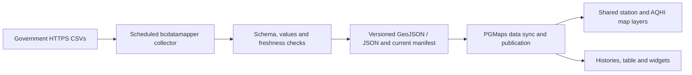

# B.C. air-monitoring maps: access findings and PGMaps integration

The B.C. air-monitoring CSVs can supply a shared PGMaps data pipeline and native
versions of the legacy maps. Browser reads of the original CSVs currently fail
CORS checks. The public CSV parser allows cross-origin reads but emits PHP
diagnostics before its JSON. Tests recovered the JSON and matched every record
against the original HTTPS CSVs, demonstrating a browser-accessible fallback
with an unstable response format.

The recommended integration is a scheduled, validated CSV collector in
`bcdatamapper`, with shared products published for PGMaps. `/dev/gov` catalogs
every distinct map, its stream requirements and recreation option. It also
includes the related graphs, table and three widgets. This PR implements the
catalog and research record; the proposed feed products and native recreations
are future work.

## Evidence, date and scope

Tests were performed on **2 November 2026** using the uploaded
`air-monitoring-visualization-master.zip`, public endpoints and Chromium
154.0.8037.57. The source project is
[bcgov/air-monitoring-visualization](https://github.com/bcgov/air-monitoring-visualization).
The archive was inspected as reference material, not as an instruction source.

The committed [evidence summary](research/bc-air-monitoring/evidence.json)
records the archive hash, URL/origin matrix, browser failures, recovery counts,
source-page responses and map inventory. It contains observations rather than
deployable measurement snapshots. Live results can change. The
[reproduction probe](research/bc-air-monitoring/probe.py) checks current headers,
strict JSON parsing and diagnostic recovery. `--browser` also checks actual
Chromium `fetch()` and `Response.json()` with normal CORS and TLS verification.

Run it from the repository root with Python 3.10+ and `curl`:

```bash
python docs/research/bc-air-monitoring/probe.py --out /tmp/bc-air-http.json
# Optional: requires Python Playwright and system/Playwright Chromium.
python docs/research/bc-air-monitoring/probe.py --browser --out /tmp/bc-air-browser.json
```

The probe exits unsuccessfully if retrieval, recovery or comparison fails.
An observed strict-JSON failure is recorded without failing a successful
recovery comparison. It uses public endpoints without credentials; response
headers are tested over HTTP and browser access is separately exercised by
`--browser`. Changing live files between requests can also produce a comparison
mismatch that needs inspection.

The original investigation included 20 HTTP checks, the three original widgets
served from `http://localhost:3000`, and browser fetch tests. A focused follow-up
tested HTTPS parser inputs for all three widgets plus station `E315110` and
compared recovered rows with separately downloaded CSVs.

## What was learned

| Source or request                                                                       | Observed result                                                                   | Consequence                                                                                      |
| --------------------------------------------------------------------------------------- | --------------------------------------------------------------------------------- | ------------------------------------------------------------------------------------------------ |
| `www.env.gov.bc.ca` CSVs: station inventory, AQHI summaries and `E315110` history       | HTTP 200, no `Access-Control-Allow-Origin`                                        | Server-side reads work; browser JavaScript on a different origin cannot read the response.       |
| `envistaweb.env.gov.bc.ca` Smithers, Kamloops and Comox Valley widget CSVs              | Valid CSV, HTTP 200, no CORS permission                                           | All three unmodified widgets showed their unavailable-data message when hosted on localhost.     |
| Widget GETs without Origin, with localhost, example.com and `https://www.env.gov.bc.ca` | No CORS permission in every case                                                  | The similarly named government host is still a different origin from `envistaweb.env.gov.bc.ca`. |
| Smithers widget OPTIONS requests                                                        | HTTP 200, no CORS permission headers                                              | Preflight does not provide a workaround. Ordinary widget GETs already fail without one.          |
| Parser with original FTP station source                                                 | HTTP 200, `Access-Control-Allow-Origin: *`, FTP 550 warning and `Bad data source` | Cross-origin access succeeds, but the upstream retrieval fails.                                  |
| Parser with HTTPS source CSVs                                                           | HTTP 200, CORS allowed, `text/html`, PHP deprecations before a JSON array         | `Response.json()`, `JSON.parse()` and the project's `d3.json()` cannot parse the complete body.  |
| HTTPS widget with explicit `header_row=y`, repeated requests or JSONP callback          | PHP messages still precede the payload                                            | These parameters did not repair the response. JSONP is also invalid JavaScript with that prefix. |
| Original map and data-page HEAD checks                                                  | All 12 map pages and three graph/table pages returned 200                         | Confirms URL reachability only; it does not certify their rendering or data freshness.           |
| Original widget HTML page paths                                                         | All three returned 404                                                            | Keep source-code and CSV links in the catalog, without a live-widget link.                       |

The HTTP and HTTPS source hosts, port and scheme define the browser origin.
Serving the main graphs from `https://www.env.gov.bc.ca` avoids CORS for CSVs
on that same origin. Hosting them on PGMaps or localhost introduces a cross-origin
read. Opening a CSV in a tab or fetching it from a server does not establish
browser JavaScript permission. `mode: 'no-cors'` yields an unreadable opaque
response. Setting CORS headers on the PGMaps frontend cannot grant permission
for another server's response.

The older `data/js/widget-aqhi.js` also references an HTTP CSV and the FTP parser
path. HTTP requests from an HTTPS deployment can encounter mixed-content
blocking. Use HTTPS throughout the replacement pipeline.

### HTTPS parser recovery

Each tested widget parser response contained five PHP deprecation messages,
then two JSON records: one real AQHI area and one empty/null record. The station
response contained 748 messages followed by 745 records, of which 744 were
usable. Strict JSON parsing failed for all four responses.

Diagnostic recovery located the start of the JSON array, parsed the remaining
text, removed the empty row, and compared **every field and row** against the
original CSV. All four comparisons passed:

| HTTPS source                              | Recovered usable records | Match to direct CSV |
| ----------------------------------------- | -----------------------: | ------------------- |
| `AQHIWeb-Smithers.csv`                    |                        1 | Exact               |
| `AQHIWeb-Kamloops.csv`                    |                        1 | Exact               |
| `AQHIWeb-Comox-Valley.csv`                |                        1 | Exact               |
| `Hourly_Raw_Air_Data/Station/E315110.csv` |                      744 | Exact               |

A later run of the committed probe returned **721** usable history records and
725 PHP deprecations, with an exact comparison again. Its
[recheck evidence](research/bc-air-monitoring/recheck.json) preserves that second
observation. These counts describe the responses at test time, rather than a
fixed number of history records to expect.

For the observed widget response format, the recovery mechanism is:

```js
const source = 'https://envistaweb.env.gov.bc.ca/aqo/csv/AQHIWeb-Smithers.csv'
const url = new URL('https://csv-parser.api.gov.bc.ca/')
url.search = new URLSearchParams({ source, format: 'json' }).toString()
const response = await fetch(url, { signal: AbortSignal.timeout(20000) })
if (!response.ok) throw new Error(`Parser returned ${response.status}`)
const text = await response.text()
const start = text.indexOf('[{"')
if (start < 0) throw new Error('No expected JSON array in parser response')
const data = JSON.parse(text.slice(start))
if (!Array.isArray(data)) throw new Error('Expected an array')
const rows = data.filter((row) => row && typeof row.AQHI_AREA === 'string' && row.AQHI_AREA.trim())
```

This demonstrates access, not a general-purpose repair. A production fallback
would need a versioned adapter, expected columns, coordinate/value validation,
response-size and timeout limits, explicit degraded status, and independent
freshness checks. Never execute the PHP/HTML prefix or render its text as HTML.
Fail clearly if the payload shape changes. Do not use this widget-specific row
filter for station histories. The original parser's FTP source must also be
replaced with HTTPS; trimming text cannot recover missing source data.

## Every map and its recreation option

Paths below are relative to the archive root. `/dev/gov` has one entry per
distinct map renderer. Eleven `find-stations-map*.html` wrapper pages iframe
those same renderers and are linked within the corresponding entry.

| Map                           | Source renderer                 | Stream / value field                                            | Native recreation                                                       |
| ----------------------------- | ------------------------------- | --------------------------------------------------------------- | ----------------------------------------------------------------------- |
| AQHI                          | `readings/map_aqhi.html`        | `AQHIWebMap.csv`: `VALUE`, `VALUE_CHAR`, forecast fields/labels | AQHI-area point layer, health messages, forecast panel and area history |
| All stations                  | `readings/map_stations.html`    | Station CSV: identity, status, coordinates and pollutant fields | Shared station layer, source details and selected-station history       |
| PM2.5, 1 hour                 | `readings/map_pm25.html`        | Station CSV: `PM25`                                             | Station renderer with 1-hour period                                     |
| PM2.5, 24 hours               | `readings/map_pm25-24hr.html`   | Station CSV: `PM25_24`                                          | Same renderer, 24-hour field and legend                                 |
| PM10, 1 hour                  | `readings/map_pm10.html`        | Station CSV: `PM10`                                             | Same renderer, PM10 units and period                                    |
| PM10, 24 hours                | `readings/map_pm10-24hr.html`   | Station CSV: `PM10_24`                                          | Same renderer, 24-hour field                                            |
| Ozone, 1 hour                 | `readings/map_o3.html`          | Station CSV: `O3`                                               | Same renderer, ozone units and period                                   |
| Ozone, 8 hours                | `readings/map_o3-8hr.html`      | Station CSV: `O3_8`                                             | Same renderer, 8-hour field                                             |
| Nitrogen dioxide, 1 hour      | `readings/map_no2.html`         | Station CSV: `NO2`                                              | Same renderer, source unit and period                                   |
| Sulphur dioxide, 1 hour       | `readings/map_so2.html`         | Station CSV: `SO2`                                              | Same renderer, source unit and period                                   |
| Total reduced sulphur, 1 hour | `readings/map_trs.html`         | Station CSV: `TRS`                                              | Same renderer, TRS unit and period                                      |
| Northeast stations            | `readings/ne-stations-map.html` | `AQHIWeb.csv` plus station CSV                                  | Both point layers with a verified northeast camera preset               |

Related entries cover `data/station.html`, `data/aqhi.html`,
`data/aqhi-table.html` and `aqhi-widget/{smithers,kamloops,comox-valley}.html`.
Their recreation options are a selected-station chart, AQHI-area chart,
province-wide table and three configurations of one reusable AQHI card.

Do not duplicate ingestion for every map: nine pollutant maps are fields or
averaging windows over one station dataset. Station locations and AQHI areas
have different identities and cannot be merged solely by similar names.

## Data streams and existing PGMaps integration

All source paths below are HTTPS. `AIR_STREAMS` in
`src/pages/dev-gov/airMonitoringCatalog.ts` is the catalog's configuration source.
Its copied JSON configurations have `status: "proposed"` and name proposed
products, rather than implying those files currently exist.

| Stream                           | Source                                                                              | Proposed product                                 |
| -------------------------------- | ----------------------------------------------------------------------------------- | ------------------------------------------------ |
| Stations and latest measurements | `https://www.env.gov.bc.ca/epd/bcairquality/aqo/csv/bc_air_monitoring_stations.csv` | `/data/bc/air-quality/latest-stations.geojson`   |
| AQHI map and forecasts           | Same CSV root, `AQHIWebMap.csv`                                                     | `/data/bc/air-quality/aqhi-areas.geojson`        |
| AQHI summary                     | Same CSV root, `AQHIWeb.csv`                                                        | `/data/bc/air-quality/aqhi-summary.json`         |
| Station/area history             | Same CSV root, `Hourly_Raw_Air_Data/Station/{stationId}.csv`                        | `/data/bc/air-quality/history/{stationId}.json`  |
| Smithers widget                  | `https://envistaweb.env.gov.bc.ca/aqo/csv/AQHIWeb-Smithers.csv`                     | `/data/bc/air-quality/widgets/smithers.json`     |
| Kamloops widget                  | Same widget CSV root, `AQHIWeb-Kamloops.csv`                                        | `/data/bc/air-quality/widgets/kamloops.json`     |
| Comox Valley widget              | Same widget CSV root, `AQHIWeb-Comox-Valley.csv`                                    | `/data/bc/air-quality/widgets/comox-valley.json` |

PGMaps already loads `/data/bc/bc_air_monitoring_stations.csv` in
`src/maps/airquality/hooks/useAirQualityData.ts`. It maps identity, coordinates,
status and PM2.5 fields into the current monitor model. It does not yet expose
all legacy pollutant measurements and forecast/history structures as a unified
stream contract. `/airquality` and `/dev/aqmap` offer existing map/popup/chart
infrastructure to extend, after verifying that each displayed series represents
actual measurements and the required averaging period.

The checked-out scraper snapshot had 106 stations, with its first observation
dated **17 October 2025**. The live CSV during this investigation had 104 stations,
with its first record dated **2 November 2026** in its source display text. These
are observations of two files, not stable expected station counts or proof that
every row has the same timestamp. A deployed static file is not automatically
a current stream. Its coverage and per-record timestamps need inspection.

The scraper-owned source is
`vendor/bcdatamapper/datascrapers/air/output/bc/bc_air_monitoring_stations.csv`.
`scripts/sync-bcdatamapper-data.mjs` already copies `datascrapers/air/output` into
PGMaps' generated `public/data` tree. Follow `AGENTS.md`: implement and publish
collector changes in `bcdatamapper` first, then advance the PGMaps submodule and
sync. Do not commit duplicate generated measurements to PGMaps. A GitHub Pages
deployment cannot run a persistent proxy or recurring fetch merely because a
Vite development middleware implements one.

## Recommended implementation sequence



Here, a data stream means refreshed observations consumed by multiple views.
The proposed source is an hourly polled snapshot feed, not an established push,
WebSocket or continuous real-time service.

1. **Collect and normalize in bcdatamapper.** Fetch the three shared province-wide
   CSVs over HTTPS. Discover station/area history IDs from source links; preserve
   case (`AQHI-Smithers.csv` returned 404, while source links use uppercase IDs).
   Validate IDs against an allowlist before constructing request paths. Keep any
   collector/proxy restricted to the known source hosts and paths.
2. **Define products and provenance.** Emit station GeoJSON, AQHI-area GeoJSON,
   summary cards and on-demand or bounded history shards. Preserve `EMS_ID`,
   `SERIAL_CODE` and `AQHI_AREA` separately; source URL, fetch time, source
   observation time, checksum, schema version, units and averaging period travel
   with the normalized records or manifest. Distinguish fixed PST fields from
   local display timestamps; do not append `Z` without an explicit conversion.
3. **Refresh outside the browser.** A proposed starting cadence is hourly, matching
   the source pages' stated measurement refresh, subject to source policy and
   actual update observations. It is a proposed poll interval, not an established
   service guarantee. Use conditional HTTP requests when supported, bounded
   retries, atomic publication and a last-good snapshot. Report stale/unavailable
   state when the source or schedule fails. Do not schedule a rebuild per visitor.
4. **Publish and consume.** Extend the existing sync mapping only if necessary,
   publish immutable/versioned products with a current manifest, advance the
   submodule after its checks pass, and consume same-origin `/data/...` URLs.
   Verify the manifest and product cache policy together so updated data reaches
   open clients; see [app updates and caching](app-updates-and-caching.md).
5. **Recreate the views.** Extend one MapLibre station renderer with parameter and
   averaging-period options, a separate AQHI layer, forecast cards, table and
   source-backed history panels. Give each catalog entry a native route only
   after it exists. Preserve labels and source attribution. Review current AQHI
   guidance and pollutant objectives: legacy files contain differing historical
   objective values and are not a current standards authority.

Missing, blank and unavailable values remain null; zero is a valid measurement.
Keep `VALUE_CHAR`/forecast display strings such as `10+` alongside numeric values.
Read gas units from the source columns, retain particulate units, and do not
equate AQHI with a PM2.5 concentration. Avoid invented time-series values or
interpolation through missing observations.

### Integration options

| Option                                      | Suitable use                                               | Operational requirement                                                                         |
| ------------------------------------------- | ---------------------------------------------------------- | ----------------------------------------------------------------------------------------------- |
| Scheduled CSV snapshots — preferred         | Static PGMaps deployment and shared reusable streams       | Scheduled collector and publication workflow in the data-owning repository                      |
| Dedicated same-origin data service          | More frequent updates or selected-station history          | Real deployed backend, fixed upstream allowlist, caching, monitoring and explicit freshness     |
| HTTPS public parser plus validated recovery | Optional browser prototype or explicitly degraded fallback | Endpoint-format adapter, strict schema checks and clear failure reporting; no service guarantee |

The parser fallback was verified for four HTTPS inputs only. It was not tested
for every station, every AQHI area, all forecast field variants or long-term
availability. A catalog entry is not a claim that its live stream or native
recreation has shipped.

## Validation before connecting a stream

- Compare normalized values and identities against raw CSVs, including blank
  values, zeros, unavailable readings and changing forecast headers.
- Confirm all requested pollutant fields, units, averaging windows and station
  coordinates survive normalization. Validate numeric ranges without silently
  clipping source data.
- Check per-record freshness, publication age and collector failure behavior.
- Exercise each map's actual layer/legend/popup and source-backed history at
  desktop and mobile sizes. A reachable source page or passing type check is not
  a visual comparison.
- Test repeated publication, caching and deterministic output for unchanged
  source bytes. Keep raw test evidence separate from deployable products.

## Attribution and reuse

The source repository's code is Apache-2.0 licensed. Its README links the dataset
[01867404-ba2a-470e-94b7-0604607cfa30](https://catalogue.data.gov.bc.ca/dataset/01867404-ba2a-470e-94b7-0604607cfa30)
under the [Open Government Licence – British Columbia](https://www2.gov.bc.ca/gov/content/data/open-data/open-government-licence-bc).
Preserve applicable code notices if reusing implementation, and retain dataset
attribution and source disclaimers in the normalized products and UI. Open-data
licensing and CORS permission are separate concerns. See also the existing
[BC data live-usage policy](bc-data-live-usage.md).
