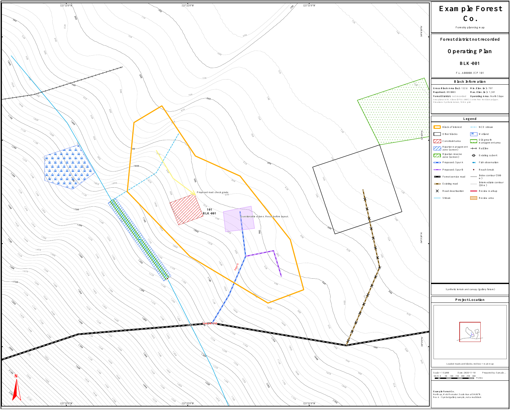

# Block map sheets

A block map sheet is a printed sheet of one harvest block: a map frame at a stated scale, a title
bar, block information, a legend that lists only what is drawn, a scale bar, a north arrow and a
footer. It is written as a PDF, an editable SVG or a PNG ([Formats](#formats)), one block at a time
or as a series of one sheet per block ([Sheet series](#sheet-series)). Six presets reproduce the layout and symbology of a set of ArcGIS Pro block-map sheets
(field layout, three LiDAR design sheets, a 1:50,000 access sheet and a portrait imagery sheet).
An additional **Ministry-style Operating Plan** preset uses a measured 36 × 29-inch landscape
layout with a white right-hand column, two-column legend and project locator.
No licensee names or logos come with them; a user can add one logo of their own. It is kept in the browser's
branding store (IndexedDB) and used by every sheet and report, never in a project file; without one, the brand
selected in Branding supplies its logo.

The road design tool offers it as **Save & export → Block map sheet** ([In the road designer](#in-the-road-designer)), and the visual
quality page as **Save & export → Block map sheet** ([On the visual quality page](#on-the-visual-quality-page)).
Both print through one builder, so a sheet type is the same sheet in either. The engine is generic and
other tools can adopt it; see [Adopting it in another tool](#adopting-it-in-another-tool).

| Part                     | Where                                                                   | DOM / network                               |
| ------------------------ | ----------------------------------------------------------------------- | ------------------------------------------- |
| Layouts, paper sizes     | `src/lib/mapSheet/layout.ts`                                            | None                                        |
| Scale, frame, scale bar  | `src/lib/mapSheet/scale.ts`                                             | None                                        |
| Draw operations, helpers | `src/lib/mapSheet/drawOps.ts`                                           | None                                        |
| Fixed-interval contours  | `src/lib/mapSheet/contours.ts`                                          | None                                        |
| Text widths              | `src/lib/mapSheet/textMetrics.ts`                                       | None                                        |
| PDF and SVG renderers    | `src/lib/mapSheet/renderPdf.ts`, `renderSvg.ts`                         | None (jsPDF is passed in)                   |
| Formats, file writer     | `src/lib/mapSheet/sheetFormats.ts`; `sheetFileDeps.ts`                  | None (jsPDF, rasteriser passed in); `sheetFileDeps.ts` browser |
| Sheet series             | `src/lib/forestry/blockSheet/sheetSeries.ts`                            | None (jsPDF, rasteriser passed in; fflate)  |
| PNG encoder              | `src/lib/mapSheet/png.ts`                                               | None (`CompressionStream`)                  |
| Imagery capture          | `src/lib/mapSheet/printCapture.ts`                                      | Browser: hidden MapLibre map, tile requests |
| Symbol model and drawing | `src/lib/mapSheet/symbols.ts`, `icons.ts`                               | None                                        |
| Map patterns and icons   | `src/lib/mapSheet/symbolRaster.ts`, `mapSymbols.ts`                     | None (the map is passed in)                 |
| Swatch SVG, sheet PNG    | `src/lib/mapSheet/symbolSvg.ts`; `sheetPng.ts`                          | None; `sheetPng.ts` needs a canvas          |
| Presets and colours      | `src/lib/forestry/blockSheet/sheets.ts`, `styles.ts`                    | None                                        |
| Symbol catalogue         | `src/lib/forestry/blockSheet/symbolCatalogue.ts`, `symbolMismatches.ts` | None                                        |
| Gallery sheets           | `src/lib/forestry/blockSheet/gallerySheets.ts`, `blockSheetFixtures.ts` | None                                        |
| Classed rasters          | `src/lib/forestry/blockSheet/classedRasters.ts`                         | None                                        |
| Block facts, BCGS        | `src/lib/forestry/blockSheet/blockFacts.ts`, `bcgs.ts`                  | None                                        |
| Sheet composer           | `src/lib/forestry/blockSheet/composeSheet.ts`, `prepareSheet.ts`        | None                                        |
| Shared sheet run         | `src/lib/forestry/blockSheet/buildSheet.ts`, `setupFields.ts`           | None (slice runner and imagery passed in)   |
| Operating-plan panels    | `src/lib/forestry/blockSheet/operatingPlanPanels.ts`                    | None                                        |
| Setup form               | `src/components/ui/map-sheet-setup.tsx`                                 | React                                       |
| Output form              | `src/components/ui/map-sheet-output.tsx`                                | React                                       |
| Road tool adapter        | `src/pages/dev-forestry-roads/blockSheet.ts`, `BlockSheetSetup.tsx`     | Loads capture and jsPDF on demand           |
| Visual quality adapter   | `src/pages/dev-forestry/visualsBlockSheet.ts`, `visualsBlockSheetPdf.ts`, `VisualsBlockSheetSetup.tsx` | Module none; the PDF writer reads terrain tiles |
| Road plan sheet symbols  | `src/pages/dev-forestry-roads/planSheetSymbols.ts`, `PlanView.tsx`      | Module none; the plan adds the layers       |
| Legend swatch            | `src/components/ui/sheet-symbol-swatch.tsx`                             | React                                       |
| Symbol gallery           | `src/pages/DevForestryBlockSheets.tsx`, `dev-forestry-block-sheets/`    | React, `/dev/forestry/block-sheets`         |

## Before you rely on it

- **The map is Web Mercator, north up.** The stated scale is exact at the frame's centre latitude,
  which the footer prints ("Scale true at 54.06°N"). At 1:50,000 on a tabloid frame in central BC
  the top and bottom edges are about 0.2 % off. The reference sheets were BC Albers with a north
  arrow rotated about 3.4° for meridian convergence; these sheets are not.
- **Gross area is planar BC Albers (EPSG:3005)**, outer rings less holes, as BC tenure areas are
  reported. It is not a geodesic area and not a merchantable area.
- **Min. and max. elevation are sampled, not surveyed.** They come from the tool's terrain, on a
  grid at the terrain's own resolution inside the block. A block only partly on the terrain prints
  the covered part and says how many samples had no ground. No terrain prints "not recorded".
- **Merch area, NAR, timbermark, FIZ, district, region, TSA, operating area and nearest community
  are typed.** Nothing looks them up. Blank fields print "not recorded" in grey.
- **The legend lists what the frame shows.** A layer with nothing inside the frame is left out, and
  the class legend appears only with a classed base.
- **Slope is from the terrain grid as sampled for the sheet**, about 150 dpi on paper (1.7 m on the
  ground at 1:10,000). It is raw slope, not the 12 m ground trend the route searches use, so
  micro-relief shows as steep streaks, as on the reference sheets.
- **The preview is a thumbnail.** It samples at 40 dpi and shows imagery as a flat colour; the
  PDF loads the imagery.

## Sheet presets

| Preset                        | Layout (tabloid unless stated)                  | Default scale | Base                  | Contours    | Block outline            | Extras                           |
| ----------------------------- | ------------------------------------------------ | ------------- | --------------------- | ----------- | ------------------------ | -------------------------------- |
| Field Layout                  | Landscape, side panel (`FIELD_SIDE_PANEL`)       | 1:10,000      | White                 | 10 m, black | `#ffaa00` 2.5 on white 3 | Road Information table           |
| LiDAR Design Slope            | Landscape, side panel (`LIDAR_SIDE_PANEL`)       | 1:10,000      | Slope classes         | 10 m, black | `#000000` 2.5 on white 3 | Source bar, class legend         |
| LiDAR Design Canopy Height    | Same                                             | 1:10,000      | Canopy height classes | 10 m, black | Same                     | Source bar, class legend         |
| LiDAR Design Hillshade        | Same                                             | 1:10,000      | Greyscale hillshade   | 10 m, black | Same                     | Source bar                       |
| General Block Access 1:50,000 | Landscape, bottom panels (`ACCESS_BOTTOM_PANEL`) | 1:50,000      | White                 | 20 m, black | `#ffaa00` 2.5 on white 3 | Block Access Comments box        |
| Field Ops Imagery             | Portrait, bottom panels (`IMAGERY_PORTRAIT`)     | 1:10,000      | Satellite imagery     | 10 m, white | `#ffaa00` 2.5 on white 3 | Ruled notes area, imagery credit |
| Ministry-style Operating Plan | Landscape 36 × 29 in (`OPERATING_PLAN_SIDE_PANEL`) | 1:20,000 | White | 20 m, black | `#ffaa00` 2.5 on white 3 | White side column, two-column legend, locator |

Selecting the operating plan starts at its native **2592 × 2088 pt (914.4 × 736.6 mm)** size;
paper and scale can then be changed independently. The main frame is 2173.222 × 2055.057 pt,
starting at (8.5, 13.824) pt. Its title prints the typed district, block, licence and permit;
its logo slot uses only the user's own branding. The locator shows the loaded roads and blocks
over 3.5 times the main frame's ground width, with the main extent outlined in red. It fetches no
additional context. Its legend uses the same PGMaps symbols as the main map, only for features
drawn there; it does not infer harvest years or recreate symbol-font glyphs from a source PDF.
The layout is a visual export option: PDFs retain selectable text and vector paths, but do not
contain georeferencing metadata. The north-up Web Mercator and centre-latitude scale rules above
apply to this preset too.

Synthetic gallery example at 1:5,000 on native paper (the default scale is 1:20,000):

Letter, ANSI D (22 × 34 in), A3 and A4 use the same fractional layout. ANSI D is exactly twice
tabloid, so it prints the tabloid sheet at `k` = 2 with four times the ground at a given scale; its
terrain raster then meets the 4,000,000-cell budget at about 90 dpi rather than 150, and imagery
the 4,096 px side at about 150 dpi instead of 200. Saved sheet setups keep the sheet, paper, scale
and typed fields in the road tool (`docs/forestry-road-design/exports-and-project-files.md`, Saved
sheet setups). Type and line widths scale by
`k = min(width / 1224, height / 792)` (portrait swaps the sides), never below 4.5 pt
(`MIN_SHEET_FONT_PT`). The dialog offers 1:5,000, 1:10,000, 1:20,000, 1:50,000 (`SHEET_SCALES`) or
**Fit the block**, which picks the smallest scale in `FIT_SCALES` whose frame holds the block's box
at 80 % (`FIT_FILL`).

### Sheet furniture

| Element        | Style                                                                                                                                      |
| -------------- | ------------------------------------------------------------------------------------------------------------------------------------------ |
| Title bar      | Fill `#ffd37f`, 1 pt black stroke; title Helvetica Bold 16 pt; Lat, Long, F.L., CP and Block fields Helvetica Bold 12 pt, **black** text   |
| Header fields  | Laid out left to right after the title and measured; shrunk to 7 pt, then cut with "...", so none overlap                                  |
| Legend labels  | Wrapped onto two lines within the row, then shrunk to 80 %, then cut with "..." (`fitLabel`, `textMetrics.ts`); never overflow the column  |
| Section bars   | Fill `#ffd37f`, 1 pt black; Helvetica Bold, black, centred                                                                                 |
| Panels         | White, 1 pt black                                                                                                                          |
| Scale bar      | Alternating black and white, about 1 cm a segment rounded to 1, 2, 2.5 or 5 × 10ⁿ m; the left segment halved; 2–6 right segments; "Metres" |
| North arrow    | Vector needle, red `#ff0000` and white with a white 3 pt outline, bottom left in the frame, pointing up                                    |
| Graticule      | DMS labels Times Italic 6 pt with a white halo, 1.5 pt ticks 3 pt long; interval from 5" up so at most six ticks show                      |
| Labels in map  | White halo 1.2 pt; block label Helvetica Bold 8 pt black (CP, then Block ID); road names Helvetica Bold 6 pt `#ff0000`                     |
| Road table     | Header `#cccccc`; two halves of five rows: colour key, road name, chainage `0+000 - 1+080`; "Summary Date/By" in bold red                  |
| Footer         | Scale, date, prepared by; scale bar; logo row with the organisation, the projection note, revision and the planning caveat                 |
| Imagery credit | 6.5 pt `#323232` with halo, bottom right in the frame                                                                                      |

The reference sheets printed white text on `#ffd37f`, about 1.4:1 contrast. These print black.

### Map styles

Each colour is a constant in `styles.ts`. The sheet's map, its legend swatch and
`lineSymbolPaint`/`areaSymbolPaint` (MapLibre paints) all read the same object, so a legend cannot
disagree with the map. Widths are points on tabloid at the sheet's scale.

**Slope classes, percent** (`SLOPE_CLASSES`, drawn at `SLOPE_CLASS_OPACITY` = 216/255 ≈ 0.85). A value
on a break belongs to the class below it (`min < value ≤ max`, ArcGIS's "≤ upper").

| Class  | < 20  | 20–30     | 30–35     | 35–40     | 40–50     | 50–60     | 60–85     | 85 +      | 95 + (overlay, opaque) |
| ------ | ----- | --------- | --------- | --------- | --------- | --------- | --------- | --------- | ---------------------- |
| Colour | clear | `#ffff73` | `#a3ff73` | `#73dfff` | `#df73ff` | `#ffaa00` | `#ff7f7f` | `#e81515` | `#000000`              |

**Canopy height, metres** (`CANOPY_HEIGHT_CLASSES`, opaque):

| Class  | < 5   | 5–10      | 10–15     | 15–20     | 20–25     | 25–30     | 30–35     | 35–40     | 40 +      |
| ------ | ----- | --------- | --------- | --------- | --------- | --------- | --------- | --------- | --------- |
| Colour | clear | `#ff7f7f` | `#4ce600` | `#267300` | `#beffe8` | `#00a9e6` | `#e8beff` | `#a900e6` | `#000000` |

**Hillshade** (`HILLSHADE_PRESET`): greyscale, opaque, sun azimuth 315°, altitude 45°, z-factor 1.
Flat ground prints grey 180.

**Contours** (`CONTOUR_INTERVAL_M` = 10, index every `CONTOUR_INDEX_EVERY` = 2nd line, so 20 m):

| Variant     | Index line        | Intermediate line | Labels                                                    |
| ----------- | ----------------- | ----------------- | --------------------------------------------------------- |
| `default`   | `#4e4e4e` 0.35 pt | `#b2b2b2` 0.25 pt | 6 pt, index `#000000`, intermediate `#828282`, white halo |
| `onImagery` | `#ffffff` 0.35 pt | `#ffffff` 0.25 pt | 6 pt `#ffffff`, no halo                                   |

Labels run along the line every 220 pt, staggered by level, at least 34 pt apart.

The 1:50,000 access sheet sets its own spacing (`contourIntervalM` 20, `contourIndexEvery` 5, so
100 m index lines): 10 m crowds a 1:50,000 frame. Contours cover the whole frame: when the project's
terrain does not, the sheet loads the 22 m regional DEM for the frame (`sheetContourSource`,
`blockSheet.ts`) if the project is on regional terrain or the sheet is at 1:50,000 or smaller, and
its source line says "from the regional DEM over the whole frame". A detailed (LiDAR) terrain on a
design-scale sheet is never replaced by 22 m contours; there, contours stop at the edge of the data.
The preview keeps the loaded terrain, as it keeps a flat colour for imagery. If the regional tiles
cannot be loaded, the sheet says so and draws contours from the project's terrain only. The legend's
index-contour label comes from the spacing drawn (`ContourResult.indexEvery`).

**Features** (detail widths up to 1:25,000, `DETAIL_SCALE_LIMIT`; overview widths beyond):

| Feature                  | Symbol                                                                                         |
| ------------------------ | ---------------------------------------------------------------------------------------------- |
| Block of interest        | `#ffaa00` 2.5 over white 3.0; on LiDAR sheets `#000000` 2.5 over white 3.0                     |
| Other blocks             | `#000000` 1.0 outline                                                                          |
| Constraint area          | `#e60000` 0.5 hatch at 45°, 5 pt apart; `#a80000` 0.4 outline                                  |
| Riparian reserve zone    | The reserve symbol: `#38a800` 0.5 hatch at 45°, 5 pt apart; `#38a800` 1.2 outline              |
| Riparian management zone | `#97dbf2` 1.6 hatch with a `#4065eb` 0.4 hatch on it, 45°, 5 pt apart; `#4065eb` 0.4 outline   |
| Stream                   | `#00a9e6` 1.0 (overview 0.1)                                                                   |
| NCD stream               | `#00a9e6` 1.0 dash 5/2 (overview 0.1 dash 2/2)                                                 |
| Forest service road      | `#000000` 4.0 with a white 1.0 centre dash 5/5 (overview 2.0 / 0.75)                           |
| Existing road            | `#734c00` 2.5 with a white 1.0 centre dash 5/5 (overview 1.5 / 0.75)                           |
| Road deactivation        | Black × 7 pt every 24 pt along a deactivated mapped road, over its own symbol                  |
| Proposed (designed) road | The road's own colour 2.5 with a white 1.0 centre dash 5/5 (overview 1.5 / 0.75)               |
| Review markup            | Each note's colour: lines 2.0, areas filled at 0.35 with a 1.0 outline, pins 6.6 pt dots, halo |
| Any catalogue symbol     | `SheetLayers.extras`: a geometry with the catalogue symbol it draws with, listed by its label  |

The 1:50,000 sheet draws streams as 0.1 pt hairlines, as the reference map did; its legend showed
0.4 pt. Every catalogue symbol, and why most have no data yet, is in
[Symbol library](#symbol-library).

## Symbol library

A symbol is data (`src/lib/mapSheet/symbols.ts`). One function per kind turns it into drawing
operations, and the sheet's map, its legend swatches, the road plan's legend and the gallery all call
it, so a symbol cannot be drawn two ways.

| Kind  | Parts                                                                                                                                                                                                                                                                    |
| ----- | ------------------------------------------------------------------------------------------------------------------------------------------------------------------------------------------------------------------------------------------------------------------------ |
| Line  | Strokes stacked bottom first, each with colour, width, dash, cap and a sideways `offset` (positive to the right of travel, as MapLibre's `line-offset`); then `markers`: an icon every `spacing` points along the line                                                   |
| Area  | Fill and opacity; `hatches` (one for a single hatch, two for a cross-hatch, a grid, a double hatch or alternating stripes, a second set shifted by `phase`); a `markerFill` grid of icons, staggered or not; outline strokes, `inside` for a casing just inside the edge |
| Point | An icon, its size in points, a primary and secondary colour and a halo drawn round every part first                                                                                                                                                                      |
| Class | A raster class colour and opacity                                                                                                                                                                                                                                        |

Hatches and marker fills are clipped to their polygon, anchored to the page origin so neighbouring
areas line up, and drawn as PDF vectors. Markers follow the line's direction; the first sits half a
spacing in (`start`), none past the end. A legend swatch shorter than one spacing shows one marker
in its middle.

**Icons are PGMaps' own drawings** (`icons.ts`): simple vector parts in a unit box, made to read like
the usual map symbols at 5–12 pt (bridge, culvert, pipe arch, gate, fish, fish barrier, point of
diversion, wellsite, scenic "P", spot height, pits, plot, tree, warning, marsh mark, ticks, crosses,
dots). The reference sheets drew points with symbol-font glyphs; none were extracted or traced, and
no symbol font is embedded. The wetland's marsh marks are a generated staggered grid.

**The catalogue** (`symbolCatalogue.ts`) defines every feature on the reference sheets (ArcGIS Pro
block-map sheets supplied by a BC licensee, November 2026) that PGMaps could draw: 167
symbols (16 of them raster classes) in the source's groups (classes, contours, blocks and management areas, hydrology, roads and
linear features, point features, final layout features, GPS and design polygons) and a group of
PGMaps' own additions. Each entry carries the source's values as text (`spec`) and either where
PGMaps draws it from (`source`) or what data it lacks (`missing`). Labels are generic; branded
labels became "Other licensee blocks", "Operating areas" and "Licensee road permit". Where the
source left a value unrecorded (a marker's spacing, an outline's colour), the entry says which value
was chosen.

Drawn from PGMaps data today: the block of interest, other blocks, constraint areas, the riparian
screen (reserve and management zones), streams and NCD streams, forest service roads (gravel main),
other mapped roads (spur), deactivation crosses, designed roads, contours and review markup.
Everything else is defined, drawn in the gallery and ready for `SheetLayers.extras`, but has no data
source in the forestry tools yet:

| Missing data                                       | Symbols waiting for it                                                                                         |
| -------------------------------------------------- | -------------------------------------------------------------------------------------------------------------- |
| FWA lakes and wetlands                             | Lake / river, wetland                                                                                          |
| Land designations (parks, UWR, WHA, OGMA, tenures) | Parks, eco/rec reserve, recreation site, woodlot, community forest, UWR, WHA, caribou, OGMA, range, ecosystems |
| RESULTS silviculture status                        | Previously harvested, satisfactorily restocked, free growing, other openings                                   |
| Road surface or use class (FTEN has only status)   | Paved, operational, temporary, other road, barge crossing, licensee road permit                                |
| Structure and field point inventory                | Bridges, culverts, pipe arches, gates, crossings, pits, plots, CMTs, invasive plants                           |
| Field traverse or design (GPS) layers              | GPS lines, prework lines, final layout features, design polygons                                               |
| Other provincial layers                            | Rail, pipeline, transmission line, seismic line, fence, wellsite, private land, archaeology, VRI               |

Nine features (landing, yard tower, high value snag, wildlife point, beetle trap, borrow pit, measure
plot, count plot, research installation) were listed on the reference legends with nothing to read,
so they have no symbol (`UNSPECIFIED_FEATURES`).

### Legend and map disagreements

Where a reference legend drew a symbol differently from its map, PGMaps uses the map's value and its
legend draws from that same symbol (`symbolMismatches.ts`, checked by `symbolCatalogue.test.ts`):

| Feature                             | Reference legend      | Reference map                | PGMaps |
| ----------------------------------- | --------------------- | ---------------------------- | ------ |
| Intermediate contour (field layout) | `#828282` 0.1         | `#b2b2b2` 0.25               | Map    |
| Contour on imagery                  | `#cccccc` 0.5         | `#ffffff` 0.35 / 0.25        | Map    |
| LiDAR stream                        | `#005ce6` 1.0         | `#005ce6` 0.5                | Map    |
| Block of interest (field layout)    | `#ffaa00` 1.5         | `#ffaa00` 2.5 over white 3.0 | Map    |
| Classified and NCD streams          | 0.4                   | 1.0 at 1:10,000              | Map    |
| Previously harvested                | outline `#9c9c9c` 0.4 | outline `#6e6e6e` 0.1        | Map    |

### On the live map

`mapSymbols.ts` gives MapLibre the same symbols: `lineSymbolPaint` (widths, dashes and offsets),
`lineMarkerLayers` (`symbol-placement: line` icons at the sheet spacing, rotated with the line),
`areaSymbolPaint` (a colour fill, or a `fill-pattern` tile for hatched and marker-filled areas, with
the fill baked into the tile) and `pointSymbolLayout`. `symbolRaster.ts` draws the tiles and icons as
RGBA pixels at the device pixel ratio, without a canvas, and `keepSymbolImages` adds them and answers
`styleimagemissing`, so they come back after a style reload or theme change.

A point is 96/72 CSS pixels, as for line widths, so on screen a pattern matches the print at the
sheet's scale on a 96 dpi display. The road plan offers **Map settings → Legend and map symbols**,
with **Standard road plan** and **Block sheet forestry** choices saved in this browser. Choosing
**Block sheet forestry** means the context (avoid areas, harvest areas, the riparian screen, streams and mapped roads)
then draws with the sheet symbols, classed by `contextSheetKey` exactly as the sheet classes it, and
the legend lists those symbols with swatches drawn by `SheetSymbolSwatch`. The plan's own context
colours come back with **Standard road plan**. A third choice, **Block sheet, my saved styles**,
draws the sheet symbols with this browser's saved styles over the features they were chosen for
([Choosing a map style](#choosing-a-map-style)). The active map and any visible legend are captured
in map PDFs, so the Map PDF prints whichever of the three the plan shows.

Where the map cannot match the print:

- **Patterns do not scale with zoom.** A `fill-pattern` tile is fixed in screen pixels, so hatch
  spacing matches the paper only at the zoom of the sheet's scale. Paper hatches are fixed in points
  too, so the look is the same; the ground distance between lines is not.
- **A tile has whole pixels.** `tileSide` picks the smallest tile holding whole periods of every
  hatch within `PATTERN_TILE_TOLERANCE` (2 %), up to `MAX_PATTERN_TILE_PX`, and draws the nearest
  exactly repeating family of lines. A hatch at an odd angle (the special harvest area's 55°) is drawn
  within about a degree; `PatternTile.hatches` reports the angle and spacing drawn, and the gallery
  prints them under each tile.
- **MapLibre places line markers itself.** It chooses where the first marker falls and drops markers
  near tile edges and tight bends, so the count and phase differ from the sheet; spacing and
  orientation match.
- **An `inside` casing draws centred on the edge**, because a MapLibre line cannot be clipped to its
  polygon.
- **The tile's colours are blended once.** A hatched area with a fill draws as one pattern layer, so
  the fill's opacity is in the tile and the layer is opaque.

## Choosing a map style

A sheet's map draws PGMaps' sheet symbols unless a tool hands the composer symbols of its own
(`ComposeInput.symbols`, keyed by `SheetSymbolRole`: block, other block, constraint, the two
riparian zones, stream, NCD stream, forest service road, existing road, deactivated road). The map
and the legend draw the same object, so they cannot disagree. A symbol of the wrong kind for its
feature (a point style for a stream) is left out, and two layers given the same symbol share one
legend row. `deactivated` is the whole deactivated road, as the styled GIS exports draw it: with a
style of its own that road draws with it alone, without crosses over its own symbol.

| Where                                   | The choice                                                                                  | What the other choice draws with                                                                                              |
| --------------------------------------- | ------------------------------------------------------------------------------------------- | ----------------------------------------------------------------------------------------------------------------------------- |
| Road designer, Block map sheet          | Sheet setup → **Map style**: _PGMaps sheet symbols_ (default) or _My saved styles_          | The styles this browser's style library assigns to features (`styleLibrary.ts`); the library panel sits under the form        |
| Road designer, plan, legend and Map PDF | Map settings → **Legend and map symbols** → _Block sheet, my saved styles_                  | The same library, over the block sheet symbols; the Map PDF prints the plan as shown                                          |
| Visual quality, Block map sheet         | Options → **Map style**: _PGMaps sheet symbols_ (default) or a figure style                 | That figure style's landform, block, opening, private-land and rock symbols (`presets.ts`), where it has one                  |
| Visual quality, VIA report maps         | VIA report options → **Map style**: _The report's own map symbols_ (default) or a figure style | That figure style's block and opening symbols on the overview map, the 11 × 17 sheet and the figure page's location map       |

- **PGMaps' symbols stay the default everywhere.** Nothing changes for a sheet, a plan or a report
  until a style is asked for.
- **A saved style is this browser's.** It is never written to a project file, a saved sheet setup
  (`sheetSetups.ts` leaves the choice out) or the catalogue; another browser prints PGMaps' symbols.
- **Roads keep their own colours.** Designed roads draw the proposed-road symbol in each road's
  colour under every style, so the Road Information table's colour keys still tell them apart.
- **A saved style has one width.** PGMaps' own line symbols are thinner beyond 1:25,000
  (`DETAIL_SCALE_LIMIT`); a saved style draws at the width it was saved with at every scale.
- **A figure style was measured on a perspective figure.** Its strokes are the widths printed on
  that figure (about 1 pt), thinner than the sheet's own 2.5 pt block outline; the block of interest
  then reads lighter than on a sheet in PGMaps' symbols.

## On the visual quality page

**Save & export → Block map sheet** prints every sheet type from the assessment's scene
(`visualsBlockSheet.ts`): the chosen proposed block as the block of interest, the other proposed
blocks as other blocks, each landform's outline, existing openings, private-land, natural
non-green and wildlife-tree-patch masks, the assessed road (or the viewpoint, for a spot), the
views of interest in the package and, when the page has already read the inventory, its polygons
with an established VQO. Nothing is read for the sheet except terrain, and no figure from the run
is printed on it.

- **Terrain is the terrain tiles.** Contours, slope, hillshade and the block's elevations are read
  from the Terrarium tiles (SRTM/CDEM) over the frame when the sheet is written, at the finest zoom
  whose tiles stay within `SHEET_DEM_TILE_BUDGET`. The source bar names the tiles and their zoom,
  not a resolution: the ground is coarser than a tile's pixel.
- **The terrain sheets drop "LiDAR" from their names here** (_Design Slope_, _Design Hillshade_;
  `visualsSheetTitle`), because their ground is not LiDAR on this page.
- **Canopy height is unavailable.** The page loads no canopy height grid; the road designer prints
  that sheet from a canopy surface.
- **A permanent non-forestry disturbance is not drawn.** No catalogue has a symbol for it; _What
  goes in_ says so.
- **Typed fields are kept in this browser**, as the road designer keeps its own. A blank F.L., CP or
  Forest District prints the FS1252 office field.
- **Terrain that does not load** leaves a contour sheet without contours or block elevations, said
  beside the saved file; a slope or hillshade sheet is refused, since the terrain is the sheet.
- **Every format, the series and the mask.** The dialog's format chips choose PDF (unchanged, the
  default, no brand fonts), SVG or PNG and are stored with the sheet's other settings
  (`VisualsSheetSettings.output`); **File** under the sheet's options is `MapSheetOutput` with
  `showFormat={false}`, so the format is chosen in one place. `writeVisualsSheet` (DOM-free; jsPDF
  or the rasteriser passed in by `visualsBlockSheetPdf.ts`) writes one sheet through `sheetFile` or
  a series through `writeSheetSeries`. _What goes in_ lists the file from the same plan
  (`visualsSheetOutputPlan`, `visualsSheetFileRows`): format, pages and container, blocks in order,
  ZIP file names, mask and terrain read.
- **The series' blocks are the scene's proposed blocks** (`visualsSeriesBlocks`, in the scene's
  order; a block's imported planning ids fill `{attr:BLOCK}`, `{attr:FL}`, `{attr:CP}` and
  `{attr:OPENING}`). Each page is the same run framed on its block, its typed fields and comments
  filled for it (`visualsSeriesPageRun`). With one block in the scene there is no series.
- **Blocks chosen earlier and gone are left out, never replaced.** The list of chosen ids is this
  browser's; ids the scene does not have are dropped from the series and counted in _What goes in_,
  and kept in the list until the blocks are ticked again. With every chosen block gone, nothing is
  written and the dialog says why.
- **A series reads terrain per sheet**: up to `SHEET_DEM_TILE_BUDGET` (64) tiles a sheet, so up to
  64 × N for N sheets, and the imagery sheet captures its imagery once a sheet. Sheets are made one
  after another with progress; _Stop_ or closing the dialog cancels. A sheet that cannot be made is
  left out by name, said beside the saved file and in a ZIP's `notes.txt`.
- **The preview of a series is its first sheet**, in the page's format and marked as such; Download
  makes every sheet. A single sheet's preview is the downloaded file itself.
- **Copy image** sits beside Download once a single sheet's preview is current, and copies that
  drawn sheet as a PNG at `SHEET_PNG_DPI` without building it again. A series offers none.

## In the road designer

**Save & export → Block map sheet** (`blockSheet.ts`, `BlockSheetSetup.tsx`) offers every format,
the series and the mask under **File** in its Sheet setup (`MapSheetOutput`); the details are in the
road design guide's
[Block map sheet](forestry-road-design/exports-and-project-files.md#block-map-sheet).

- **A default sheet is the same file as before:** one PDF goes through `blockSheetPdf`; SVG, PNG and
  series go through `sheetFile` and `writeSheetSeries` (`blockSheetFile`, `blockSheetSeries`).
- **The series' blocks are the sheet's own list** (`seriesBlocks`: harvest areas and imported
  reference areas, with their attributes for `{attr:FIELD}`). Each page is the same run framed on its
  block (`seriesPageRun`).
- **The File choices are this browser's,** kept with the rest of the sheet's settings. A saved sheet
  setup keeps them without the blocks a series takes, which belong to the project.
- **The mask is the export's only.** The report package's block sheets are built without it.
- **Copy image** on the preview builds the sheet in full and copies it as a PNG at `SHEET_PNG_DPI`.

## Formats

`sheetFile(sheet, format, deps)` (`src/lib/mapSheet/sheetFormats.ts`) writes a composed sheet as
one file; `SHEET_FORMAT_INFO` gives each format's label, extension and MIME type. Raw rasters are
encoded as PNG first (`encodeSheetImages`), so a `ComposedSheet` goes in as `buildSheet` returned
it. jsPDF and the PNG rasteriser are passed in; `browserSheetFileDeps(format)` (`sheetFileDeps.ts`,
browser only) loads what the chosen format needs.

| Format | What is vector                                                                      | What is a picture                                                    | Needs           |
| ------ | ----------------------------------------------------------------------------------- | -------------------------------------------------------------------- | --------------- |
| PDF    | Frames, symbols, hatches, contours, text with halos                                  | The terrain base (slope, canopy height, hillshade), imagery, the logo | `deps.jspdf`    |
| SVG    | The same: text stays `<text>`, lines and fills stay `<path>`, `<rect>`, `<circle>`  | The same rasters, embedded as PNG (or the logo's JPEG) data URLs      | Nothing         |
| PNG    | Nothing: the SVG drawn on a canvas at `SHEET_PNG_DPI` (150 dpi)                     | The whole sheet                                                      | `deps.rasterise` |

**The SVG is a standalone file** for Inkscape and Illustrator (`standaloneSheetSvg`, `renderSvg.ts`):
an XML declaration; `width` and `height` in points (`1224pt` × `792pt` for tabloid) with a matching
`viewBox`, so one unit is one point; `xml:space="preserve"`; `xmlns` and `xmlns:xlink`; a `<title>`;
the map frame as a `clipPath` group. Text names its fonts plainly (Helvetica, Arial, sans-serif; Times
New Roman for the graticule), never through a CSS variable, and a label centred on its line is moved
down by `SVG_MIDDLE_BASELINE_EM` rather than set with `dominant-baseline`, which Illustrator ignores.
A haloed label is two `<text>` elements, the halo first. Nothing outside the file is referenced: an
image that is not a data URL is refused, and characters XML cannot hold are dropped. The in-app
preview (`sheetSvg`) is unchanged.

- **Brand fonts reach the PDF only.** `deps.configurePdf` is called once on each new document (the
  road designer passes `configurePdfBrand`); the SVG and PNG print Helvetica.
- **The PNG is a picture of the SVG**, so it shows exactly what the SVG and the PDF show; above
  `MAX_SHEET_PNG_SIDE` (8,192 px) its resolution is lowered to fit. The rasters inside it keep the
  resolution they were sampled at (150 dpi terrain, 200 dpi imagery).

## Sheet series

A series is one sheet per block (`src/lib/forestry/blockSheet/sheetSeries.ts`), as a GIS atlas or
map series prints one page per feature. The tool lists its blocks (`SheetSeriesBlock`: an id, the
name printed and attributes); the person picks which (`'all'`, which takes in blocks added later, or a
list of ids) and the order: **As listed** (the tool's order) or **By name**, read as people read it
("Block 2" before "Block 10", case ignored).

`writeSheetSeries({ blocks, settings, build, deps, signal, onProgress })` builds the pages one after
another through the tool's own `build(page)` (its `buildSheet` call framed on that page's block),
reports progress page by page, stops on Cancel, and writes:

| Format | Written as                                                                                    |
| ------ | --------------------------------------------------------------------------------------------- |
| PDF    | One PDF, a page a block (each page keeps its own paper size); or, if asked, a ZIP of one PDF a block |
| SVG    | A ZIP of one standalone SVG a block                                                            |
| PNG    | A ZIP of one PNG a block                                                                       |

Only one page's drawing is held at a time: each page is encoded and written before the next is built.

**A page that cannot be built is left out by name, never silently.** Its block and reason go in the
result's `leftOut` and `notes`, and in a ZIP's `notes.txt` (`SERIES_NOTES_FILE`) with every sentence a
written page was drawn without (`BuiltSheet.missing`, under the page's name). One block without terrain
or canopy should not cost the other forty pages of a long series; the tool shows the notes beside
the saved file. Cancel stops the whole series, and a series where no page could be built is an error
that names each page and its reason.

**Tokens.** A file name pattern, and in a series any typed field of the sheet (`fillSeriesFields`),
can hold:

| Token          | Becomes                                                                     |
| -------------- | --------------------------------------------------------------------------- |
| `{name}`       | The block's name                                                            |
| `{page}`       | The page number, from 1                                                     |
| `{total}`      | How many pages the series has                                               |
| `{attr:FIELD}` | The block's `FIELD` attribute (case ignored when no exact match), e.g. `{attr:CP}` |

Token names ignore case. A token PGMaps does not know, and an attribute the block does not have,
stay as typed, so a typo shows on the sheet rather than vanishing; the form lists them under the
pattern (`unfilledSeriesTokens`). An attribute the block has but leaves blank fills in empty. A typed
field without a token prints the same on every page: in a series, type `{name}` (or leave Block ID
blank, which falls back to each block's name).

**File names** (`seriesFileNames`): the pattern (default `{page}-{name}`) filled for each page, then
made safe on Windows, macOS and Linux (letters, digits, `.`, `_`, `-`, `(`, `)`, `+`; spaces and
anything else become `-`; no leading or trailing dot; a reserved device name such as `CON` gains `_`;
at most `MAX_SERIES_FILE_NAME_LENGTH` characters), falling back to `sheet-N`. Two pages whose names
match the way a file system compares them (case ignored) get `-2`, `-3`, … so none overwrites another
when the ZIP is unpacked.

## Mask outside the block

`maskOutsideBlock` (`ComposeInput`, `SheetBuild`; **Dim the map outside the block** in the output
form) lays white at 0.6 (`OUTSIDE_BLOCK_MASK`) over the map frame outside the block of interest:
over the base, contours, constraints, other blocks, streams and roads, under the block's own outline,
its label, the point symbols, the review markup and the sheet furniture. It is one even-odd path,
the frame's ring with the block's rings cut out, so a hole in the block is dimmed too. It is off by
default, and a sheet with no block (framed on its roads) is never dimmed.

A masked sheet says so once (`MASK_NOTE`, "Map dimmed outside the block"): first in the source bar on
the sheets that have one (the LiDAR sheets and the operating plan), else in the footer's map note
after "North up, Web Mercator". The legend gains no row: the mask is not a map feature.

## Symbol gallery

`/dev/forestry/block-sheets` (linked as **Symbol gallery** under the block sheet setup) shows:

- **Sheet presets**: each preset at 1:5,000, 1:10,000, 1:20,000 and 1:50,000 on tabloid, and on
  letter, A3 and A4 at its default scale, drawn from the synthetic fixtures (`galleryLayers`) through
  the real composer and SVG renderer. Previews draw when scrolled into view, one at a time; each card
  downloads its PDF, SVG and PNG through `sheetFile`, the tools' own writer (terrain at 150 dpi). The
  imagery sheet uses a synthetic stand-in, so the gallery needs no network.
- **Symbols**: every catalogue symbol in its group, drawn on a sample shape at twice print size, its
  legend swatch and, for patterned areas, the map's pattern tile, beside the source values and the
  data it comes from.
- **Legend vs map**: the disagreements above, with the legend's, the map's and PGMaps' renderings
  side by side.

Designed roads take the road tool's own colours (`distinctRoadColors`) rather than the reference
red, so the Road Information table's colour keys tell them apart.

## Block information: worked out or typed

| Field                                     | Source                                                                                                       |
| ----------------------------------------- | ------------------------------------------------------------------------------------------------------------ |
| Lat / Long (title bar)                    | Area-weighted centroid of the block, computed in BC Albers; 4 decimals (field, access) or 6 (LiDAR, imagery) |
| Gross Block Area (ha)                     | Planar BC Albers area, one decimal                                                                           |
| Mapsheet                                  | BCGS 1:20,000 sheet of the centroid, by arithmetic (`bcgsMapsheet`); null outside 48–60°N, 112–144°W         |
| Min. / Max. Block Elev. (m)               | Terrain samples inside the block (`blockElevationRange`)                                                     |
| F.L., CP, Block ID                        | Typed; Block ID falls back to the block's name                                                               |
| Everything else                           | Typed                                                                                                        |
| Date, prepared by, organisation, revision | The project's issue stamp (`projectIssue.ts`); the date is ISO, YYYY-MM-DD                                   |

The BCGS arithmetic: series tens count 8 to 11 westward from 112°W in 8° steps and units 2 to 4
northward from 48°N in 4° steps; letters A–P are 2° × 1° blocks snaking from the south (A–D east to
west, E–H back, I–L, M–P); sheets 001–100 are 0.2° × 0.1° cells from the south-west corner, west
to east, rows northward. It reproduces `093I003` at (−121.5254, 54.0595) and `093G087` at
(−122.71, 53.895), the second checked against the provincial grid layer. A point on a cell line
falls in the cell north or east of it.

## Limits and budgets

| Limit                       | Value                                          | Enforced in                                                                     | What happens when exceeded                                 |
| --------------------------- | ---------------------------------------------- | ------------------------------------------------------------------------------- | ---------------------------------------------------------- |
| Coarsest scale              | 1:250,000                                      | `scale.ts`, `MAX_SHEET_SCALE`                                                   | Refused; fitting stops at it                               |
| Terrain raster resolution   | 150 dpi                                        | `prepareSheet.ts`, `SHEET_RASTER_DPI`                                           | —                                                          |
| Terrain raster cells        | 4,000,000                                      | `classedRasters.ts`, `MAX_SHEET_GRID_CELLS`                                     | Coarsened to fit                                           |
| Contour grid                | One sample per 2.5 pt of paper                 | `prepareSheet.ts`, `CONTOUR_GRID_PT`                                            | —                                                          |
| Contour segments            | 250,000                                        | `contours.ts`, `MAX_SHEET_CONTOUR_SEGMENTS`                                     | Interval doubled; the source bar says "widened to fit"     |
| Elevation samples per block | 250,000, no finer than 1 m                     | `blockFacts.ts`, `MAX_BLOCK_ELEVATION_SAMPLES`, `MIN_BLOCK_ELEVATION_SPACING_M` | Spacing widened by 1.5× until it fits                      |
| Imagery capture             | 200 dpi, longest side 4,096 px                 | `printCapture.ts`, `PRINT_CAPTURE_DPI`, `MAX_CAPTURE_SIDE_PX`                   | Resolution lowered to fit                                  |
| Imagery load time           | 30 s                                           | `printCapture.ts`, `PRINT_CAPTURE_TIMEOUT_MS`                                   | Export fails: "The imagery did not finish loading in time" |
| Typed field                 | 120 characters                                 | `sheets.ts`, `MAX_SHEET_FIELD_LENGTH`                                           | Cut; on the sheet a long value is cut with "..." to fit    |
| Access comments             | 2,000 characters                               | `sheets.ts`, `MAX_SHEET_COMMENTS_LENGTH`                                        | Cut; lines past the box end in "(continues: shorten …)"    |
| Road table                  | 10 roads (two halves of `ROAD_TABLE_ROWS` = 5) | `composeSheet.ts`, `ROAD_TABLE_ROWS`                                            | Nine listed and "+N more roads"                            |
| Legend                      | As many rows as the panel holds                | `composeSheet.ts`, `legendPanel`                                                | "+N more not shown"                                        |
| Logo                        | 2 MB, PNG, JPEG or SVG (SVG as 1,200 px PNG)   | `src/branding/model.ts`, `MAX_UPLOADED_LOGO_BYTES`                              | Refused with a message                                     |
| Smallest type               | 4.5 pt                                         | `layout.ts`, `MIN_SHEET_FONT_PT`                                                | Held at 4.5 pt                                             |
| Markers along one line      | 4,000                                          | `drawOps.ts`, `MAX_LINE_MARKERS`                                                | Spacing widened so the count fits                          |
| Icons in one marker fill    | 5,000                                          | `symbols.ts`, `MAX_MARKER_FILL`                                                 | Grid widened so the count fits                             |
| Map pattern tile            | 256 device pixels a side                       | `symbolRaster.ts`, `MAX_PATTERN_TILE_PX`                                        | Closest fit within it; spacing off by more than 2 %        |
| Map pattern spacing error   | 2 %                                            | `symbolRaster.ts`, `PATTERN_TILE_TOLERANCE`                                     | A larger tile with more periods is tried                   |
| Points to screen pixels     | 96/72                                          | `symbolRaster.ts`, `PX_PER_PT`                                                  | —                                                          |
| PNG sheet                   | 8,192 pixels on the longest side               | `sheetPng.ts`, `MAX_SHEET_PNG_SIDE`                                             | Pixels per point lowered to fit                            |
| PNG sheet resolution        | 150 dpi (150/72 px a point)                    | `sheetFormats.ts`, `SHEET_PNG_DPI`                                              | —                                                          |
| Sheets in one series        | 50                                             | `sheetSeries.ts`, `MAX_SHEET_SERIES_PAGES`                                      | Refused before any page is built: "Choose fewer blocks"    |
| Series file name            | 100 characters before the extension            | `sheetSeries.ts`, `MAX_SERIES_FILE_NAME_LENGTH`                                 | Cut                                                        |
| Outside-block mask          | White at 0.6                                   | `styles.ts`, `OUTSIDE_BLOCK_MASK`                                               | —                                                          |
| Terrain tiles (visual quality sheet) | 64 a sheet                            | `src/pages/dev-forestry/visualsBlockSheet.ts`, `SHEET_DEM_TILE_BUDGET`          | A coarser zoom is read, down to zoom 10                    |

## Built-in assumptions

- Web Mercator framing; the frame centres on the middle of the block's box, not its centroid.
- Raster pixels are sampled at cell centres on the sheet's own frame, so the raster and the vectors
  line up without resampling. The PDF holds the raster as PNG (`png.ts`), RGB when opaque.
- Gradients are central differences, one-sided beside a gap; a missing cell stays transparent and
  no contour crosses a gap.
- A stream draws dashed as NCD only when its imported class is "NCD". An unassessed reach draws as
  a stream.
- A mapped road whose evidence names it an FSR draws as a forest service road; every other mapped
  road draws as an existing road. FTEN has no surface or use class, so paved, gravel main,
  operational and spur are not told apart. A road with a recorded deactivation also carries the
  deactivation crosses.
- The riparian screen's reserve band draws with the reserve symbol and its management and
  unresolved bands with the riparian management zone symbol. Each band is one dissolved zone, not
  one buffer per stream reach (`mergeRiparianZones`, `riparianDisplay.ts`): provincial streams arrive
  as short reaches, and a creek of 27 reaches drew 27 overlapping outlines with circles at every
  joint and the hatch doubled wherever buffers overlapped. The management zone is drawn only
  outside the reserve, so each piece of ground carries one hatch. If a union fails, the sheet draws
  the per-reach shapes rather than nothing.
- In the road tool the block is a harvest area or an imported reference area; with none, the sheet
  frames the roads and block facts print "not recorded". Other harvest areas draw as other blocks;
  avoid areas draw as constraint areas.
- Review markup is the plan's map notes, drawn as they are. There is no separate markup layer.
- The canopy height sheet needs a canopy height grid. In the road tool that is a named reference
  surface whose name contains "canopy" or "CHM"; otherwise the preset is unavailable.

## Failure modes

| Symptom                                                        | Cause                                                                                 |
| -------------------------------------------------------------- | ------------------------------------------------------------------------------------- |
| "Choose a block, or draw a road, before making a block sheet." | Nothing to frame: no block area, road or note                                         |
| Min./Max. elevation "not recorded"                             | No terrain under the block, or no terrain loaded                                      |
| Blank or partial slope raster                                  | The terrain does not cover the frame; outside it the base stays white                 |
| "No canopy height grid is loaded."                             | Canopy height preset without a canopy surface                                         |
| "A map image provider blocks image export."                    | The imagery server sent no CORS header (from `captureMapImage`)                       |
| "The imagery did not finish loading in time."                  | Tiles slower than 30 s; retry, or pick a smaller paper or coarser scale               |
| Red "NOT CURRENT" box over the map                             | An invalid section or engineering input: the sheet is stamped (`INVALID_INPUT_RULES`) |
| "Contours … (widened to fit)" in the source bar                | Too many contour segments at 10 m for the budget                                      |

## Adopting it in another tool

1. Build `SheetLayers` from the tool's own data: the block polygon, roads, streams, notes, and
   anything else as `extras` with a catalogue symbol.
2. Call `sheetFrame(kind, paper, scale, { bounds: sheetFocus(layers) })`.
3. Call `buildSheet({ frame, layers, sources: { terrain, canopy }, symbols, … }, { drive, captureImagery })`
   (`buildSheet.ts`). It works out the block's facts, runs `prepareSheetTerrain` through `drive` (a
   slice runner, so Cancel works) with any `ElevationSource`, takes the imagery through
   `captureImagery` (`captureBasemap(IMAGERY_BASEMAP, …)`) for the imagery preset, and composes the
   sheet. `symbols` is the tool's map style, when it has one ([Choosing a map style](#choosing-a-map-style)).
4. `sheetFile(built.sheet, format, await browserSheetFileDeps(format))` for the file
   ([Formats](#formats)), or `encodeSheetImages(ops)` and `sheetSvg` for a preview. For a series,
   `writeSheetSeries` with the tool's blocks and a `build` that runs step 3 for each page
   ([Sheet series](#sheet-series)).
5. Offer `MapSheetSetup` for the choices, with the tool's own `kinds` and `areas`, the fields from
   `sheetSetupFields(kind, facts)` and, when the tool has more than one look, `styles`; and
   `MapSheetOutput` beside it for the format, the series and the mask.

The road designer (`blockSheet.ts`) and the visual quality page (`visualsBlockSheet.ts`) are the two
adapters to read.

A LiDAR tool that already has `slope.tif` or a CHM grid can wrap it as an `ElevationSource`
(`elevationAt(lng, lat)`) and pass it straight in. Keep the presets' colours in `styles.ts` and
use `lineSymbolPaint`/`areaSymbolPaint` for any MapLibre layer that should match the sheet.
