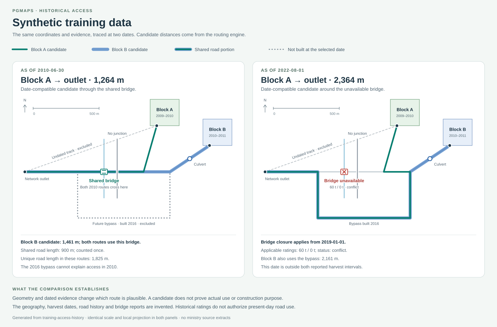

# Reconstructing cutblock access and crossing history

**Terrain → Access history** connects a selected cutblock entrance to an explicitly
identified network outlet through roads and structures that are compatible with a
chosen historical date. It keeps the evidence, assumptions, rejected candidates,
source identifiers and review decisions with the road project.

The workflow now includes a live investigation of **BC opening 60677**, a selected-block
evidence overview, map-to-record navigation, portable evidence, and an offline worked
reconstruction. Public source records establish identities and mapped candidates;
dated evidence and reviewed operational records are still needed to establish historical
access. The last section describes the additional data and validation needed for a
province-wide road-purpose database.

## Open the real BC investigation

1. In a local or preview build of this PR, open **Forest road design**
   and choose **Projects → Browse example scenarios → BC records · opening 60677**.
2. The app queries RESULTS and FTEN, then loads regional terrain for the opening's
   local study area. The existing project is retained until both stages succeed.
   **Cancel** stops loading without opening a partial investigation.
3. The new project opens with the actual FTEN polygon and road geometry. **Terrain →
   Access history** selects the block and shows its opening, licence, cutting permit,
   source block, timber mark, client and reported harvest timing.
4. Expand **Evidence coverage and remaining gaps**. Inspect each retained query's
   count, date and request URL. The overview explains which physical road dates,
   access locations and structure records are still missing.
5. Use **Inspect road or structure** to select a loaded road, or click a road/block
   on the map and choose **Access evidence**. The record view retains its business
   identifiers and sources; **Locate** returns to its actual geometry.
6. Follow **Next** to add the missing evidence or locations. A source-only project
   has no historical path to review yet. Save the project to retain the source
   snapshots and query outcomes for later investigation.

This scenario starts a clean investigation with real regional DEM metadata and only
the fetched block/road context. The orange alignment is labelled **Design draft · no
historical-use assertion**. It provides a normal design workspace; it does not depict
an as-built or inferred historical road. The history ledger begins with source records
and empty road-event, entrance/outlet, structure and path collections. Imported roads
have unknown condition and reuse disabled.

To investigate within an existing project, use **Terrain → Access history → Load
actual BC records**. This stages the same bounded opening lookup. Review **What the
records establish and leave open**, then choose **Add records to this project** or
**Dismiss preview**. Applying the preview preserves the other project data and selects
the imported block. A changed project, conflicting retained feature, failed request,
transfer limit or cancellation prevents a partial import. The clean scenario is useful
when the current project contains an unrelated training example.

### The exact scope of the live recipe

The recipe `bc-opening-60677-v1` makes three source requests:

| Request | Filter and returned evidence | Coverage limit |
| --- | --- | --- |
| [RESULTS openings, layer 26](https://delivery.maps.gov.bc.ca/arcgis/rest/services/whse/bcgw_pub_whse_forest_vegetation/MapServer/26) | Exact `OPENING_ID = 60677`; reported opening and business identifiers | Up to 100 identity records; no road-use relationship inferred |
| [FTEN cutblock polygons, layer 8](https://delivery.maps.gov.bc.ca/arcgis/rest/services/whse/bcgw_pub_whse_forest_tenure/MapServer/8) | Exact `OPENING_ID = 60677`; source attributes and WGS84 polygon geometry | Up to 25 polygon parts and 20,000 polygon vertices |
| [FTEN road segment lines, layer 21](https://delivery.maps.gov.bc.ca/arcgis/rest/services/whse/bcgw_pub_whse_forest_tenure/MapServer/21) | Spatial intersection with the cutblock envelope buffered by approximately 1 km; forest file, road section, station limits, client and timber mark | Up to 250 road records/geometry parts; combined pilot geometry capped at 30,000 vertices |

The road request is an envelope query, and returned source lines can extend beyond
that envelope. The pilot separately measures separation from the actual cutblock
footprint to identify candidates within 1,000 m. A line intersecting the envelope,
a line touching the block, and a reviewed entrance are different observations.
Multiple polygon or line parts remain associated with their source entity. Counts
of geometry parts are distinguished from counts of source records.

If FTEN returns no polygon, the road request is recorded as **skipped**. A successful
request returning zero rows is retained as a successful empty query. A request error
or timeout aborts assembly; it is not recorded as zero rows. The complete source
recipe is bounded to 65 seconds, with a 30-second request limit inside the pilot
and separate response-size budgets. Direct identity/road tools retain their
20-second request limit. The recipe does not
query Ministry bridge/culvert or PSCIS inventories.

The repository contains the recipe and tests with invented fixtures. It does not
contain a committed extract of opening 60677 or its provincial road geometry. Each
live run retains its source URLs, query bounds, business identifiers and retrieval
time in the user's project. Later service responses can differ.

### What the opening 60677 records established

The following observations come from actual source responses retrieved on
**2026-11-09**: FTEN cutblock at **02:21:06 UTC**, RESULTS at **02:21:09 UTC**, and
FTEN roads at **02:35:13 UTC**. Those responses were checked with the production
parsers and proximity calculation. This is a dated, bounded sample; it is not a
claim that a later service response will contain the same rows.

| Evidence | Observed result | Meaning for this investigation |
| --- | --- | --- |
| [Opening identity][actual-results-query] and [FTEN polygon identity][actual-cutblock-query] | 1 RESULTS opening record and 1 FTEN cutblock record; `OPENING_ID 60677`, `CUT_BLOCK_SKEY 162217` | An exact opening-ID crosswalk with no disagreement in the supplied supporting business keys |
| Supporting keys | Licence `A18165`, cutting permit `70`, block `1`, timber mark `EJ3070`, client `00001271` in both records | A consistent administrative identity; the leading zeroes in the client code are retained |
| Reported harvest timing | FTEN start `1997-07-01`; completion field `1997-09-01` | The start field denotes actual harvesting start; completion can be actual or estimated. The project retains that uncertainty |
| Cutblock geometry | 1 polygon part with 115 coordinate positions | An actual returned tenure footprint from which to define the local investigation |
| [Road-envelope query][actual-road-query] | 20 source road records, 20 line parts, 1,440 coordinate positions | Mapped tenure roads intersecting the buffered search envelope; source linework is retained at its returned extent |
| Distance to the actual footprint | 11 of the 20 road parts within 1,000 m; 1 with zero separation | A smaller candidate set than the envelope result; geometric contact still needs an entrance and topology review |
| Shared business codes | All 20 road parts share client `00001271`; none shares timber mark `EJ3070` | Client matching is too broad to identify which road served this block; the differing road timber marks do not by themselves disprove access |
| Physical road chronology | The source rows report `ACTIVE` / `HI`; no physical construction, presence-observation, closure or deactivation event is supplied by this query | Administrative codes cannot establish the network available in 1997 |
| Crossing and use evidence | Bridge/culvert inventories were not queried; no reviewed entrance, outlet, route-use record or construction rationale was returned | These remain gaps, with no inferred absence of crossings and no historical-use assertion |

The exact WGS84 road-query envelope, ordered west/south/east/north, was:

```text
[-123.73618604975827, 54.72553584100911, -123.68720192591495, 54.75248933903812]
```

The first three geometric candidates were **R01860 / K6** (`OBJECTID 20924`, zero
separation), **R04624 / V** (`OBJECTID 33037`, approximately **33.969 m**), and
**R01860 / W98_1** (`OBJECTID 743401`, approximately **75.072 m**). These distances
come from the application's footprint-to-line calculation, not a surveyed entrance.
The [same bounded road request][actual-road-query] identifies the underlying rows.

This gives a concrete starting point for working backwards: identify the 1997
block, prioritize a small set of road candidates, then seek dated access and
crossing evidence. It does **not** establish that R01860/K6 was used in 1997,
that any queried road was built for this block, or why an operator chose a route.
Those conclusions require the additional evidence described below.

## Try the synthetic reconstruction



The comparison uses the actual saved coordinates and engine results. It is a
data diagram; rendered browser acceptance is still a separate check.

1. Start the app and open `/dev/forestry/road-design?example=training`.
2. Open **Projects → Browse example scenarios** and load
   **Training · reconstruct block access and bridges**.
3. Open **Terrain → Access history**. On a phone, first open **Show road controls**.
4. Inspect the saved **2010-06-30** route for block A. Select block B to see its
   different spur and culvert. Both routes use the same mainline and bridge.
5. Set **Historical date** to **2022-08-01**, then **Trace historical access**.
   The bridge's closure and conflicting reports exclude that crossing. The route
   uses the bypass constructed in 2016. Expand **Structure evidence and conflicts**.
6. Select the saved 2010 route again. Its date and evidence remain 2010 even while
   the next trace date is 2022. The map and legend identify the selected saved date.
7. Expand **Review this association**, choose **Documented use**, select the
   synthetic haul-ledger source, enter a reviewer and a specific reference, and
   save the assertion. This demonstrates the review mechanism using invented evidence.
8. Export the history bundle or Markdown report, or use **Save → Save project JSON**.
   Reopen the project and inspect the retained route, review, identifiers and sources.

The example contains two cutblocks, eight road features, a bridge, a culvert,
explicit entrances and outlet, and five invented source records. All road reuse
switches remain off. The reference alignment is a design draft, not an as-built road.
No provincial feature extract is embedded in the example.

| Input change | Expected result | What it demonstrates |
| --- | --- | --- |
| Trace at 2010-06-30 | Both blocks can connect through the shared bridge | A road network can serve multiple blocks |
| Inspect the bypass at that date | Excluded: constructed in 2016 | Today's network cannot be backdated automatically |
| Trace at 2022-08-01 | The bridge crossing is blocked; the later bypass is available | Time changes the usable historical topology |
| Inspect bridge reports in 2022 | Both 60 t and 0 t reports, plus the closure, remain visible | A newer inventory row does not erase a contradictory notice |
| Enable unknown historical timing | An undated track can become an explicitly qualified candidate | Missing dates remain assumptions |
| Inspect the grade-separated road | Its line crossing does not create a junction | Intersection on a map is insufficient for connectivity |
| Change a road's section ID, geometry, asset or evidence | Saved assertions become stale | A review is tied to the inputs it actually used |
| Change only the next trace date | Existing assertions keep their own date | A historical record is not overwritten by a new query |

The implementation lives in `trainingAccessHistoryScenario.ts`; its integration
tests verify these outcomes. The [portable example files](../../examples/forestry/access-history/)
can be regenerated with `npm run example:access-history`.

## What a connection means

The planner keeps five relationship types. They are explicit categories, not a
percentage confidence score.

| Relationship | Meaning |
| --- | --- |
| Nearby only | A relationship is recorded for investigation; it does not assert use |
| Inferred access | A bounded network trace found a date-compatible or explicitly qualified candidate |
| Documented plan | A reviewer cites a record describing planned access |
| Documented use | A reviewer cites a record supporting actual use of this route |
| Rejected association | The candidate is retained with the reason for rejecting it |

Neither proximity nor a shared tenure/client identifier proves that a road was
constructed for a particular block. An existing mainline may have preceded that
block by decades. A route used for harvest may include old roads, a new spur,
temporary crossings and a shared bridge. Preserve those distinctions when
explaining an operational decision.

The trace does not automatically promote an inference to documented use. A review
requires a source, reviewer, review date and reference/reasoning. Stale, missing or
contradictory inputs prevent a positive review until retraced or reconciled.
Rejected assertions remain inspectable. Review is a recorded human assertion;
the software does not authenticate the document or certify its interpretation.

## Using real BC records

For another opening, start with a bounded study area. Load mapped cutblocks with the existing
**Cutblocks & harvest history** tool, draw a block, or import a project bundle.
For a block that carries an opening ID, expand **Ministry records & structure files**
and use **Check block identity**. That performs an exact opening-ID query against
RESULTS openings and FTEN cutblock polygons. It retains unmatched records and
checks reported business keys for disagreements.

An identity check can corroborate the opening, licence, cutting permit and block
identity. It does not produce a road-to-block foreign key. The individual source
snapshots preserve typed identity attributes, source URL, record ID and retrieval
time. Content changes create distinct source snapshots; fetching unchanged content
again does not manufacture new physical evidence. Typed query records retain successful
empty results and skipped requests independently of the source entities returned.

FTEN defines its disturbance-start field as the actual start of harvesting, while
its disturbance-end field can be actual or estimated completion. The footprint
adapter therefore labels a supplied completion interval as potentially estimated;
a start without an end remains start-only. RESULTS disturbance fields describe
reported activities for an opening and can have a different meaning. These fields
are retained with their source and never used as physical road construction dates.
See the [FTEN cutblock catalogue and field metadata](https://catalogue.data.gov.bc.ca/dataset/dfb8b498-fa4b-4286-b3ec-58db88aca1cf)
and [RESULTS opening catalogue](https://catalogue.data.gov.bc.ca/dataset/53a17fec-e9ad-4ac0-95e6-f5106a97e677).

Use **Load open road segments** to load bounded FTEN Road Segment Lines around
the selected block and saved access locations, falling back to the project
alignments when those are unavailable. This preserves forest file, road section, station limits,
timber mark and client identifiers. Leading zeroes remain significant strings.
Segment IDs are namespaced separately from the existing road-section loader.
Changed geometry or authoritative identifiers are not silently merged over a
reviewed road.

Roads arrive with unknown condition and reuse disabled. Administrative status,
award/retirement dates and a timber mark are not construction dates or proof of
the destination served. Enter physical road events from suitable dated records
or imagery in the evidence ledger. Where only a date range is known, retain the
range. A later observation of a road does not establish when it was first built.

For bridges and major culverts, import a WGS84 point GeoJSON extract you are
entitled to use. The Ministry structures adapter preserves the source row,
physical structure and crossing site separately. A unique exact forest-file and
road-section match must also be spatially plausible. Ambiguous, distant and
unmatched records remain unresolved. A PSCIS import preserves fish-passage
observations; a fish barrier status is never converted into a truck closure.

Add a source for each relevant survey, construction record, aerial-image
observation, closure notice or haul plan. Use **Entrances and outlets** to locate
the actual block access point and the network destination. An entrance must be
in or at the selected block within the declared attachment tolerance. A block
centroid is not used as a substitute. Choose a historical date, review connection
assumptions, trace, and inspect the exclusions before recording a conclusion.

### Read the selected-block overview

The overview works before any route has been traced. It shows the selected block's
typed business keys, harvest timing and retained source entities, then describes
the scope of its road and structure counts:

- **Selected route** uses the current saved assertion for that block, its own
  historical date, and its actual road and structure IDs. Changing the next trace's
  date does not reinterpret the saved route.
- **Nearby loaded records · connection not established** uses the selected block's
  retained road-query bounds or a 1 km buffer around its footprint and valid
  entrances. An outlet explicitly assigned to the block extends the study corridor.
  This view is also used when the selected assertion is rejected, stale or unresolved.

The nearby view excludes unrelated synthetic roads, assets and outlets when reviewing
a real ministry block. If a user explicitly assigns an example road or outlet to the
real block, the overview flags that mixing. A shared outlet outside the selected
study area does not make the block ready to trace. Invalid or missing access locations
are reported rather than counted as valid entrances/outlets.

**Evidence coverage and remaining gaps** distinguishes dated physical evidence from
mapped tenure geometry, resolved asset attachments from unresolved candidates, and
retained query results from unqueried sources. It counts distinct source entities
separately from their saved versions. Disagreeing business keys remain visible; the
app does not silently choose the most convenient snapshot.

**Next** links to source loading, entrance/outlet placement, evidence reconciliation,
tracing or review. The suggested action reflects the evidence currently retained.
It does not imply that a nearby road is connected, that every crossing has been
inventoried, or that a positive use assertion has been independently verified.

### Source access and reuse

The registry in `accessHistorySources.ts` distinguishes public access from reuse
rights. The following were checked against the official catalogue in November
2026. Recheck terms before adding a bulk publishing pipeline.

| Dataset | Role in this change | Access path |
| --- | --- | --- |
| [RESULTS openings](https://catalogue.data.gov.bc.ca/dataset/53a17fec-e9ad-4ac0-95e6-f5106a97e677) | Typed opening and disturbance identity | Bounded live query; OGL-BC |
| [FTEN cutblock polygons](https://catalogue.data.gov.bc.ca/dataset/dfb8b498-fa4b-4286-b3ec-58db88aca1cf) | Actual footprint; opening/licence/permit/block keys; reported harvest fields | Bounded live query; OGL-BC |
| [FTEN road segment lines](https://catalogue.data.gov.bc.ca/dataset/9e5bfa62-2339-445e-bf67-81657180c682) | Road business keys and mapped segment geometry | Bounded live query; OGL-BC |
| [Consolidated cutblocks](https://catalogue.data.gov.bc.ca/dataset/b1b647a6-f271-42e0-9cd0-89ec24bce9f7) | Wider harvest history; already used by the cutblock tool | Reference in this registry; Access Only |
| [Ministry bridges and major culverts](https://catalogue.data.gov.bc.ca/dataset/df943320-9e31-421c-8ada-d4df80518684) | Asset and crossing identity, reported ratings | Local user import; Access Only |
| [PSCIS assessments](https://catalogue.data.gov.bc.ca/dataset/7ecfafa6-5e18-48cd-8d9b-eae5b5ea2881) | Fish-passage observations at crossing sites | Local user import; Access Only |
| [BCTS Block Access Roads](https://catalogue.data.gov.bc.ca/dataset/7c166ce7-a3ff-40ee-b7e2-98b3059aba37) | Potential additional evidence if lawfully available | Restricted reference only; not queried |

See the province's [data licence guidance](https://bcgov.github.io/data-publication/pages/dps_licences.html).
No Access Only or restricted source is automatically queried by the new adapters.
The existing cutblock/road-section loaders have their own existing behavior;
adding this module does not expand their redistribution rights.

## Data model and reproducibility

`RoadProject.accessHistory` is optional, preserving compatibility with existing
`pgmaps-road-project-v1` files. Its value has schema `historical-access-v1`.

| Collection | What is retained |
| --- | --- |
| `sources` | Dataset and record ID, URL, retrieval/publication times, synthetic flag, description, optional typed block identity and successful/skipped query metadata |
| `events` | Road ID, physical event kind, earliest/latest event dates, observation date, source IDs and geometry fingerprint |
| `structures` | Asset type and coordinate, distinct site/structure/row IDs, road binding and tolerance, construction/removal ranges, independent restriction reports |
| `anchors` | Explicit block entrances and network outlets, coordinates, road binding, evidence; outlets can be assigned to a block or shared nearby |
| `paths` | Relationship, selected block/anchors, frozen settings/date, ordered directed segments, geometry, roads/assets, assumptions, sources and review |
| `settings` | Date and explicit assumptions for the next trace, geometric tolerances and variant cap |

Paths contain ordered physical road segments plus any junction or attachment
connectors. Serialized length, coordinates, source-node transitions and named access
locations must agree. An imported path cannot jump between two roads just because
their coordinates coincide, including at a grade-separated crossing. It must retain
the eligible crossing records encountered along the path and the supporting source
references. Omitting an asset from the path's list cannot hide its closure. Disconnected
or inconsistent current paths are rejected by the parser. Stale historical geometry remains
available for inspection with a stale status. A fingerprint covers relevant
source snapshots, block/road geometry, business keys, events, structures,
anchors and trace settings. It is a change detector, not a cryptographic signature.

Construction, observation, publication and retrieval dates have different
meanings. The engine evaluates physical event intervals, not source timestamps.
It filters future construction and definite closures/removals, handles explicit
reactivation evidence, and requires an opt-in for unknown timing. Each saved
trace evaluates one explicit date; multiple dates require separate saved runs.
It does not claim continuous availability throughout an entire harvest interval.

Known closures/removals dominate undated reports regardless of record order.
An undated closure cannot downgrade a structure known to be unbuilt or removed
to an allowable unknown state. A notice with an unknown start stops applying
after its documented expiry. Construction/removal claims and independent structure
reports require retained sources. Contradictory ratings and simultaneous closures
remain visible together.

Date intervals can be narrowed by compatible observations: a road observed in 2009
can establish existence for a 2010 trace when its construction was bounded to
2008–2012. An observation before the earliest possible construction requires
reconciliation. Traces also state when harvest completion is unknown, when only
calendar-year precision is available, or when the analysis date lies outside the
reported harvest period. A later bypass cannot thereby become evidence of an
earlier harvest route.

`buildHistoricalRoadTopology` shares the existing network's strict junction
geometry but uses a distinct graph type. It does not set `reuseAllowed`, invent
serviceable condition, mark roads proposed, or disable the operational checks.
Current-use haul, grade, capacity, rehabilitation and permission checks remain
in the operational graph. Historical candidates return mapped length and
evidence, not a certified haul route or a historical construction price.

Alternatives are bounded: a shortest geometric candidate is followed by
one-edge-exclusion searches. This is not exhaustive k-shortest enumeration, a
global optimum or a calibrated model of historical decision-making. The result
reports candidate/search limits and unresolved connections. Unknown level
endpoint snaps require a separate explicit assumption; crossing lines do not
automatically join.

Crossings are evaluated where a traced segment actually passes the asset. An
asset elsewhere on a long road does not block the entire road. Records for a
replacement structure remain distinct from its predecessor. Multiple reports
about one physical structure are checked together; a compatible inventory row
does not cancel a closure row. Source namespaces prevent coincident numeric
RRI and PSCIS identifiers from becoming an accidental replacement group.

`historicalSharedUsage` reports unioned physical road length, distinct physical
structures and distinct crossing sites. Opposite travel directions and graph
splits are reconciled against source-segment extents. Rejected assertions are
excluded. These are overlap measures, not allocated construction costs; cost is
unknown. Alternative candidate routes must not be added together as a build estimate.

### Map, exports and editing

The selected saved route is dashed and labelled by its relationship and date.
Stale/unknown results use amber; contradictory/conflicting evidence uses red.
Structure markers retain site, structure and source-row identifiers in their
inspection cards. The map uses the shared toolkit layers and the same assessment
functions as the sidebar and report.

Click a block or road and use **Access evidence** to open its record in the access
panel. Clicking a historical route or structure opens that saved assertion or
asset record directly. **Inspect road or structure** provides the same record access
from the selected-block overview; its **Locate** action focuses the corresponding
geometry. These view changes do not create a block-to-road association. A selected
road's current-use review remains a separate action.

Saved entrances and outlets are shown as map markers with their role, named road,
block assignment and source count. Use **Entrances & outlets** to name and edit
coordinates, identify the physical road and cite a location source when available.
An outlet assigned to the selected block remains in its study corridor even beyond
the initial nearby search. A **Shared nearby outlet** can be reused by nearby blocks.
Location validation checks the block footprint and explicit road tolerance; a map
marker alone does not establish connectivity or use. Alignment endpoints are
available as manual coordinate aids and are not automatically adopted as entrances.

A history bundle has schema `pgmaps-access-history-bundle-v1` and contains
`context` plus `accessHistory`. Imports are bounded and validated before applying.
Conflicting existing feature IDs are rejected atomically. Newly imported roads
have reuse disabled, and unrelated project data is retained. The UI previews a
bundle before applying it and offers an undo for that import. The ledger editor
uses explicit apply, rejects a stale draft and lets the user download it before
reconciling concurrent changes. Sources and existing reviews are not silently
overwritten by a ministry refresh.

The Markdown report includes assertions, assumptions, review references, road
events, structures, report conflicts and sources. The ordinary project export
preserves all of this with the rest of the design. A bundle or report may contain
user-imported evidence: its source rights still apply to subsequent sharing.

## Limits and budgets

| Limit | Enforcing location |
| --- | --- |
| 500 total project context features | `parseProject` in `project.ts` |
| 500 network roads / 20,000 source vertices | `MAX_NETWORK_ROADS`, `MAX_NETWORK_VERTICES` in `roadNetwork.ts` |
| 50,000 network nodes / 75,000 edges / 2,000,000 topology operations | Corresponding `MAX_NETWORK_*` constants in `roadNetwork.ts` |
| 100 saved historical paths | `MAX_HISTORY_PATHS` in `accessHistory.ts` |
| 500 sources / 1,000 road events / 500 structures / 100 anchors | `MAX_HISTORY_SOURCES`, `MAX_HISTORY_EVENTS`, `MAX_HISTORY_STRUCTURES`, `MAX_HISTORY_ANCHORS` |
| 50,000 aggregate path/segment coordinates | `MAX_HISTORY_PATH_VERTICES` |
| 24 entrance/outlet pairs and 48 path searches per trace | Pair guard in `traceHistoricalAccess`; `MAX_HISTORY_PATH_SEARCHES` |
| 1–8 displayed candidate variants, default 3 | `parseHistoricalTraceSettings` |
| 10 MiB history bundle or ledger import | `MAX_HISTORY_IMPORT_BYTES` |
| 100 identity records per dataset / 1 MiB response / 20 s request timeout | `MAX_BLOCK_IDENTITY_RECORDS`, `MAX_IDENTITY_RESPONSE_BYTES`, `ACCESS_SOURCE_TIMEOUT_MS` |
| FTEN opening footprint: 25 polygon parts / 20,000 vertices / 5 MiB response | `MAX_BC_OPENING_POLYGONS`, `MAX_BC_OPENING_VERTICES`, `MAX_BC_OPENING_POLYGON_BYTES` |
| Actual-opening pilot: 250 road records/parts / 30,000 combined context vertices / 30 s per source request / 65 s overall source assembly | `BC_PILOT_MAX_ROADS`, `BC_PILOT_MAX_VERTICES`, `BC_PILOT_SOURCE_TIMEOUT_MS`, `BC_PILOT_TIMEOUT_MS` |
| FTEN road query: 0.3° maximum span, 500 roads, 10 MiB response | Existing-road query/import constants reused by `accessHistorySources.ts` |
| 5 MiB / 500 imported structure points | `MAX_STRUCTURE_IMPORT_BYTES`, `MAX_IMPORTED_STRUCTURES` |

Limits reject incomplete imports or report bounded search results; they do not
silently pretend a partial area is a complete provincial network. CORS, service
availability, transfer limits and missing records remain visible load failures.

## What the wider BC system still needs

### First expand the actual-opening investigation

The next useful work is to close identifiable gaps in this bounded case before
running the inference over an entire district:

1. Review the nearest mapped road candidates against dated imagery or an operating
   plan. Record the actual entrance/landing and destination, and preserve alternative
   possibilities when the connection is ambiguous.
2. Establish physical presence around the reported harvest period for each necessary
   road extent. Retain image acquisition dates and first/last visibility bounds, or
   cite construction/as-built, closure and reopening records. Keep changes in road
   geometry and successive incarnations separate.
3. Obtain permitted Ministry/operator crossing extracts for those named road sections.
   Resolve forest-file/road-section keys plus actual point-to-road geometry, then
   retain crossing-site, physical-asset and source-row identities separately. Establish
   the relevant structure's construction, replacement/removal and restriction history.
4. Trace the dated candidate with explicit entrances and outlets. Report exclusions,
   unknown timing, topology gaps and shared road/crossing extents. Compare this result
   with a route-specific plan, haul record or other operational evidence before a
   reviewer records documented use.
5. Repeat for a contrasting case with known use evidence and a different period or
   terrain. Measure wrong attachments, missed alternatives and unresolved gaps, then
   decide which new source or topology step would improve the next regional sample.

None of these records alone explains why an operator chose a route. Construction
purpose, actual use, shared access for future blocks, historical constraints and costs
remain separate questions. The broader expansion below supplies the infrastructure
and reference evidence needed to answer them.

### 1. A maintained data catalogue and immutable snapshots

Keep provincial acquisition code in `vendor/bcdatamapper`, following the repo's
existing ownership contract. The browser should consume scoped, versioned
results. A scheduled worker needs source descriptors, checked access/reuse terms,
schema versions, checksums, retrieval times, paging/retry logic, geographic
coverage, successful-empty versus failed-query distinctions and retained source
versions. Restricted/private evidence needs controlled storage and separate
distribution rules. Do not put all source extracts into PGMaps' static assets.

Store source entities and versions separately: opening, cutting authority,
block, road section, road segment, crossing site, physical structure and report.
Keep aliases and many-to-many joins, with conflict records. A structure may be
replaced at a site; a section may be split; one opening can appear in multiple
datasets. Object IDs, site IDs, physical asset IDs and business keys serve
different purposes. This PR establishes their project representation; the
province-wide entity resolution and versioned database are additional services.

### 2. Historical geometry and observed construction evidence

A current road layer alone cannot reconstruct a past network. Acquire earlier
road inventories, dated orthophotos/satellite observations, permitted engineering
records, as-built plans and closure/deactivation records. Use image acquisition
dates to bound first/last visibility. Store uncertainty intervals and review
their geometry; do not label first observation as construction.

Broaden the source catalogue with integrated/digital road networks, road-use
permits, FOM/BCTS sale and operating-plan documents, Ministry of Transportation
bridge/culvert data and other operators where appropriate. Each source needs its
own identity adapter, extent/version check, licence assessment and tests before
it can become an automatic ingest. PSCIS and RRI are complementary evidence,
not interchangeable structure inventories.

### 3. Spatial indexing and scalable reconstruction

Use a spatial database for regional queries, stable source-segment topology and
temporal versions. Materialize explicit junctions and grade separation, rather
than repeatedly snapping a province-wide network in the browser. Background
jobs can generate candidate block entrances, test temporal paths, record
unresolved evidence and export bounded project bundles. The pure trace API and
portable records here are the interface for that handoff. Increasing the browser's
500-feature budget is not a substitute for this service.

### 4. Validation against actual operational records

Build a reviewed reference set stratified by district, period, tenure type,
terrain and road/crossing type. Use dated plans or operator records to label
actual access, distinguish planned versus built versus used, and retain multiple
valid routes. Measure candidate recall, false associations, temporal violations,
asset-attachment errors, unresolved proportions and review effort. Hold out
districts/years when evaluating generalization. Include negative and incomplete
cases, not only examples with a clean match.

Only after that evaluation should inferred associations receive calibrated
confidence estimates. The current explicit evidence categories are intentionally
not presented as probabilities. Public identity joins and the synthetic example
are not evidence of real route-selection accuracy.

### 5. Learning why routes were selected

Historical use and historical purpose are separate questions. To compare the
actual road with alternatives, reconstruct information available at the time:
existing access, dated terrain/imagery, harvest boundaries and landings, crossing
options, known slope/geotechnical limits, fish/riparian constraints, seasonal
requirements, tenure permissions, available aggregates, haul destination,
vehicle requirements and period-appropriate costs.

Generate feasible alternatives using the existing terrain, constraint, network
and cost tools, then compare measured length, grade, earthworks, crossings,
rehabilitation, shared infrastructure and haul. Preserve objectives separately.
Fit or calibrate preferences only on well-supported records and test sensitivity
to unknown costs/constraints. An observed road may reflect future blocks,
contract timing or constraints absent from public data; the shortest mapped
route is not a sufficient explanation of the original decision.

### 6. Multi-user review and operational handoff

The current workspace is a portable local project, not a multi-user evidence
service. Production review needs access control, append-only review history,
document references, reconciliation of concurrent edits and an audit trail.
Current engineering/permission/condition review remains a separate gate before
using a reconstructed corridor in a present-day design. Loading a historical
assertion must never become an implicit operational road approval.

## Developer entry points

- `accessHistoryTypes.ts`, `accessHistory.ts`: contracts, parser, chronology,
  topology tracing, assessment, review and shared-usage calculations.
- `roadNetwork.ts`: separate operational and historical topology entry points.
- `accessHistorySources.ts`: registry, open identity/segment queries and local
  RRI/PSCIS import adapters.
- `bcAccessPilot.ts`, `bcAccessPilotScenario.ts`: bounded live opening recipe and
  atomic clean-project assembly with regional terrain.
- `accessHistorySummary.ts`, `AccessHistoryOverview.tsx`: scoped coverage, retained
  query outcomes, evidence gaps and next actions before or after tracing.
- `AccessHistoryPanel.tsx`, `AccessHistorySourcesPanel.tsx`: review, authoring,
  staged actual-record preview, source loading and import/export workflow.
- `AccessHistoryRecord.tsx`, `AccessHistorySelection.ts`: record inspection and
  map/panel selection continuity without asserting an evidence relationship.
- `AccessHistoryIO.ts`: portable bundle and Markdown report.
- `accessHistoryMap.ts`, `AccessHistoryLayers.tsx`: shared map/legend presentation.
- `trainingAccessHistoryScenario.ts`: deterministic worked example.
- `scripts/forestry/inspect-bc-access-pilot.ts`: manual bounded live review; prints
  a source/evidence summary without writing a provincial data snapshot into the repo.
- `tests/e2e/forestry-access-history.spec.ts`: desktop and 320 px phone acceptance
  workflow. Run locally; no feature-specific automatic workflow was added.

After initializing the existing toolkit and json-url submodules, run
`npm ci` and `npm run ci:prepare`. The focused unit suites and acceptance tests
are listed in the PR validation record. Use an already-running Vite server and
`PGMAPS_E2E_BASE_URL` to run the browser suite without fetching unrelated datasets.
`npm run check:access-history` typechecks the complete road-page dependency graph,
new modules, example generator and browser spec in a bounded entrypoint project;
it supplements the existing full-repository `npx tsc -b` check.

To reproduce the actual opening lookup independently of the map interface:

```sh
node --import tsx scripts/forestry/inspect-bc-access-pilot.ts 60677
```

The command performs live source requests and prints query URLs, bounds, identity
records, candidate counts and gaps. It accepts another numeric opening ID. Use
`--help` for its explicit Python transport option on a managed network where Node's
native fetch does not honor the configured proxy. The application continues to use
native browser fetch with the same source budgets and parsers.

The [example directory](../../examples/forestry/access-history/) also contains an
isolated review page using the actual evidence panel and a coordinate diagram.
It supports interface inspection without WebGL; it does not exercise the production
MapLibre plan or provide terrain/basemap interpretation. Browser observations and
the full verification record are documented separately in
[Access-history validation](access-history-validation.md).

[actual-results-query]: https://delivery.maps.gov.bc.ca/arcgis/rest/services/whse/bcgw_pub_whse_forest_vegetation/MapServer/26/query?f=json&where=OPENING_ID%3D60677&outFields=OPENING_ID%2CFOREST_FILE_ID%2CCUTTING_PERMIT_ID%2CCUT_BLOCK_ID%2CTIMBER_MARK%2CCLIENT_NUMBER%2CDISTURBANCE_START_DATE%2CDISTURBANCE_END_DATE&returnGeometry=false&resultRecordCount=101
[actual-cutblock-query]: https://delivery.maps.gov.bc.ca/arcgis/rest/services/whse/bcgw_pub_whse_forest_tenure/MapServer/8/query?f=geojson&where=OPENING_ID%3D60677&outFields=CUT_BLOCK_SKEY%2COPENING_ID%2CHARVEST_AUTH_FOREST_FILE_ID%2CHARVEST_AUTH_CUTTING_PERMIT_ID%2CCUT_BLOCK_ID%2CTIMBER_MARK%2CCLIENT_NUMBER%2CLIFE_CYCLE_STATUS_CODE%2CDISTURBANCE_START_DATE%2CDISTURBANCE_END_DATE&returnGeometry=true&resultRecordCount=26&orderByFields=CUT_BLOCK_SKEY&outSR=4326
[actual-road-query]: https://delivery.maps.gov.bc.ca/arcgis/rest/services/whse/bcgw_pub_whse_forest_tenure/MapServer/21/query?f=geojson&where=1%3D1&geometry=-123.73618604975827%2C54.72553584100911%2C-123.68720192591495%2C54.75248933903812&geometryType=esriGeometryEnvelope&inSR=4326&outSR=4326&spatialRel=esriSpatialRelIntersects&returnGeometry=true&resultRecordCount=251&orderByFields=OBJECTID&outFields=OBJECTID%2CFOREST_FILE_ID%2CROAD_SECTION_ID%2CSTART_STATION%2CEND_STATION%2CTIMBER_MARK%2CCLIENT_NUMBER%2CFILE_TYPE_CODE%2CFILE_STATUS_CODE%2CLIFE_CYCLE_STATUS_CODE%2CRETIREMENT_DATE
