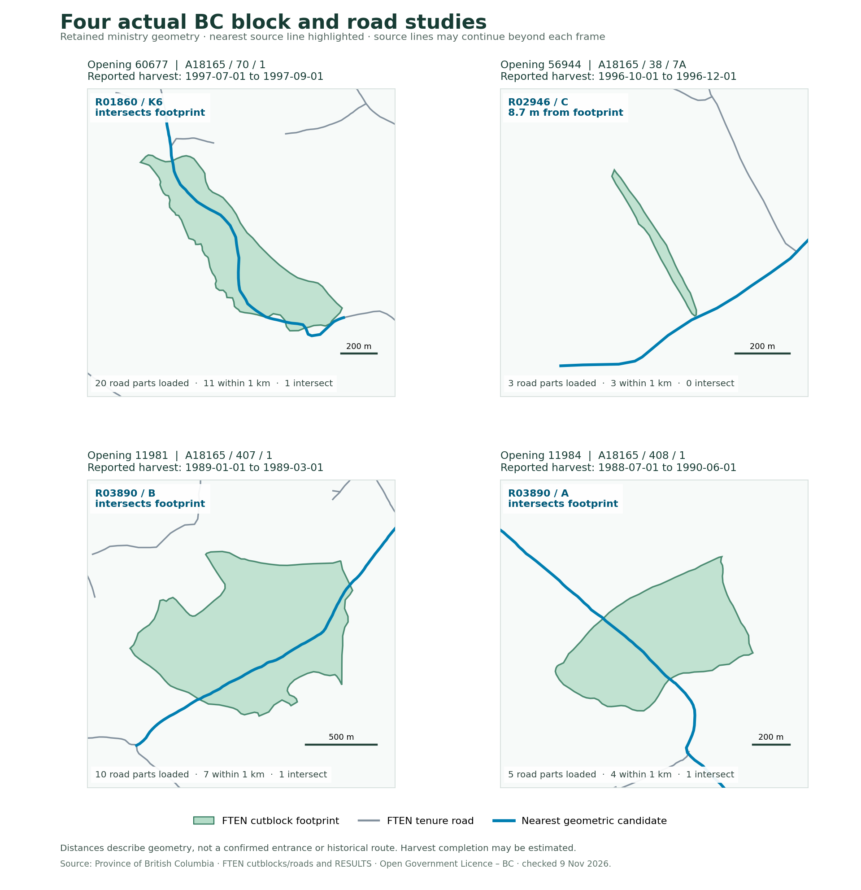

# Finding actual BC cutblocks and reviewing shared roads

This guide records what the live examples actually returned on **9 November 2026**,
how to search them, and why the workspace now opens as an access investigation.
The source observations are a bounded sample, not a maintained BC-wide inventory.
The main [access-history guide](access-history.md) describes temporal reconstruction,
bridge evidence, review and the remaining provincial data work.

## What the screenshot exposed and what changed

The first opening-60677 scenario inherited the new-design workspace's 300 m
straight starter alignment. Its profile, cut/fill and cost were calculations for
that starter. The “1 road” in the saved-project list counted the proposed alignment,
not the twenty FTEN road records. A label in the loading notice did not make that
presentation clear enough.

Real studies now open in persisted **Access investigation** mode. The opening,
mapped block parts, mapped road records, source coverage and evidence panel lead the
view. The map fits actual source geometries. The internal compatibility alignment
has no calculated stations or centreline and is hidden from the map, counts,
profiles, sections and engineering exports. Selecting **Start design** explicitly
activates an editable proposal and the engineering views. No ministry road is
converted to a proposed design by opening a study.

Saved unedited projects from the old opening-60677 example migrate when loaded.
The migration requires the exact old scenario, starter name, original two points,
default template and absence of edits or extra alignments. A changed road remains
a design; user-authored work is not discarded. Existing saved-project summaries are
refreshed from the validated projects while retaining their original edit times.

## The four checked examples

Each case returned one mapped FTEN polygon and one RESULTS opening record, with no
disagreement among the supplied supporting licence, permit, block, timber-mark and
client fields. The date interval below comes from FTEN: the start is harvesting
start, and completion can be actual or estimated. The dates do not date a road.

| Opening | FTEN cutblock key | Licence / permit / block | Reported harvest interval | Road records loaded / within 1 km / intersecting | Nearest geometry candidate |
| --- | --- | --- | --- | --- | --- |
| **60677** | `162217` | `A18165 / 70 / 1` | 1997-07-01 → 1997-09-01 | 20 / 11 / 1 | `R01860 / K6` · 0.0 m |
| **56944** | `80146` | `A18165 / 38 / 7A` | 1996-10-01 → 1996-12-01 | 3 / 3 / 0 | `R02946 / C` · 8.7 m |
| **11981** | `80183` | `A18165 / 407 / 1` | 1989-01-01 → 1989-03-01 | 10 / 7 / 1 | `R03890 / B` · 0.0 m |
| **11984** | `80188` | `A18165 / 408 / 1` | 1988-07-01 → 1990-06-01 | 5 / 4 / 1 | `R03890 / A` · 0.0 m |



The figure uses returned source coordinates. Each panel has its own metric scale;
linework outside the display window is clipped only for presentation. Blue denotes
the nearest geometric candidate, not a documented haul route. The example recipes
re-query the live sources; they do not contain a committed raw feature extract.

**60677** is the original 1997 example. R01860/K6 (OBJECTID 20924) intersects the
footprint. All twenty envelope road records share client `00001271`, so the client
match cannot identify which road served the block. None shares the block's exact
mark `EJ3070`.

**56944** demonstrates a small gap. The closest part of R02946/C (OBJECTID 26379)
is about **8.700 m** from the footprint. This is shortest footprint-to-line
separation; it is not necessarily a road endpoint distance. The application keeps
the gap and requires an explicitly reviewed entrance instead of snapping it away.
All three returned roads share the client's code; no road shares mark `EJ3038`.

**11981** demonstrates an older harvest with a mixed-client surrounding network.
R03890/B (OBJECTID 29231) intersects the footprint. Only three of ten envelope road
records share the block's client, and none shares mark `EJ3407`. R06076/3A is about
221.856 m away and belongs to a different reported client.

**11984** has a reported interval spanning 1988–1990. R03890/A (OBJECTID 29230)
intersects its footprint. Four of five envelope road records share its client;
none shares mark `EJ3408`. R06905/52A is about 326.170 m from this footprint.

The three additional complete assemblies finished at 03:40:17, 03:40:44 and
03:40:49 UTC. Per-response retrieval times and exact query URLs are retained in
source records. Opening 57243 was also attempted but its source request timed out;
it was excluded from the checked catalogue, not reported as an opening with no roads.

## A concrete shared-road study: 11981 and 11984

Both bounded queries return the same two source rows:

| FTEN road OBJECTID | Permit / section | Geometry in both responses |
| --- | --- | --- |
| `29230` | `R03890 / A` | Identical retained coordinates |
| `29231` | `R03890 / B` | Identical retained coordinates |

The two investigations contain **13 unique road records** after those two duplicate
source identities are removed, plus two cutblock footprints. This is a meaningful
place to investigate common access. It establishes shared mapped records in
neighbouring study areas; historical connectivity and actual use still need dated
evidence and reviewed entrances/outlets.

To inspect it in the interface:

1. **Projects → Find BC cutblocks → Opening ID `11981` → Search BC cutblocks → Open study**.
2. In **Access history → Source records**, enter `11984` in **Opening ID to add**.
3. **Load actual BC records**, inspect the preview, then **Add records to this project**.
4. The add notice distinguishes new records from exact source IDs already retained.
   Switch **Access-history cutblock** between the two footprints. Use **Roads near this
   block** or **Inspect road or structure** to select R03890/A and R03890/B.
5. Selection highlights that actual mapped line, opens its evidence and offers its
   source identifiers. **Fit mapped study records** shows the whole retained area.
6. Export the evidence bundle or save the investigation project to retain both
   openings and their source references.

If the service has changed a retained row's geometry or substantive source fields,
the staged importer rejects the collision for review. It does not silently replace
the earlier record. Loading a second opening creates no physical construction
history, reviewed access anchor or historical route automatically.

## Search behavior you can rely on

**Live cutblocks:** exact opening ID, forest licence, cutting permit, timber mark or
cutblock ID. Filled fields are combined with AND. Default result size is 25; the
interface can request 10, 25 or 50. One extra source row detects a capped result.
A message says when more records match and asks for a narrower query. Search is
read-only; **Open study** separately loads the evidence and terrain. A failed open
keeps the results and the existing project.

A live search for licence **A18165** returned 25 visible records with `hasMore: true`
at 03:42:59 UTC. This establishes at least 26 matches, not an exact provincial
count. Adding cutting permit **70** returned one record, opening **60677**, with no
transfer-limit flag in the checked response.

Two visible legacy rows under A18165 reported negative opening IDs, `-131060000`
and `-139210000`. Their FTEN keys and original reported values remain visible,
but the positive-ID RESULTS-linked study loader cannot open them. The result
explains that limitation. A row without geometry also remains visible with its
study action unavailable. Supporting FTEN-key-only studies is a future adapter
extension, not a reason to erase legacy records.

**Saved studies:** search by project name or opening ID, and filter access studies
versus road designs. Cards say block parts and context road records; designed
alignments are counted separately.

**Example scenarios:** search the title, description or opening ID; filter real BC
records, proposed designs or synthetic training, and filter for cutblock content.
The four real examples are reproducible recipes checked on the stated date.

**Loaded nearby roads:** filter the selected block's candidate list by road name,
permit, section, timber mark or client. Rows remain sorted by shortest separation
within 1 km. Client/mark comparisons distinguish matching, different, missing and
conflicting block values. Matching codes do not create a historical-use assertion.

The backend also accepts a bounded WGS84 envelope in the CLI/API. An interactive
map-extent search, fuzzy names, province-wide road search and automatic pagination
are not implemented. The [limits table](access-history.md#limits-and-budgets) names
the enforcing constants. Errors, cancellation and zero-result responses stay distinct.

## Bridges and culverts in these actual areas

The live opening recipe queries RESULTS, FTEN cutblocks and FTEN road segments.
It does not automatically query or redistribute Access Only structure inventories.
The existing structure import supports reviewed Ministry and PSCIS extracts.

For this research review, a separate public Ministry bridge/major-culvert **count**
query was made for each of the four exact study envelopes. All four returned zero
rows. This establishes only zero indexed rows within those envelopes in the checked
layer. It does not establish that no bridge, small culvert, licensee structure or
historical crossing existed. These research count queries were not imported into
the application's retained source ledger and the interface does not pretend they were.

The layer exposes crossing-site and road identifiers, current rating and inspection
fields. Those fields still need physical asset versions and dated reports to
establish the configuration at a 1988, 1989, 1996 or 1997 harvest. No real bridge has
been attached to these blocks without supporting records. The separate synthetic
bridge-closure example demonstrates the intended historical behavior with explicitly
invented evidence.

## Reproduce the searches

```sh
node --import tsx scripts/forestry/search-bc-cutblocks.ts --licence A18165 --limit 25
node --import tsx scripts/forestry/search-bc-cutblocks.ts --licence A18165 --cutting-permit 70
node --import tsx scripts/forestry/inspect-bc-access-pilot.ts 11981
```

On the managed proxy network used for this review, append `--python-transport`.
That optional CLI transport uses Python urllib with the inherited proxy and trust
configuration; production browser requests still use native fetch. None of these
commands creates a committed provincial data snapshot.

`render-bc-access-cases.py` accepts one to four locally retained `BcAccessPilotResult`
JSON files and an `--output` path. It generates the attributed figure above using
Matplotlib. It has no network access and does not infer missing relationships.

## Exact requests behind the case observations

Each opening uses its own polygon-derived envelope. The links preserve the source
filters, output fields and limits, so a later reviewer can repeat the query while
keeping the new retrieval date distinct from this observation.

### Opening 60677

- [results-opening · 1 returned source records](https://delivery.maps.gov.bc.ca/arcgis/rest/services/whse/bcgw_pub_whse_forest_vegetation/MapServer/26/query?f=json&where=OPENING_ID%3D60677&outFields=OPENING_ID%2CFOREST_FILE_ID%2CCUTTING_PERMIT_ID%2CCUT_BLOCK_ID%2CTIMBER_MARK%2CCLIENT_NUMBER%2CDISTURBANCE_START_DATE%2CDISTURBANCE_END_DATE&returnGeometry=false&resultRecordCount=101)
- [ften-cutblock · 1 returned source records](https://delivery.maps.gov.bc.ca/arcgis/rest/services/whse/bcgw_pub_whse_forest_tenure/MapServer/8/query?f=geojson&where=OPENING_ID%3D60677&outFields=CUT_BLOCK_SKEY%2COPENING_ID%2CHARVEST_AUTH_FOREST_FILE_ID%2CHARVEST_AUTH_CUTTING_PERMIT_ID%2CCUT_BLOCK_ID%2CTIMBER_MARK%2CCLIENT_NUMBER%2CLIFE_CYCLE_STATUS_CODE%2CDISTURBANCE_START_DATE%2CDISTURBANCE_END_DATE&returnGeometry=true&resultRecordCount=26&orderByFields=CUT_BLOCK_SKEY&outSR=4326)
- [ften-road-segment · 20 returned source records](https://delivery.maps.gov.bc.ca/arcgis/rest/services/whse/bcgw_pub_whse_forest_tenure/MapServer/21/query?f=geojson&where=1%3D1&geometry=-123.73618604975827%2C54.72553584100911%2C-123.68720192591495%2C54.75248933903812&geometryType=esriGeometryEnvelope&inSR=4326&outSR=4326&spatialRel=esriSpatialRelIntersects&returnGeometry=true&resultRecordCount=251&orderByFields=OBJECTID&outFields=OBJECTID%2CFOREST_FILE_ID%2CROAD_SECTION_ID%2CSTART_STATION%2CEND_STATION%2CTIMBER_MARK%2CCLIENT_NUMBER%2CFILE_TYPE_CODE%2CFILE_STATUS_CODE%2CLIFE_CYCLE_STATUS_CODE%2CRETIREMENT_DATE)

- [Separate Ministry structure-inventory count · 0 indexed rows in this envelope](https://delivery.maps.gov.bc.ca/arcgis/rest/services/whse/bcgw_pub_whse_forest_tenure/MapServer/38/query?f=json&where=1%3D1&geometry=-123.73618605%2C54.72553584%2C-123.68720193%2C54.75248934&geometryType=esriGeometryEnvelope&inSR=4326&spatialRel=esriSpatialRelIntersects&returnCountOnly=true)

### Opening 56944

- [results-opening · 1 returned source records](https://delivery.maps.gov.bc.ca/arcgis/rest/services/whse/bcgw_pub_whse_forest_vegetation/MapServer/26/query?f=json&where=OPENING_ID%3D56944&outFields=OPENING_ID%2CFOREST_FILE_ID%2CCUTTING_PERMIT_ID%2CCUT_BLOCK_ID%2CTIMBER_MARK%2CCLIENT_NUMBER%2CDISTURBANCE_START_DATE%2CDISTURBANCE_END_DATE&returnGeometry=false&resultRecordCount=101)
- [ften-cutblock · 1 returned source records](https://delivery.maps.gov.bc.ca/arcgis/rest/services/whse/bcgw_pub_whse_forest_tenure/MapServer/8/query?f=geojson&where=OPENING_ID%3D56944&outFields=CUT_BLOCK_SKEY%2COPENING_ID%2CHARVEST_AUTH_FOREST_FILE_ID%2CHARVEST_AUTH_CUTTING_PERMIT_ID%2CCUT_BLOCK_ID%2CTIMBER_MARK%2CCLIENT_NUMBER%2CLIFE_CYCLE_STATUS_CODE%2CDISTURBANCE_START_DATE%2CDISTURBANCE_END_DATE&returnGeometry=true&resultRecordCount=26&orderByFields=CUT_BLOCK_SKEY&outSR=4326)
- [ften-road-segment · 3 returned source records](https://delivery.maps.gov.bc.ca/arcgis/rest/services/whse/bcgw_pub_whse_forest_tenure/MapServer/21/query?f=geojson&where=1%3D1&geometry=-123.35990278097577%2C53.65565247423698%2C-123.32476188487766%2C53.678522442188964&geometryType=esriGeometryEnvelope&inSR=4326&outSR=4326&spatialRel=esriSpatialRelIntersects&returnGeometry=true&resultRecordCount=251&orderByFields=OBJECTID&outFields=OBJECTID%2CFOREST_FILE_ID%2CROAD_SECTION_ID%2CSTART_STATION%2CEND_STATION%2CTIMBER_MARK%2CCLIENT_NUMBER%2CFILE_TYPE_CODE%2CFILE_STATUS_CODE%2CLIFE_CYCLE_STATUS_CODE%2CRETIREMENT_DATE)
- [Separate Ministry structure-inventory count · 0 indexed rows in this envelope](https://delivery.maps.gov.bc.ca/arcgis/rest/services/whse/bcgw_pub_whse_forest_tenure/MapServer/38/query?f=json&where=1%3D1&geometry=-123.35990278097577%2C53.65565247423698%2C-123.32476188487766%2C53.678522442188964&geometryType=esriGeometryEnvelope&inSR=4326&spatialRel=esriSpatialRelIntersects&returnCountOnly=true)

### Opening 11981

- [results-opening · 1 returned source records](https://delivery.maps.gov.bc.ca/arcgis/rest/services/whse/bcgw_pub_whse_forest_vegetation/MapServer/26/query?f=json&where=OPENING_ID%3D11981&outFields=OPENING_ID%2CFOREST_FILE_ID%2CCUTTING_PERMIT_ID%2CCUT_BLOCK_ID%2CTIMBER_MARK%2CCLIENT_NUMBER%2CDISTURBANCE_START_DATE%2CDISTURBANCE_END_DATE&returnGeometry=false&resultRecordCount=101)
- [ften-cutblock · 1 returned source records](https://delivery.maps.gov.bc.ca/arcgis/rest/services/whse/bcgw_pub_whse_forest_tenure/MapServer/8/query?f=geojson&where=OPENING_ID%3D11981&outFields=CUT_BLOCK_SKEY%2COPENING_ID%2CHARVEST_AUTH_FOREST_FILE_ID%2CHARVEST_AUTH_CUTTING_PERMIT_ID%2CCUT_BLOCK_ID%2CTIMBER_MARK%2CCLIENT_NUMBER%2CLIFE_CYCLE_STATUS_CODE%2CDISTURBANCE_START_DATE%2CDISTURBANCE_END_DATE&returnGeometry=true&resultRecordCount=26&orderByFields=CUT_BLOCK_SKEY&outSR=4326)
- [ften-road-segment · 10 returned source records](https://delivery.maps.gov.bc.ca/arcgis/rest/services/whse/bcgw_pub_whse_forest_tenure/MapServer/21/query?f=geojson&where=1%3D1&geometry=-122.32994180980674%2C53.99276404612232%2C-122.27531640592868%2C54.021190123854296&geometryType=esriGeometryEnvelope&inSR=4326&outSR=4326&spatialRel=esriSpatialRelIntersects&returnGeometry=true&resultRecordCount=251&orderByFields=OBJECTID&outFields=OBJECTID%2CFOREST_FILE_ID%2CROAD_SECTION_ID%2CSTART_STATION%2CEND_STATION%2CTIMBER_MARK%2CCLIENT_NUMBER%2CFILE_TYPE_CODE%2CFILE_STATUS_CODE%2CLIFE_CYCLE_STATUS_CODE%2CRETIREMENT_DATE)
- [Separate Ministry structure-inventory count · 0 indexed rows in this envelope](https://delivery.maps.gov.bc.ca/arcgis/rest/services/whse/bcgw_pub_whse_forest_tenure/MapServer/38/query?f=json&where=1%3D1&geometry=-122.32994180980674%2C53.99276404612232%2C-122.27531640592868%2C54.021190123854296&geometryType=esriGeometryEnvelope&inSR=4326&spatialRel=esriSpatialRelIntersects&returnCountOnly=true)

### Opening 11984

- [results-opening · 1 returned source records](https://delivery.maps.gov.bc.ca/arcgis/rest/services/whse/bcgw_pub_whse_forest_vegetation/MapServer/26/query?f=json&where=OPENING_ID%3D11984&outFields=OPENING_ID%2CFOREST_FILE_ID%2CCUTTING_PERMIT_ID%2CCUT_BLOCK_ID%2CTIMBER_MARK%2CCLIENT_NUMBER%2CDISTURBANCE_START_DATE%2CDISTURBANCE_END_DATE&returnGeometry=false&resultRecordCount=101)
- [ften-cutblock · 1 returned source records](https://delivery.maps.gov.bc.ca/arcgis/rest/services/whse/bcgw_pub_whse_forest_tenure/MapServer/8/query?f=geojson&where=OPENING_ID%3D11984&outFields=CUT_BLOCK_SKEY%2COPENING_ID%2CHARVEST_AUTH_FOREST_FILE_ID%2CHARVEST_AUTH_CUTTING_PERMIT_ID%2CCUT_BLOCK_ID%2CTIMBER_MARK%2CCLIENT_NUMBER%2CLIFE_CYCLE_STATUS_CODE%2CDISTURBANCE_START_DATE%2CDISTURBANCE_END_DATE&returnGeometry=true&resultRecordCount=26&orderByFields=CUT_BLOCK_SKEY&outSR=4326)
- [ften-road-segment · 5 returned source records](https://delivery.maps.gov.bc.ca/arcgis/rest/services/whse/bcgw_pub_whse_forest_tenure/MapServer/21/query?f=geojson&where=1%3D1&geometry=-122.32170962878403%2C53.98026630117724%2C-122.27461128285482%2C54.00582096143804&geometryType=esriGeometryEnvelope&inSR=4326&outSR=4326&spatialRel=esriSpatialRelIntersects&returnGeometry=true&resultRecordCount=251&orderByFields=OBJECTID&outFields=OBJECTID%2CFOREST_FILE_ID%2CROAD_SECTION_ID%2CSTART_STATION%2CEND_STATION%2CTIMBER_MARK%2CCLIENT_NUMBER%2CFILE_TYPE_CODE%2CFILE_STATUS_CODE%2CLIFE_CYCLE_STATUS_CODE%2CRETIREMENT_DATE)
- [Separate Ministry structure-inventory count · 0 indexed rows in this envelope](https://delivery.maps.gov.bc.ca/arcgis/rest/services/whse/bcgw_pub_whse_forest_tenure/MapServer/38/query?f=json&where=1%3D1&geometry=-122.32170962878403%2C53.98026630117724%2C-122.27461128285482%2C54.00582096143804&geometryType=esriGeometryEnvelope&inSR=4326&spatialRel=esriSpatialRelIntersects&returnCountOnly=true)

### Source metadata

- [FTEN cutblocks: fields and service](https://delivery.maps.gov.bc.ca/arcgis/rest/services/whse/bcgw_pub_whse_forest_tenure/MapServer/8)
- [FTEN road segments: fields and service](https://delivery.maps.gov.bc.ca/arcgis/rest/services/whse/bcgw_pub_whse_forest_tenure/MapServer/21)
- [RESULTS openings: fields and service](https://delivery.maps.gov.bc.ca/arcgis/rest/services/whse/bcgw_pub_whse_forest_vegetation/MapServer/26)
- [Ministry bridges/major culverts: public inventory fields](https://delivery.maps.gov.bc.ca/arcgis/rest/services/whse/bcgw_pub_whse_forest_tenure/MapServer/38)

The FTEN and RESULTS example geometry is attributed to the Province of British
Columbia under the Open Government Licence – British Columbia. Ministry structure
and PSCIS licence/access metadata are listed separately in `ACCESS_HISTORY_SOURCES`.
