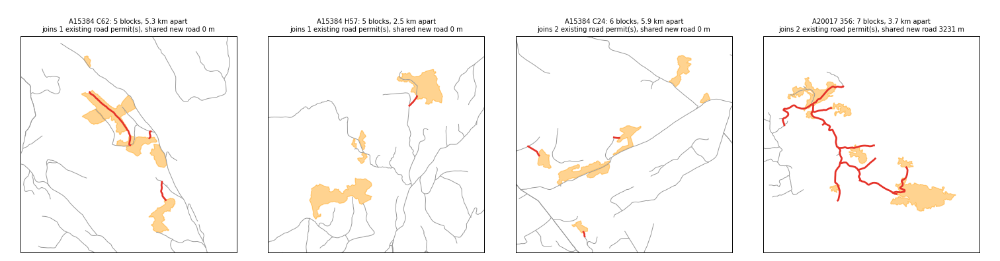

# BC access history: what public records can establish

Research notes from 2026-11-09, continuing the source review behind PR #94. The
question: from public BC records, can we tell which road was built for a block,
when it appeared, what else used it, and which structures its haul crossed? Each
finding was checked against live services on that date. The scripts that
reproduce the samples are in `scripts/forestry/access-research/`.

## Summary

| Finding                                                                                                                               | Strength                                            | What it gives the tool                                              |
| ------------------------------------------------------------------------------------------------------------------------------------- | --------------------------------------------------- | ------------------------------------------------------------------- |
| Road **section** names cite the cutting permit (CP) or block they were built for                                                      | 22/40 to 40/60 touching per district vs 0–1 control | A documented road→block link, province-wide                         |
| For blocks harvested since 2010, a touching road names the block in 23% of cases                                                      | 109 of 480 blocks, six districts                    | The share of recent blocks the name link resolves today             |
| Recent block spurs are amendments to old permits (median 19.5 years old)                                                              | 86 matched blocks                                   | `AWARD_DATE` cannot date a modern road; imagery or FOM must         |
| FOM plans name blocks and planned roads 6–15 months before harvest                                                                    | 19 of 104 blocks harvested 2022+                    | Planned access for the newest blocks, before roads reach FTEN       |
| Sentinel-2 dates a new road corridor to the season it was cleared                                                                     | Clean steps on 2024 and 2025 roads                  | Automatic "first seen" dates for roads built since 2017             |
| Built spurs join the nearest road only 26% of the time; grade and haul explain most of the rest                                       | 347 named block–road pairs                          | Rules and a reference set for drawing a road to a block             |
| Rules regenerate the junction within 150 m in 33% of held-out blocks (nearest point 29%); planning for blocks cut together helps most | 347 pairs, licence-split test                       | A saved reference set and a generator to improve against            |
| A setup (licence + CP) is cut in one season but spread over ~4.6 km, with a spur per block off one existing road                      | 294 setups, 1,434 blocks                            | Plan per setup; the right host road is chosen 70% of the time       |
| A block's own road appears with the harvest: median 22 days after the recorded start, 8% more than 6 months ahead                     | 96 roads dated with Sentinel-2                      | Treat a spur as absent until about the harvest season               |
| Recent section names (2010+) often contain the exact block ID (`N2E149.1000`)                                                         | 6–13 of 50 per district vs 0 control                | The same link, at block level, for modern roads                     |
| CP-block-shaped section **IDs** (`215-1F`)                                                                                            | 5/40 in Cascades                                    | Not reliable on its own; do not use without a name match            |
| Permit award dates, CP issue dates and harvest dates order into a sequence                                                            | Exact dates, different meanings                     | A bracketed timeline per block                                      |
| Historical air photos, catalogued with date, flight line and thumbnail                                                                | Visual, needs orientation                           | Before/after evidence for a road's appearance                       |
| RESULTS silviculture methods: machine work vs helicopter                                                                              | Dated, indirect                                     | When the road was drivable, and when it apparently stopped being    |
| Consolidated cutblocks along a road, by year                                                                                          | Dated, indirect                                     | Earlier use (road may predate its permit) and later reuse           |
| Ministry bridges sit on FSRs; licensee roads are mostly missing                                                                       | Structural gap                                      | Find structures along the haul route, not inside the block envelope |

## 1. The worked case: openings 11981 and 11984

### The road record names these blocks

PR #94 found R03890/A and /B beside both blocks but could not say why. PR #94
loads the FTEN road **segment** layer. The road **section** layer
(`WHSE_FOREST_TENURE.FTEN_ROAD_SECTION_LINES_SVW`) carries a name, an award date
and a location:

| Section        | Name in FTEN       | Length              |
| -------------- | ------------------ | ------------------- |
| R03890 A, B, C | `CP 407/8  MAIN`   | 4.61, 2.51, 2.32 km |
| R03890 H, I    | `CP 407   AMEND 2` | 0.72, 0.76 km       |
| R03890 F, G    | `CP 406   AMEND 1` | 3.09, 0.65 km       |

Opening 11981 is A18165 CP 407 and opening 11984 is A18165 CP 408. The
licensee's road permit names its mainline as the access for those two cutting
permits, with spurs added by amendment.

### The dated sequence

| Date               | Event                                                                            | Source                        |
| ------------------ | -------------------------------------------------------------------------------- | ----------------------------- |
| 1971, 1977         | Blocks harvested that touch sections C and F                                     | Consolidated cutblocks        |
| 1980-11-01         | Road permit R00646 awarded; its timber mark `R0646` is on R03890/A               | HBS timber mark R0646         |
| 1986-05-29         | Air photo: main road and its bend present, no road southwest, 11981 still forest | Frame bcc397 #65              |
| 1988-04-15         | R03890 awarded, "WILLOW RIVER & BOWRON RIVER", 15.9 ha of right-of-way timber    | FTEN road sections; HBS R3890 |
| 1988-07-01         | 11984 reported disturbance start                                                 | RESULTS                       |
| 1988-12-01         | CP 407 ("willow river") and CP 408 ("BEAVER FSR") issued                         | FTEN harvesting authority     |
| 1989-01 to 03      | 11981 harvested (winter)                                                         | RESULTS                       |
| 1989-04, 1989-09   | 11984 machine windrowing, then burning                                           | RESULTS activities            |
| 1990-06            | Both blocks planted                                                              | RESULTS activities            |
| 1990-07-20         | Air photo: fresh clearcut crossed by a road with spurs and landings              | Frame bcb90083 #151           |
| 1991-10 to 1993-09 | Machine mounding on both blocks                                                  | RESULTS activities            |
| 1992–2007          | 16 more openings harvested along sections A, F, H, I                             | Consolidated cutblocks        |
| 1995 onward        | Brushing and fertilizing by helicopter                                           | RESULTS activities            |

What this establishes, and what it doesn't:

- **Built for:** R03890/B was permitted in 1988 under a name citing CPs 407/408,
  and the photos bracket its appearance between May 1986 and July 1990. That
  supports "built for CP 407/408" for section B.
- **Possibly older:** blocks from 1971 and 1977 touch sections C and F, so parts
  of the "MAIN" may re-permit an older road. The 1977 and 1986 frames over C and
  F would settle it.
- **Reused:** the mainline served 16 later openings from 1992 to 2007. Its cost was
  shared well beyond 11981 and 11984.
- **Access lapsed:** after the 1993 mounding, every operation on these two
  blocks was by helicopter. This suggests, but does not prove, that the spurs
  were deactivated or impassable by 1995.
- **Not reused for the 2025 block:** opening 1801215 (2025, 27 m from R03890/B)
  has its own permit, R21894 (2018), with sections named `N2E149.1000` to
  `.4000` after its block ID. Adjacency alone would have attached it to R03890.

Open anomalies: 11984's disturbance starts five months before CP 408 was
issued, and R03890/A carries the timber mark of a 1980 Herrick Creek permit.
Both need the district file.

### Reading the air photos

The photo catalogue (`WHSE_IMAGERY_AND_BASE_MAPS.AIMG_PHOTO_CENTROIDS_SP`) gives
each frame's centre, date, scale, roll, frame and a 1250 px thumbnail. Over
these blocks it lists frames from 1963, 1965, 1967, 1968, 1972, 1977, 1986, 1990,
1992, 1994, 1996, 1997, 1999, 2002, 2005, 2006 and 2015.

The thumbnails are not georeferenced. Two things made them readable:

1. **Orientation from the flight line.** Consecutive frames on a roll give the
   flight bearing: 88° for roll bcb90083 (1990), 86° for bcc397 (1986). Both
   rolls flew east, and both frames matched the mapped roads only after a 180°
   rotation (south up). Check orientation per roll; don't assume north up.
2. **Footprint from scale.** A 23 cm frame covers 0.23 m × the scale
   denominator on the ground: 3.45 km at 1:15,000, 2.3 km at 1:10,000. Plotting
   FTEN geometry at that extent around the frame centre gives a sketch to match
   against. Real scale varies with terrain (1:15,900 here from the 5,639 m flying
   height and 305 mm lens).

This is enough to bracket a road's appearance. It is not survey-grade: only the
1996, 2005 and 2015 frames carry georeferencing metadata.

Thumbnails: [1986 #65](https://openmaps.gov.bc.ca/thumbs/1986/bcc397/bcc397_065_thumb.jpg),
[1990 #151](https://openmaps.gov.bc.ca/thumbs/1990/bcb90083/bcb90083_151_thumb.jpg).

### The haul route and its bridges

R03890 joins the Beaver FSR (forest file 7753), whose user-km rises eastward from
Prince George. The junction lies between the Willow River bridge (km 27.69) and
the Bowron River bridge (km 45.57):

| Crossing            | Structure      | FSR km | Rating | Last inspection | Side of junction   |
| ------------------- | -------------- | ------ | ------ | --------------- | ------------------ |
| G1-009              | Major culvert  | 13.67  | 91 t   | 2025-05-14      | Prince George side |
| G1-010 Willow River | Durable bridge | 27.69  | 91 t   | 2023-08-10      | Prince George side |
| G1-020 Bowron River | Durable bridge | 45.57  | 30 t   | 2023-07-16      | Far side           |
| G1-021 Purden Creek | Durable bridge | 63.50  | 91 t   | 2023-07-06      | Far side           |

A haul to Prince George crosses G1-010 and G1-009. The public layer has no
installation dates, so whether these structures, or predecessors, carried the
1989 haul is open. PSCIS lists six closed-bottom crossings on Bateman Creek Road
and the Beaver FSR near the blocks, assessed 2014-07-17 as fish barriers; that
is fish-passage evidence, not truck access.

## 2. How reliable are section names?

### Names that cite a CP

All 268,776 road-permit sections were pulled (attributes only, paged at 10,000).

| Pattern in name or ID                                      | Sections                | Share |
| ---------------------------------------------------------- | ----------------------- | ----- |
| Blank name                                                 | 53,036                  | 20%   |
| Name cites a CP (`CP 407`, `CP399-5-SP3`, `A19042 CP 113`) | 20,415                  | 7.6%  |
| CP and block, from name or ID                              | 17,271                  | 6.4%  |
| CP and licence in the name                                 | 6,844                   | 2.5%  |
| ID shaped CP-block (`215-1F`)                              | 9,560 not already named | 3.6%  |
| `SPUR`                                                     | 8,250                   | 3.1%  |
| `AMEND n`                                                  | 6,200                   | 2.3%  |
| `DEACT`                                                    | 377                     | 0.1%  |

CP-citing names are concentrated in the interior: Cariboo-Chilcotin (5,434),
Okanagan Shuswap (3,964), Quesnel (3,083), Prince George (2,899). They peak in
permits awarded in the 1990s (13,184).

Validation: for a fixed-seed random sample of sections citing one CP, look for
blocks of that CP within 2 km of the road, keyed by licence when the name gives
one and by the road's client otherwise. FTEN blocks first, then RESULTS
openings. Control: the same search with a CP number the name does not cite
(CP + 37).

| District                            | Sample | Cited CP touching (≤ 20 m) | Within 250 m | None within 2 km | Control touching |
| ----------------------------------- | ------ | -------------------------- | ------------ | ---------------- | ---------------- |
| Prince George (FTEN, then RESULTS)  | 60     | 40                         | 48           | 9                | 0                |
| Cariboo-Chilcotin                   | 40     | 22                         | 23           | 14               | 0                |
| Okanagan Shuswap                    | 40     | 23                         | 25           | 12               | 1                |
| Cascades, CP-block section IDs only | 40     | **5**                      | 5            | 33               | 0                |

A CP-citing name is strong evidence; about one in four has no block found in
either dataset, which reflects incomplete block coverage, not a wrong name. The
CP-block section-ID pattern fails in the Cascades, where such IDs are road
numbering. Use an ID only when the name or a block ID corroborates it.

When the name also names a block, the named block touched the road in 13 of 33
Cariboo-Chilcotin cases. Block labels vary between road and block records
(`1`, `01`, `1A`), so match leniently and show the reviewer both values.

### Names that contain a block ID

Newer permits name sections after the block: `N2E149.1000`, `MUS342.1000`,
`NAT404-B`, `ACCESS OVR064`, `PHI004_SPUR_1`. A generic matcher, any name token
equal to the `CUT_BLOCK_ID` of a block the road touches, was tested on sections
awarded since 2010. Control: the same names paired with another sampled road's
blocks.

| District      | Sample | Touching any block | Name contains a touching block's ID | Control |
| ------------- | ------ | ------------------ | ----------------------------------- | ------- |
| Prince George | 50     | 47                 | 6                                   | 0       |
| Mackenzie     | 50     | 45                 | 13                                  | 0       |
| Vanderhoof    | 50     | 50                 | 12                                  | 0       |

Precision looks high (no control hits); recall is modest because many sections
use road numbers instead (`2200.100`).

### Permit dates are permit dates

`AWARD_DATE` on a section is the permit's award date, shared by every section:
all 55 R00646 sections carry 1980-11-01, though some name CPs harvested in the
2000s. A section added by amendment has no public date of its own. Bound it with
the cited CP's `ISSUE_DATE` (harvesting authority layer) and the amendment
order, and label the award date as the permit's.

79,392 road-permit sections are `RETIRED`; the most common retirement years are
2020–2026, so retirement is mostly recent administrative clean-up rather than a
record of when roads were built or closed.

## 3. Evidence of when a road was drivable

RESULTS activity treatment units (`WHSE_FOREST_VEGETATION.RSLT_ACTIVITY_TREATMENT_SVW`)
carry dated activities with method codes:

| Method                            | Example codes                            | Implies                                    |
| --------------------------------- | ---------------------------------------- | ------------------------------------------ |
| Machine site preparation          | `SP ME MOUND`, `SP ME WINDR`             | Equipment reached the block by road        |
| Burning, ground planting, surveys | `SP BU`, `PL PL CTAIN`, `SU … PLOT`      | Crews reached it; road likely, not certain |
| Helicopter                        | `BR CA HELI`, `FE CA HELI`, `SU FE HELI` | No ground access needed                    |

On 11981 and 11984, machine work runs to 1993 and every later treatment is by
helicopter. Across a district this could flag likely deactivation dates. It is
indirect: helicopters are also chosen for cost or season.

## 4. Earlier use and later reuse

Consolidated cutblocks (`WHSE_FOREST_VEGETATION.VEG_CONSOLIDATED_CUT_BLOCKS_SP`)
within 100 m of R03890, by start year:

| Years     | Openings                | Sections touched |
| --------- | ----------------------- | ---------------- |
| 1971–1978 | 4                       | C, F             |
| 1988–1990 | 3 (11984, 11981, 11987) | A, B, C          |
| 1992–2007 | 16                      | A, F, H, I       |
| 2025      | 1 (own permit R21894)   | beside B         |

Harvests that touch a section before its permit's award date are a cheap,
province-wide test for "this permit re-used an older road". Harvests after it
show reuse, which is what shared-cost comparisons need.

## 5. Structures

The Ministry bridge and major-culvert inventory (ArcGIS layer 38) has 7,847 rows;
only 305 are on road permits, and only two of those on CP-named sections. The
rest are on FSRs. Structures that served a block are therefore found by
following its road to the FSR and on to the destination. PSCIS has 19,905
assessments, 1,287 on road-permit tenures; it fills part of the licensee-road
gap, with fish-passage meaning only.

## 6. Other sources checked

| Source                                                   | Result                                                                                                          |
| -------------------------------------------------------- | --------------------------------------------------------------------------------------------------------------- |
| FTEN harvesting authority (ArcGIS layer 12)              | CP `ISSUE_DATE`, `EXPIRY_DATE`, `EXTEND_DATE`, `LOCATION`; road permits are not in this layer                   |
| HBS timber mark lookup (`/pub/hbs/opq/P480.jsp`)         | Road permit award date, location and right-of-way area by timber mark; `robots.txt` asks for a 10 s crawl delay |
| HBS monthly scaling                                      | Only from 2011-01, 12-month windows, delivered by email; road timber marks can be licence-wide (`53/0R1`)       |
| FOM road sections and cutblocks (layers 31, 32)          | 52,559 planned roads, 47,654 planned blocks, linked by `FOM_ID` and planned date; plan-level only               |
| Road use permits (layer 28)                              | None on Beaver FSR or in the study area                                                                         |
| BCTS planned roads and road-permit blocks (layers 3, 27) | Not yet examined                                                                                                |

## 7. Recent blocks (harvested since 2010)

FTEN holds 101,651 blocks with a disturbance start in 2010 or later, and 47,004
road-permit sections were awarded in that period. The sample: 80 blocks per
district, fixed seed, in Prince George, Mackenzie, Vanderhoof, Quesnel,
Cariboo-Chilcotin and Okanagan Shuswap (`recent_blocks.py`, `recent_blocks2.py`).

### How often a touching road names the block

For each block, every FTEN road section within 20 m was checked. Its name was
compared with the block's own ID, CP and licence, and with every block ID within
2 km, so a road named after a neighbour is caught.

| Best link found                                  | PG  | MK  | VA  | QU  | CC  | OS  | All 480   |
| ------------------------------------------------ | --- | --- | --- | --- | --- | --- | --------- |
| Names **this block** (block ID or CP-block pair) | 32  | 22  | 15  | 11  | 22  | 7   | 109 (23%) |
| Names this block's CP only                       | 0   | 0   | 0   | 1   | 3   | 0   | 4         |
| Names this block's licence                       | 1   | 0   | 2   | 7   | 3   | 1   | 14        |
| Names a **different nearby block**               | 5   | 3   | 10  | 6   | 6   | 4   | 34 (7%)   |
| Names a different licence                        | 0   | 0   | 0   | 12  | 2   | 0   | 14        |
| Roads touch, no name refers to anything nearby   | 31  | 54  | 50  | 42  | 38  | 64  | 279 (58%) |
| No FTEN road touches the block                   | 11  | 1   | 3   | 1   | 6   | 4   | 26 (5%)   |

The naming conventions found, all of which the matcher handles:

| Convention                     | Examples                                               |
| ------------------------------ | ------------------------------------------------------ |
| Block ID, then a road number   | `AKI067.1000`, `MUS342.1000`, `BAR028.1000`            |
| CP-block, with or without "CP" | `CP399-5-SP3`, `153-10 ACCESS 1`, `629-2(C)`           |
| Block ID with a suffix word    | `PHI004_SPUR_1`, `ACCESS OVR064`, `D677-D5 MAINLINE`   |
| Licence and CP                 | `A19042 CP 113`, `TFL52 CP 732`                        |
| Road numbering only (no link)  | `5823.01-12-01-01-01-`, `2200.100`, `R22169-AA`, blank |

The named-block share varies with each licensee's convention, not with how well
roads are recorded: Prince George and Mackenzie licensees mostly name spurs
after blocks; Quesnel and Okanagan Shuswap mostly number them. Where they
number them, the 58% "no reference" rows still carry the licensee and the
geometry, so adjacency, ownership and imagery have to carry the case.

A road named after a different nearby block (7%) is useful evidence too: the
road was built for the neighbour and this block reused it. In Quesnel, names
citing another licence (`A57831(2)-02` beside an A70435 block) show the same
pattern across timber sale licences.

Of the 14 matches that came only from the looser patterns (CP-block without
"CP", two-character block IDs), 12 were plainly correct (`843-2 ACCESS 1`,
`51-43 ACCESS 2`); two rested on the block label alone (`DRA-7K(A)`,
`NLIT-A1(C)`). Show the reviewer the matched text.

### Blocks with no road

Of the 26 blocks with no FTEN road within 20 m, most are woodlots or small
licences, and several are not real outlines. FTEN stores an unmapped block as a
0.6 ha triangle placeholder: `W0639`, `W1848` and `W0696` are such triangles, and
all 17 placeholders among the 81 "no road" blocks found across the samples were
woodlots ([layout study](bc-access-research-layout.md), section 3). A generator
must recognise them and draw nothing.

Mapped woodlot blocks do have roads: 37 of 40 sampled have one within 100 m,
and in 35 it is on a road permit held by the woodlot licensee. The Digital Road
Atlas and Integrated Roads add little beyond FTEN for woodlots (1 of 40). The
remaining "no road" blocks are the newest, whose roads were not yet in FTEN.

### Modern spurs live on old permits

For the 86 blocks matched by a block-ID name, the gap from the road permit's
award to the block's harvest start has a median of **19.5 years** (quartiles
12.1 and 28.4). Only 17 sat on permits awarded since 2010 (median lead 2.8
years). Licensees add each new spur as an amendment to a long-lived permit:
`MCG062.2000 A716,713` on R01860 (awarded 1984) served a block harvested in 2025. Never date a modern spur from `AWARD_DATE`. No permit was awarded after
its block's harvest started.

### Forest Operations Maps for the newest blocks

FOM plans (ArcGIS layers 31 and 32) became the public planning record from about 2021. Of the 104 sampled blocks harvested since 2022, 19 overlap a FOM cutblock
by more than 85%. Planned development dates run 6 to 15 months before harvest,
and FOM road names follow the same block-ID conventions (`AKI067.1000`,
`RCE-509 Access`, `MCB-713 Access 1`).

Comparing FOM planned roads with FTEN road sections beside 13 of those blocks:
65% of 21.7 km of planned road lies within 30 m of a permitted road. The gap is
roads not yet in FTEN (CHU131C, harvested February 2026: 0%), roads permitted on
a different line, or roads never built. Planned-versus-permitted is a check the
tool can show for any recent block with a FOM.

### Dating recent roads from Sentinel-2

Sentinel-2 L2A (10 m, from 2017) is free on AWS (Element 84 Earth Search STAC,
no key). Two tests on AKI067 (Mackenzie, harvested 2024-11-08 to 2024-12-19):

1. **Before and after.** In August 2023 the FTEN road lines west of the block
   run through unbroken forest; by August 2025 the corridors, the block and its
   neighbours are cleared along them. FTEN carried the road's geometry before
   the road existed on the ground.
2. **Time series.** Mean NDVI on a 10 m buffer of the access road outside the
   block, minus NDVI 40–80 m away, per scene with ≥ 80% clear pixels (SCL
   classes 4–7). Repeated on MAL015 (Vanderhoof, harvested 2025-01-27 to
   2025-02-28):

| Block  | Road outside block | Recorded harvest         | Last scene before  | First scene after  |
| ------ | ------------------ | ------------------------ | ------------------ | ------------------ |
| AKI067 | 2,754 m            | 2024-11-08 to 2024-12-19 | 2024-09-05, −0.013 | 2025-06-04, +0.294 |
| MAL015 | 200 m              | 2025-01-27 to 2025-02-28 | 2025-01-17, −0.028 | 2025-02-06, +0.211 |

Before the change, every scene sits between −0.04 and +0.06; after it, the
contrast climbs to +0.3 to +0.46 and stays there. AKI067's corridor was cleared
between September 2024 and June 2025; snow masked its winter scenes, which sets
the width of that bracket. MAL015's winter scenes stayed usable, giving a
three-week bracket that contains the recorded harvest start.

The signal measures corridor clearing. On a short spur like MAL015's, harvest of
the adjacent block can't be separated from the road itself, so read the result
as "first seen", not as a construction date. Scenes where several tiles overlap
agree to within about 0.03, so the script reads one tile per date.

A follow-up applied this to 146 blocks harvested since 2019
([timing study](bc-access-research-timing.md)). 96 roads could be dated: a
block's own road first appears a median 22 days after the recorded harvest
start and 5 days after the block itself shows as cleared, in the same imagery
interval as the block in 52 of 89 cases. Only 8% were visible more than six
months ahead, and none more than a year. Blocks show as cleared a median 97
days after their recorded start, partly because snow hides winter harvests and
partly because the record's start precedes felling: 13 blocks were still
standing more than 60 days after it. Each block's interval is saved in the
reference set (`first_seen`).

## 8. How roads are drawn to a block

The block-ID names give a set of blocks whose own road is known. That makes it
possible to ask what the design tool needs: given a block, where does its road
join the network, how far does it go, how steep is it, and what happens when a
road already exists?

**Data.** 347 block–road pairs: blocks harvested since 2010, in six districts,
where a touching road section's name contains the block's ID or CP-block pair.
For each pair, `build_pairs.py` saves the block, the sections named for it
(same permit, same name match), every FTEN road and block within 3 km, and the
blocks each road names. `analyze_pairs.py` measures the pair against the
Terrarium DEM (z13, from about 30 m source data) and FWA streams.
`summarize_pairs.py`, `network_choice.py`, `haul_direction.py`,
`contour_following.py` and `through_roads.py` produce the figures below;
`plot_pairs.py` draws contact sheets for checking them.

**Limits.** Grades come from a smoothed regional DEM and FTEN's permitted
geometry, so real pitches are steeper than these figures and short steep
pitches vanish; compare grades between cases, not with design limits. "Existing
road" means every other FTEN road except those named for blocks harvested more
than 90 days later; an unnamed road's age is unknown. The sample covers
licensees who name roads by block, so Quesnel and Okanagan Shuswap are thin.
One permit labels every section by CP and block number, so its single-digit
block over-matched a whole network.

### When a road already reaches the block (193 of 347, 56%)

The licensee builds no access leg. The named road is either a short landing stub
off the existing road (median 306 m outside the block, often under 150 m) or
an in-block road. Several stubs can be spaced along one edge road.

In-block roads **follow the contours**. Across 128 blocks with at least 150 m
of road inside, the road's mean grade is 0.39 of the block's terrain slope
(quartiles 0.29–0.49). On blocks steeper than 10% (median slope 16%), the
in-block road averages 5.9%.

### When the nearest road is away from the block (154 of 347, 44%)

| Measure                                  | Median | p75     | p90     |
| ---------------------------------------- | ------ | ------- | ------- |
| Distance to the nearest existing road    | 163 m  | 356 m   | 521 m   |
| Access leg actually built                | 546 m  | 1.06 km | 1.72 km |
| Leg length ÷ nearest-road distance       | 2      | 6       | 11      |
| Leg sinuosity (length ÷ straight)        | 1.1    | 1.1     | 1.4     |
| Leg maximum grade (100 m windows)        | 8%     | 12%     | 16%     |
| Straight junction-to-block maximum grade | 9%     | 13%     | 18%     |

Only **40 of 154** legs join the network at its nearest point to the block.
The other 114 join elsewhere, and four measurable reasons account for 82 of
them (72%):

| Reason                                                                | Cases               |
| --------------------------------------------------------------------- | ------------------- |
| A straight connection to the nearest road would exceed 12%            | 47                  |
| The joined point is closer to an FSR along the network (shorter haul) | 29 of 53 measurable |
| The nearest road belongs to a smaller, separate network               | 16                  |
| The nearest road is retired                                           | 13                  |

"Smaller, separate network" means the nearest road's network is not the joined
road's, is smaller within the 3 km window, and does not leave it. Cases are
keyed by block `OBJECTID` (`explain_elsewhere.py`); an earlier count matched by
block name, which repeats across licences, and read 34 of 60 for haul.

Grade separates the two groups most clearly: 47 of 114 "joined elsewhere"
cases had a straight alternative over 12%, against 8 of 40 that joined the
nearest point. Small streams do not: the legs actually built crossed slightly
more FWA streams (0.76 on average) than the straight alternatives would have
(0.50).

In 83 of the 114, the nearest road and the joined road belong to the same
connected network, so the choice was _where_ to join, not _which_ network.
Where it could be measured, the joined point saved 65 m to 6.3 km of haul to
the FSR in 29 of 53 cases; it cost haul in 15.

### The 32 cases those reasons leave

A follow-up study tested public layers against them, with the 40 legs that
joined the nearest point as a control ([full write-up](bc-access-research-junctions.md)):

| What distinguishes the joined point                                                             | Unexplained (32) | Joined nearest (40) |
| ----------------------------------------------------------------------------------------------- | ---------------- | ------------------- |
| The block's road is a development road, continuing past the block or to blocks cut later        | 16               | 8                   |
| The road joins the network at two or more points                                                | 8                | 1                   |
| The straight link crosses a wetland, lake, river or order-3+ stream that the built road avoids  | 6                | 0                   |
| The nearest road is another licensee's; the built road joined the licensee's own road or an FSR | 7                | 1                   |
| The nearest road names a block cut later, so it probably was not built yet                      | 6                | 3                   |

At least one fits 25 of the 32; seven remain unexplained. About 25 factors were
tested on small groups, so these are leads, not proof. Two results hold across
all 154 legs:

- **No built leg crosses an FWA wetland**, while 11 straight links would have.
  Lakes and rivers are avoided too.
- **Larger streams are avoided, small ones are not.** Built legs cross small
  streams as often as straight links, but avoid order-3+ streams more often
  than not.

Private land, the ALR and terrain-stability mapping could not be tested: the
sampled blocks barely touch them.

**DEM resolution.** BC's public 1 m LiDAR tiles (LidarBC) covered 108 cases.
Over 100 m windows, straight-link grades changed by a median of +0.3 points
(correlation 0.91 with Terrarium), and built legs read 0.7 points flatter. The
12% split holds but does not sharpen, so the regional DEM is enough for choosing
a junction. LiDAR does matter for checking a drawn road's short pitches: over
40 m windows it reads about 2.5 points steeper than Terrarium.

Legs run uphill to the block in 100 cases, downhill in 64 and level in 83, so
there is no general rule about haul direction relative to slope.

### Roads through the middle of a block

A road through the middle of a block is often not the block's own road:

| Road crossing the block               | Blocks   | What lies beyond it                                                    |
| ------------------------------------- | -------- | ---------------------------------------------------------------------- |
| Through-road not named for this block | 60 (17%) | Mostly blocks harvested **earlier** (22 of 35 that continue to blocks) |
| The block's own road, passing through | 41 (12%) | Blocks harvested around the same time (10) or **later** (10)           |
| The block's own road, ending in it    | most     | Nothing; 302 of 346 named road pieces end inside the block             |

The first row is a block laid out around a road that already served earlier
harvest: the block often sits on both sides of it, sometimes split along it,
and the road named for the block is only a short stub. The second row is a
development road, built for this block and continuing to blocks cut alongside
or after it. Dead-end in-block roads reach a median 40% of the way to the
block's deepest point.

### How much road a block gets

| Measure                                    | p25   | Median | p75     |
| ------------------------------------------ | ----- | ------ | ------- |
| Block area                                 | 18 ha | 42 ha  | 78 ha   |
| Road named for the block                   | 305 m | 815 m  | 1.87 km |
| Named road per hectare                     | 8 m   | 25 m   | 49 m    |
| Share of the block within 300 m of a road  | 50%   | 80%    | 100%    |
| Distance that 90% of the block lies within | 185 m | 342 m  | 589 m   |

These figures use FTEN roads only, which undercount in-block road. A follow-up
study ([layout study](bc-access-research-layout.md)) measured the government's
Integrated Roads layer on the same pairs and on 210 more blocks spread across
slope classes. It carries 1.3–2.2× FTEN's in-block road and gives tighter
targets:

| Block class (mean slope) | In-block road | 90% of the block within | Contour roads apart, down the slope |
| ------------------------ | ------------- | ----------------------- | ----------------------------------- |
| Flat, under 15%          | 40 m/ha       | 176 m                   | 181 m                               |
| 15% and steeper          | 51–58 m/ha    | 124–152 m               | 105–144 m                           |
| Coast, 45% and steeper   | 68 m/ha       | 114 m                   | 108 m                               |

Layout changes at about 15% slope, not at the 35–40% usually associated with
cable yarding; no public field records the harvest system, so the classes are
by slope. In-block road grade falls from 0.37 × slope on flat ground to 0.20 ×
slope at 45% and steeper, levelling off near 10%. Most road runs within 60 m of
the block boundary, and the top road sits in the top third of the block in only
12–28% of blocks. Landing stubs number about 0.65 per 10 ha, 70–110 m long and
250–350 m apart along the host road.

### The cutting permit as a whole

A block is usually one of several in a setup: the licence and cutting permit
(the licence alone for timber sales without CPs) under which blocks are planned,
permitted and roaded together. `build_setups.py` fetched every FTEN block of
the 323 setups behind the 347 pairs, and every road section named for any of
their blocks or their CP; 29 setups spread over more than 15 km were left out.
`setup_metrics.py` and `setup_hosts.py` measured the remaining 294.

| Setup measure                                    | Median | p75    | p90     |
| ------------------------------------------------ | ------ | ------ | ------- |
| Blocks                                           | 3      | 6      | 10      |
| Distance between its two farthest blocks         | 4.6 km | 7.4 km | 10.3 km |
| Years between first and last harvest start       | 0      | 1      | 2       |
| Road named for the setup                         | 3.4 km | 7.4 km | 16.3 km |
| Places its named roads join the existing network | 3      | 6      | 15      |

- **A setup is cut together but spread out.** Half are harvested within one
  season, yet their blocks sit kilometres apart.
- **Its blocks mostly get their own spurs off the existing road.** Of 1,434
  blocks in setups with two or more, 77% touch a road named for the setup, 22%
  touch only existing roads, and under 1% touch none.
- **One existing road usually carries the setup.** In 116 of 237 setups every
  join is on a single existing road permit; in 80 it is two. A median 80% of a
  setup's joins are on its most-used existing road; 63 setups join an FSR.
- **Shared new road is the exception.** Routing each block back to where the
  setup's roads meet the network, only 45 of 239 setups use any new road for two
  or more blocks, and in those it is a median 27% of their new road.

So the common layout is a comb: an existing road, often a mainline or FSR, with
a short spur to each block, all cut in one or two seasons. The development road
of section 8 (a new road continuing through the block to others) is the less
common pattern, seen in about one setup in five.

The first three hang their spurs off one or two existing roads; the fourth
(A20017 CP 356) built 3.2 km of shared new road to reach its blocks.

### What this suggests for drawing a road to a block

1. **Start from the network, not the nearest point.** Offer junction
   candidates along every existing road within about 1 km, scored by new road
   length, grade, and haul distance along the network to the FSR or outlet.
   The nearest point won only 26% of the time.
2. **Treat a steep straight connection as a reason to go around.** A
   connection over about 12% on the regional DEM was the strongest single
   predictor of joining elsewhere; expect the leg to be about twice the
   nearest-road distance.
3. **Skip retired roads and small isolated fragments** as junctions.
4. **If a road already reaches the block, draw no access leg.** Add landing
   stubs and contour-following in-block roads so 90% of the block is within
   about 175 m on flat ground and 150 m from 15% slope up.
5. **Ask whether the road should continue.** If blocks lie beyond, a
   development road through the block is the observed pattern; if an existing
   road crosses the block, lay the block out around it.
6. **Plan the setup, not the block.** Find the existing road that carries the
   setup's blocks and spur each block off it; draw shared new road only when
   blocks lie beyond reach of the existing network.
7. **Skip placeholder blocks** (0.6 ha triangles) and look for a woodlot's
   access on its own licensee's permits first.
8. **Use these pairs to calibrate the route search.** The 347 pairs are a
   reference set: run the tool's own search from each block and compare its
   junction, leg length and grade with what was built.

## 9. Generating roads from the rules

The pairs are saved as a reference set in
`examples/forestry/access-history/reference-pairs/` (GeoJSON, index and a map
viewer; its README documents every field). For each block, the generator
(`generate_road.py`) removes the real road, applies the rules above, and is
scored against what was built.

### The rules as implemented

1. If an existing road reaches the block (≤ 20 m), build no access leg.
2. Otherwise consider joining points every 40 m along existing roads within
   1 km. Skip retired roads and isolated fragments (under 1 km of connected
   road that does not leave the 3 km window). Roads named for blocks cut more
   than 90 days later are not "existing".
3. Cost new road on a 20 m grid by length × (1 + A × grade above 6%), blocking
   steps steeper than GMAX.
4. Score each joining point by build cost + W_HAUL × haul distance along the
   network to an FSR, and join at the best one.
5. Inside the block, add branches with a doubled grade penalty until 80% of
   the block is within 300 m of a road, stopping each branch 150 m short of the
   point it was aimed at.
6. **Group rule** (`generate_group.py`): plan for the block together with
   blocks within 1.5 km cut within ±2 years, growing roads from the network to
   the cheapest-to-reach unconnected block each time and reusing roads already
   added.
7. **Water** (version 2): FWA wetlands, lakes, rivers and reservoirs outside
   the block are impassable.
8. **Larger streams** (version 2): entering an order-3+ FWA stream costs an
   extra 200 m of road.
9. **In-block layout by slope** (version 3, replacing rule 5's targets): 90%
   of the block within 175 m when its mean slope is under 15%, 150 m otherwise,
   with a strong grade penalty above 6% so branches hold the contour.
10. **Placeholders** (version 3): a 0.55–0.65 ha triangle gets no road.

### Calibration

`calibrate_generator.py` tried A ∈ {5, 15, 40}, GMAX ∈ {14%, 18%, 24%} and
W_HAUL ∈ {0, 0.03, 0.1, 0.3, 1}, on the 141 blocks that needed an access leg
and had a clear real junction. Blocks were split by a hash of the licence, so a
licensee's road system sits entirely on one side; settings were chosen on the
training half (75 blocks) and scored on the test half (66).

| Setting tried                                                       | Result                                                                           |
| ------------------------------------------------------------------- | -------------------------------------------------------------------------------- |
| Best: A = 5, GMAX = 14%, W_HAUL = 0                                 | Test: joining point within 150 m in 33%, within 300 m in 41%, median error 583 m |
| Nearest-point baseline                                              | Test: 29% within 150 m, 38% within 300 m, median 672 m                           |
| Any W_HAUL > 0                                                      | No better than 0                                                                 |
| Routing to the block core instead of its edge (`calibrate_core.py`) | 30–32% within 150 m: no better                                                   |

Haul distance explained choices after the fact (section 8) but did not help
predict them: the network beyond the 3 km window, and the destination mill, are
unknown to the generator.

Version 2 (`calibrate_v2.py`) added the follow-up study's rules at A = 5,
GMAX = 14%, W_HAUL = 0, with the same split:

| Rule added                                          | Test: within 150 m | Test: within 300 m | Test: median error |
| --------------------------------------------------- | ------------------ | ------------------ | ------------------ |
| None (version 1)                                    | 33%                | 41%                | 583 m              |
| Water impassable                                    | 35%                | 44%                | 400 m              |
| Order-3+ stream crossing +200 m                     | 36%                | 45%                | 451 m              |
| Both (**version 2**)                                | 36%                | 47%                | 317 m              |
| Another licensee's permit road +300 m as a junction | 32%                | 39%                | 611 m              |
| Drop roads permitted after the harvest start        | 32%                | 39%                | 634 m              |

Water and larger streams help; on the training half they made no difference
either way, so the gain is modest. Preferring the licensee's own roads and
dropping later permits explained choices in the follow-up study but made
predictions slightly worse, so version 2 leaves them out. Across all 141
blocks, version 2 puts the joining point within 150 m in 33% and within 300 m
in 40% (version 1: 31% and 37%).

### Results on all 347 blocks (version 2)

| Check                                                   | Result                                    |
| ------------------------------------------------------- | ----------------------------------------- |
| Joining point within 150 m of the real one (139 blocks) | 33% (nearest point: 27%)                  |
| Median joining-point error                              | 495 m (nearest point: 605 m)              |
| Generated leg's mean distance from the real leg         | median 183 m (straight to nearest: 289 m) |
| Generated leg length ÷ real leg length                  | median 0.53                               |
| Generated in-block road ÷ built (FTEN) in-block road    | median 1.47 (version 3)                   |

Generated legs are half as long as the real ones. The reason (`shared_legs.py`):
47 of 139 real legs pass other blocks cut in the same period or later, so they
were planned for several blocks. Those are where the single-block rule fails:

| Real leg                                           | Blocks | Junction within 150 m | Median junction error | Real ÷ generated length |
| -------------------------------------------------- | ------ | --------------------- | --------------------- | ----------------------- |
| Also passes blocks cut in the same period or later | 47     | 15%                   | 1,094 m               | 3.4×                    |
| Serves this block only                             | 92     | 42%                   | 300 m                 | 1.7×                    |

The group rule raises how much of the real road the generated one follows
(`corridor_agreement.py`; share of the built road outside the block lying near
generated road):

| Built road near generated road | Single block | Group rule |
| ------------------------------ | ------------ | ---------- |
| Within 150 m, all legs         | 26%          | 28%        |
| Within 300 m, all legs         | 37%          | 43%        |
| Within 300 m, shared legs      | 26%          | 36%        |
| Blocks with ≥ 50% within 150 m | 22%          | 26%        |

Version 3's in-block layout lands inside the layout study's ranges:

| Block class           | Generated in-block road | Target (acceptable) | 90% of block within | Target |
| --------------------- | ----------------------- | ------------------- | ------------------- | ------ |
| Flat, under 15% (229) | 35 m/ha                 | 40 (15–55)          | 160 m               | 175 m  |
| 15% and steeper (110) | 42 m/ha                 | 55 (35–80)          | 140 m               | 150 m  |

It generates about 1.5× the in-block road FTEN shows as built, in line with
Integrated Roads carrying 1.3–2.2× FTEN's in-block road.

### At the setup level

`setup_generate.py` generated roads for 115 whole setups (2–8 blocks, under
6 km across) in two ways: each block connected to its own best existing road,
or every block connected to one common host road chosen to minimise the setup's
total cost. 68 had blocks needing access and a known real host road.

| Check                                                            | Independent | Common host |
| ---------------------------------------------------------------- | ----------- | ----------- |
| Blocks whose chosen existing road is one the setup really joined | 70%         | —           |
| The setup's chosen road is its most-used real host road          | —           | 62%         |
| Setup's named road outside its blocks within 150 m of generated  | 22%         | 21%         |
| Within 300 m                                                     | 32%         | 29%         |

Picking the right existing road is fairly predictable: seven blocks in ten
connect to a road the setup really used. Forcing one common host does not help,
because independent choices already land on the main host most of the time.
The exact route is where the rules still fall short.

### What the rules capture and what they miss

They capture the structure: no access leg when a road reaches the block, gentle
grades with steep straight lines avoided, contour-following in-block roads at
about 25 m/ha, roads planned for the blocks cut together, and water bodies and
larger streams avoided. Where a road serves one block only, the joining point
lands within 150 m four times in ten.

They miss the exact junction and route most of the time. In the misses
(`generated-vs-built.png` in the reference set shows eight), the real road joins
a farther road the rules had no reason to choose. Still missing: landings and
the yarding plan, soils, the destination mill, and roads whose age the data
cannot show (an unnamed road that was not there yet). A finer DEM is not the
gap: 1 m LiDAR did not change the junction findings (section 8).

## 10. What this means for the tool

1. **Load road sections, not just segments.** Join on `FOREST_FILE_ID` +
   `ROAD_SECTION_ID` and keep the name, award date, amendment and location.
   Storing the layer is cleared for PG Maps; snapshot it in
   `vendor/bcdatamapper` like other scraper-owned data.
2. **Add an evidence class: "named in road permit".** Cite the section name
   verbatim. It records the licensee's planned access, so it sits with
   _Documented plan_, above _Nearby road_.
3. **Rank by it.** In "Roads near this block", a road whose section names the
   block's CP or block ID outranks a closer road that doesn't.
4. **Work backwards from a road.** Given a permit, list the CPs and blocks its
   sections name and the blocks harvested along it, by year.
5. **One timeline per block.** Permit award, CP issue, harvest interval,
   silviculture methods, photo years, and harvests along the road.
6. **Photo strip.** Frames before and after the harvest, with flight bearing
   and suggested rotation, and a reviewer field for "road absent / present".
7. **Structures along the route.** Trace to the FSR and outlet before searching.
8. **Match names against neighbours too.** Report "named for a different
   block" as reuse evidence, not as a miss.
9. **FOM for recent blocks.** Show the FOM plan, its planned roads and the
   share already permitted.
10. **"First seen" from Sentinel-2** for roads built since 2017, as a dated
    interval, alongside the air photo strip for older roads.

## Open questions

- Should a bulk HBS pipeline use a project email address for scaling reports?
- Why does R03890/A carry `R0646`, a 1980 Herrick Creek timber mark?
- Can the 1977 and 1986 frames over sections C and F confirm an older road?

## Reproducible queries

WFS base: `https://openmaps.gov.bc.ca/geo/pub/wfs?service=WFS&version=2.0.0&request=GetFeature&outputFormat=application/json`.
Use `CQL_FILTER` for bounding boxes (`BBOX(GEOMETRY, …)`; `BBOX(SHAPE, …)` for the
photo and consolidated-cutblock layers). Responses cap at 10,000 rows; page with
`startIndex` and `sortBy=OBJECTID`.

- R03890 sections: `typeNames=WHSE_FOREST_TENURE.FTEN_ROAD_SECTION_LINES_SVW&CQL_FILTER=FOREST_FILE_ID='R03890'`
- Road-permit sections: same type, `CQL_FILTER=FILE_TYPE_CODE='B01'`
- Photos over the blocks: `typeNames=WHSE_IMAGERY_AND_BASE_MAPS.AIMG_PHOTO_CENTROIDS_SP&CQL_FILTER=BBOX(SHAPE,-122.33,53.98,-122.27,54.025,'EPSG:4326')`
- Silviculture: `typeNames=WHSE_FOREST_VEGETATION.RSLT_ACTIVITY_TREATMENT_SVW&CQL_FILTER=OPENING_ID=11981`

ArcGIS base: `https://delivery.maps.gov.bc.ca/arcgis/rest/services/whse/bcgw_pub_whse_forest_tenure/MapServer`

- Cutting permits: `/12/query?f=json&where=FOREST_FILE_ID='A18165' AND CUTTING_PERMIT_ID IN ('407','408')&outFields=*`
- Beaver FSR structures: `/38/query?f=json&where=FOREST_FILE_ID='7753'&outFields=*`

HBS timber marks: POST `https://a100.gov.bc.ca/pub/hbs/opq/timberMarkQuery.do`
with `timberMark=R3890&actionType=Submit&pageName=P480`.
