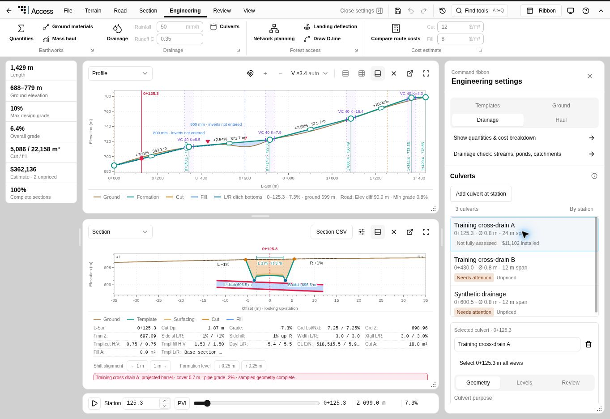
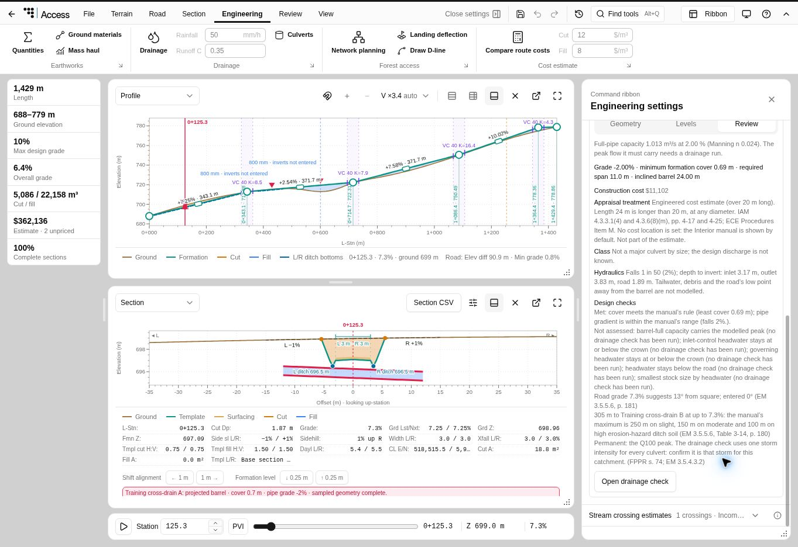
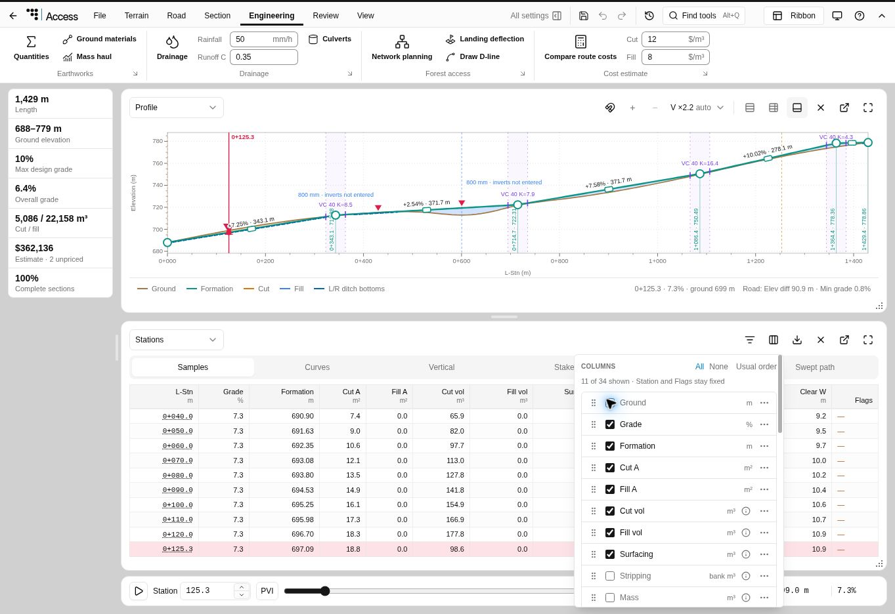
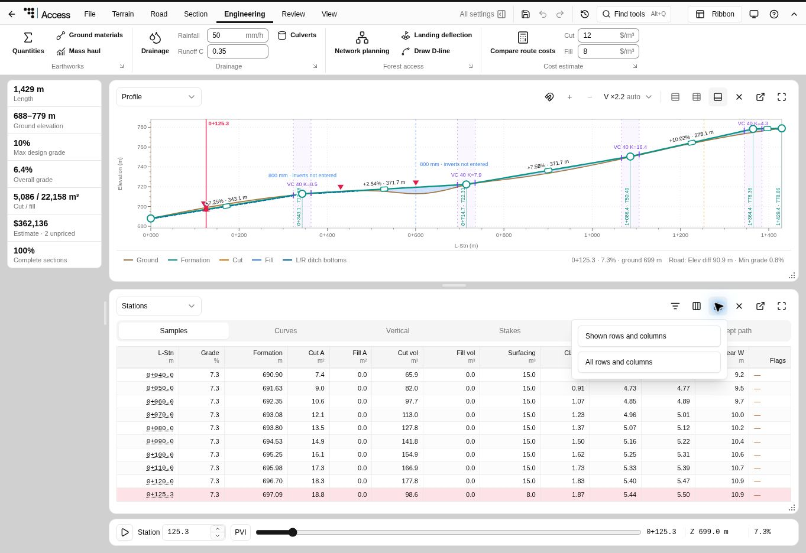
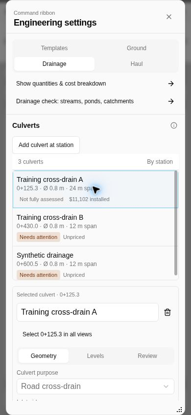
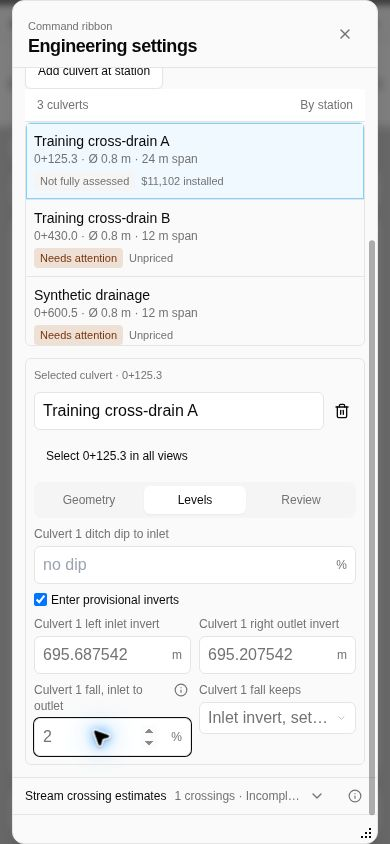

# Road-design interface review: selected culvert and table exports

This first implementation addresses the culvert editing workflow, station-table customization,
and several inconsistencies found during the interface review. The screenshots are captures of
the locally built application using the synthetic Hillside access training example. They are
not mockups. The project and downloaded CSV are included so the review can be reproduced.

## What changed

- **One culvert inspector.** A compact inventory lists every entered culvert by station, with
  its diameter, span, review status and installed cost or unpriced state. Selecting a row
  opens only that culvert's fields and selects its station in the connected views. Selection
  uses the culvert ID, so sorting and renaming do not change which object is edited. Invalid
  raw inputs remain accessible for repair even when no calculated schedule row exists.
- **Geometry, Levels and Review.** The selected inspector groups the existing controls into
  three tabs. The existing geometry, cost, provisional-invert and engineering-check fields
  remain available. Review status distinguishes a failed check from an assessment that
  still lacks drainage data; pricing is a separate status.
- **Column order and matching CSVs.** The station table uses the shared document-contents
  editor for visibility and ordering, with drag handles, move menus and Alt+arrow keys.
  Column order is remembered locally. The download menu offers **Shown rows and columns**
  and the existing full-column export as **All rows and columns**. Both respect the report's
  station range and interval; only the shown export also applies the flagged-only filter
  and selected column order. Station identifiers, flags and unknown-earthwork length remain
  in the CSV so data quality is not silently discarded. Totals sum the exported rows.
- **Exact vertical controls.** Adding a control at a typed station samples the road there,
  preserving fractional chainage instead of moving it to a nearby calculation station.
  Ground at elevation zero is accepted.
- **Consistent grade colours.** Plan and terrain presentation use the reviewed grade flags,
  including directional limits and permitted short pitches. Display simplification carries
  a breach across skipped calculation stations rather than losing it between visible points.
- **Precise cover feedback.** A small cover shortfall is reported with sufficient precision
  and its deficit, avoiding a warning that appears to compare two identical rounded values.
- **Recoverable plan-map failure.** A boundary around the plan pane keeps profile, section,
  tables and controls available if map initialization fails. Retry remounts only the map.

The larger design-model proposals from the audit remain follow-up work: persistent K-value
constraints, automatic culvert constraints, full-bench/minimum-cut-fill policies, graphical
template picking and additional 3D performance work.

## Desktop screenshots

### Inventory and linked profile/section

Three culverts are listed; only Training cross-drain A is edited. Its stored chainage is
125.321 m, displayed as 0+125.3 in the connected views.

### Review of the selected culvert

The existing geometry and engineering checks are grouped on Review. This synthetic example
has no drainage run, so the hydraulic checks remain explicitly unassessed.

### Column ordering

Ground was hidden and Grade was moved ahead of Formation using Alt+Up.

### Export choices

The shown CSV was downloaded through this menu. Its first columns are `station_m`,
`design_grade_pct` and `design_elevation_m`; the hidden ground-elevation column is absent.
See [the actual downloaded CSV](stations-shown.csv).

## Narrow-screen screenshots

These are the same application rendered in a **390 × 844 CSS-pixel iframe viewport** inside
desktop Chromium. They verify responsive layout, not a physical phone or mobile-browser
engine. The document's measured width and scroll width were both 390 px. The culvert inventory,
selected inspector and level controls fit the panel; the panel scrolls vertically.

| Inventory                                                    | Levels                                                                  |
| ------------------------------------------------------------ | ----------------------------------------------------------------------- |
|  |  |

## Reproduce the review

1. Build the checked-out branch with `npm run road-design:build` and serve
   `standalone/forestry-road-design/dist` using the documented local preview workflow.
2. Open [synthetic-review.road.json](synthetic-review.road.json) using **File → Open project file**.
   This file contains only the built-in synthetic training terrain/context and three example
   culverts created through the interface; it is not a surveyed or approved road design.
3. Use **Engineering → Culverts**, select Training cross-drain A and inspect Geometry, Levels
   and Review. The examples use the Profile and Section panes, with Plan hidden.
4. Change the detail pane to **Stations**. Open **Choose columns**, uncheck Ground, and use
   Alt+Up on Grade's move handle. Download **Shown rows and columns** and compare its headers
   with the included CSV. Column preferences are local to the browser, not stored in the
   project file.

## Verification and limits

- Full repository TypeScript check passed with the existing TypeScript 5.9.3 lockfile:
  `NODE_OPTIONS=--max-old-space-size=8192 npx tsc -b --pretty false`.
- **163 focused tests across 13 files passed**, covering the selected inspector, invalid
  inputs and ID selection, station/CSV behaviour, exact controls, grade presentation,
  engineering warnings and map-boundary recovery.
- ESLint and Prettier passed for all **33 changed/new TS and TSX files**.
- `npm run road-design:check-boundary` passed: 1,500 files reached, 1,180 owned / 320 shared,
  and 40 packages.
- `npm run road-design:build` passed and verified 12 page assets and 68 public files.
- Live browser checks covered adding/selecting/editing culverts, linked station/profile/
  section selection, project export and reopening, keyboard column reordering, shown CSV
  download, and the narrow-screen inspector.
- The available preview browser could not initialize **WebGL 2**. The map failure was
  observed and isolated by the new fallback. GPU-rendered plan/3D behaviour was **not visually
  verified**. A WebGL-capable browser pass remains a review step before merging.
- Browser-suite selectors were adapted for the selected inspector and its tabs; the full
  Playwright suite was **not run**. No GitHub Actions workflow was manually dispatched.
- Dependencies, lockfiles, submodule pointers and project-file schema are unchanged.

The screenshots show the production build before two final changes: generic error wording
in the non-WebGL map fallback, and reopening collapsed controls when a culvert is selected
in a non-ribbon layout. These changes were included in the final successful build; the
captured views use ribbon layout and do not display that error message.
