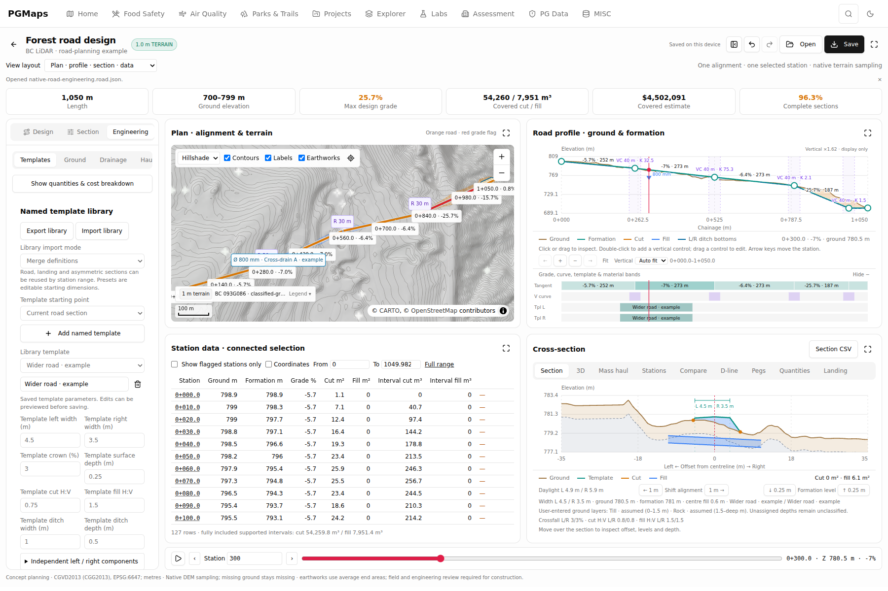
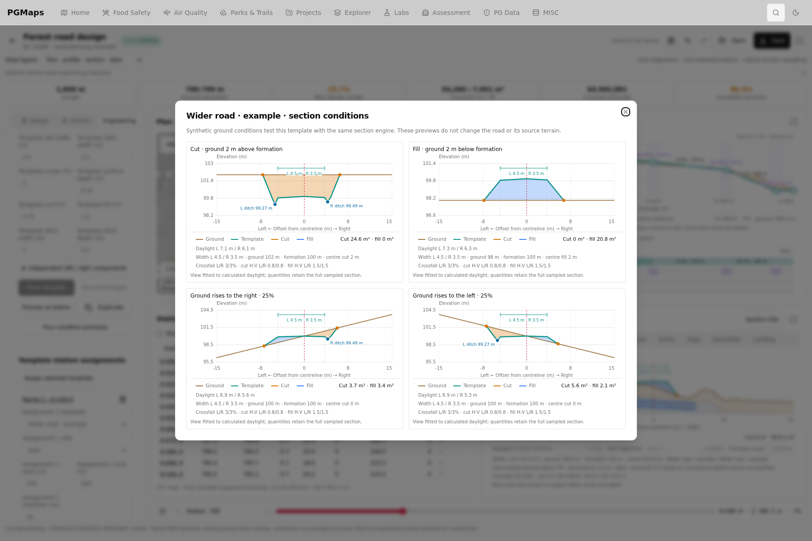
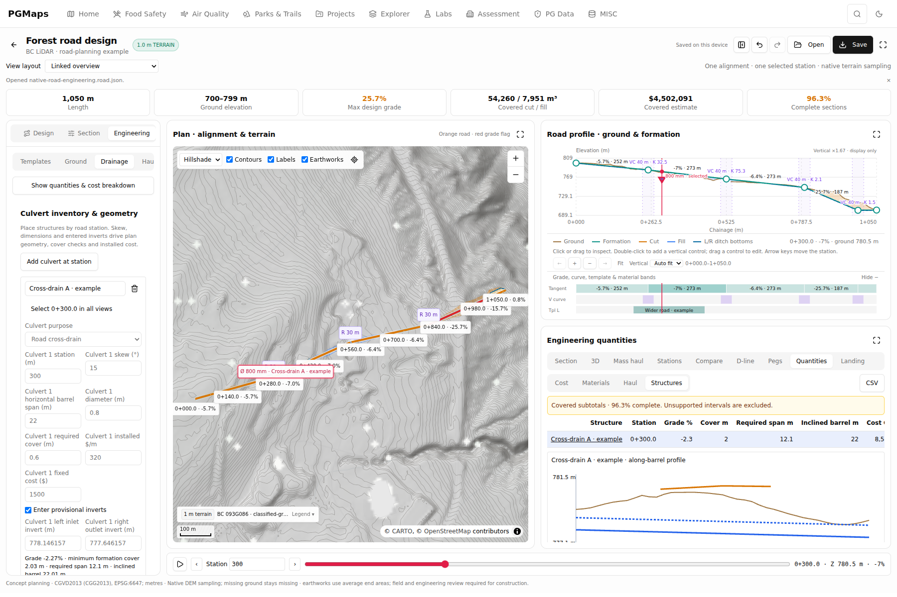
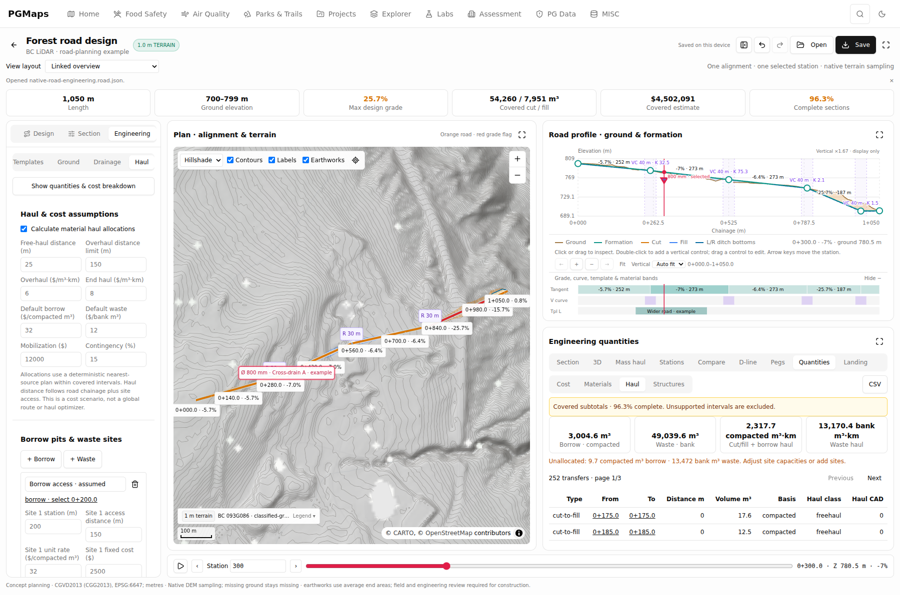
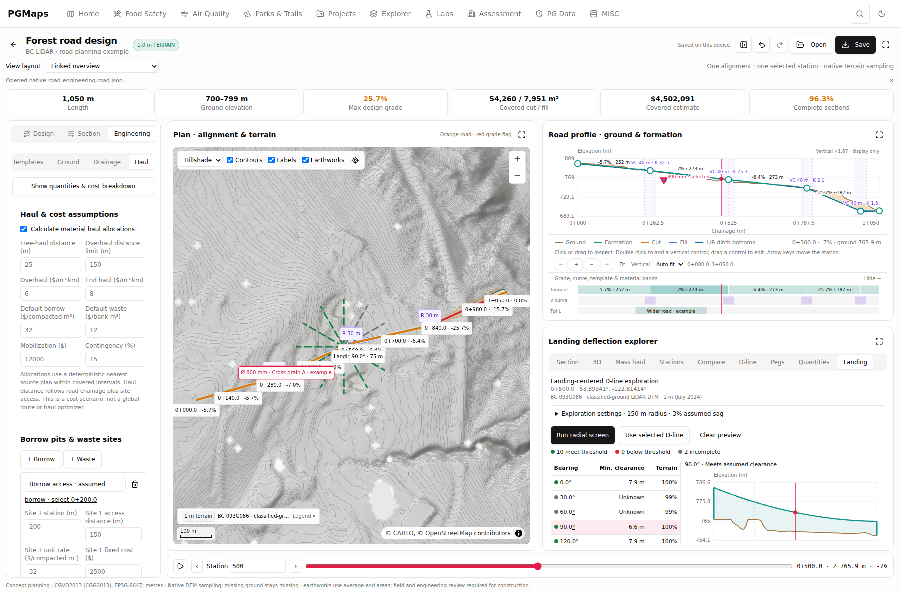
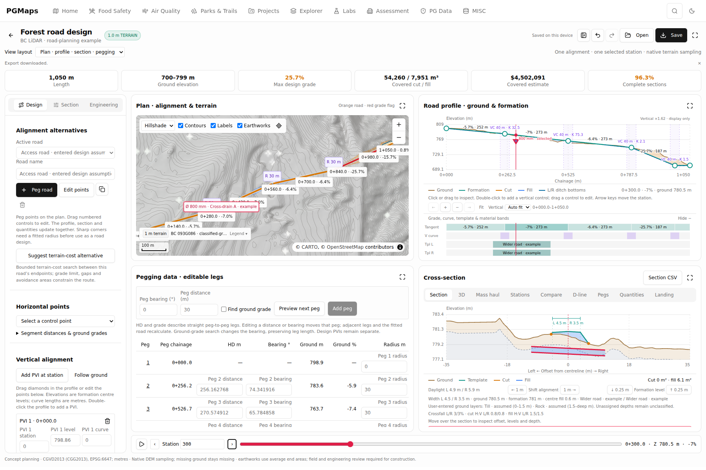
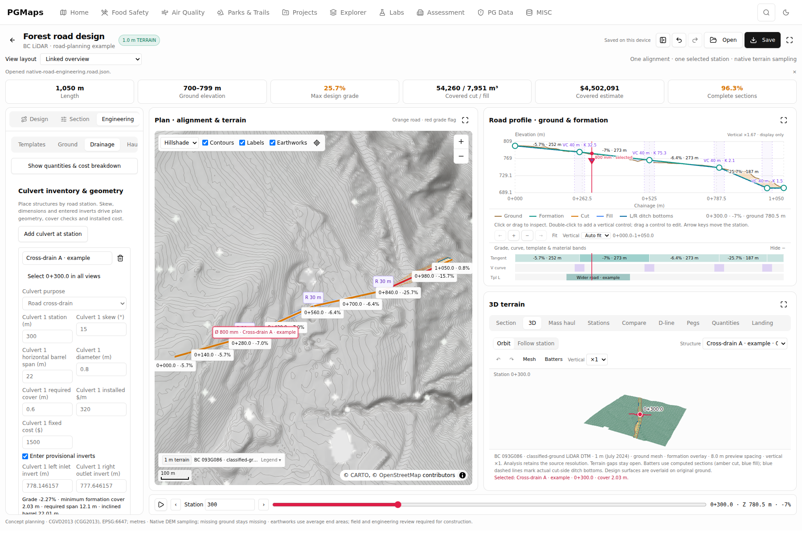
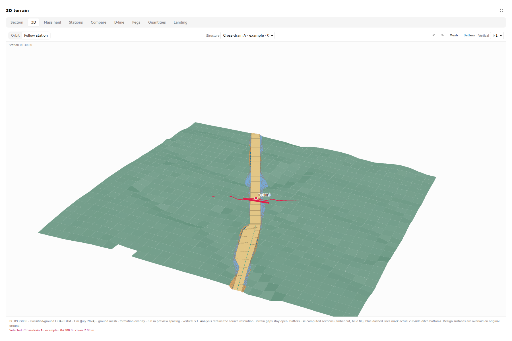

# Forestry road workspace: screenshot comparison

These are actual browser captures of the expanded PGMaps implementation on
2026-10-21. The [region-by-region reference matrix](forestry-road-reference-matrix.md)
audits all 15 supplied screenshots and distinguishes the original gaps, current
implementation, verification and remaining differences. The
[implementation notes](forestry-road-design.md) describe calculations and limits.

The workspace runs at `/dev/forestry/road-design` on the feature branch in
[PR #44](https://github.com/ahzs645/PGMaps/pull/44). These captures do not imply
that the PR has been merged or that the production site has been updated.

## Data used in the captures

The plan, profiles and sections use the published **1 m BC 093G086 ground DTM**,
EPSG:3157, with CGVD2013 (CGG2013), EPSG:6647 elevations in metres. The browser
loaded the actual remote GeoTIFF without a network stub and the saved project
retained SHA-256
`b1259f310ceed97a11f25883d7df609390b977a293b622f9e4946a7853ad00e2`.

The road is an editable example requiring review. Material horizons, rates,
template assignments, culvert inverts and haul sites are explicitly entered
example assumptions. They are not measurements inferred from LiDAR. The example
has steep grades and incomplete sections; the application displays those flags
and reports supported subtotals. The four template-condition previews below
deliberately use labelled synthetic ground to inspect a template in isolation.

No original commercial screenshot, manual page or installer is included here.

## Where the screenshot workflows now appear

| Reference region                                        | PGMaps implementation                                                                                                                            | Capture                    |
| ------------------------------------------------------- | ------------------------------------------------------------------------------------------------------------------------------------------------ | -------------------------- |
| S01, S10–S13: plan, profile, section and data           | Shared curved stationing; engineering layout; assigned templates, layers, schedules and selectable features                                      | 1                          |
| S06–S09: template library and section previews          | Named templates; independent sides; Save/Discard; actual-station preview; four ground conditions; station assignments and portable library       | 2                          |
| S01 and manual pp. 143–147: culverts                    | Editable skew/span/diameter/inverts; cover and barrel checks; linked map/profile/section/3D selection                                            | 3, 7, 8                    |
| S01, S13 and manual pp. 89–115: material, cost and haul | Entered horizons and reuse factors; component costs; borrow/waste sites; bank versus compacted quantities; supported haul transfers              | 4                          |
| S03, S05: D-lines and radial landing exploration        | Selectable radial fan; shared map/profile span cursor; support offsets/orientation; adopt as saved D-line; profile measurements and reports      | 5                          |
| S10, S11, S14, S15: pegging and immediate feedback      | Dedicated four-pane pegging layout; numeric distance/bearing edits; next-peg preview; sampled ground grade; shared live map/profile/section/data | 6                          |
| S02–S04: terrain and inventory context                  | Ground-only transects and exports; hillshade/elevation/slope/aspect; actual context-layer toggles; links to measured LiDAR inventory workspaces  | Reference matrix and tests |

## 1. Connected engineering workspace

The selected station is **0+300.0** in the map, road profile, cross-section and
station control. The section resolves the assigned left/right widths and entered
ground horizons. Profile bands show grade, vertical curves, templates, materials
and structures; they share the profile's zoom range. The compact map disclosure
keeps terrain provenance and legends available without covering the road.

## 2. Reusable templates and four ground conditions

The same section engine evaluates cut, fill and opposite side slopes. The
previews focus on the computed daylight geometry. Editing a saved template
creates an unsaved candidate: previews do not change the road until Save or an
explicit application. Discard restores the saved definition.

## 3. Culvert inventory linked to the map and profile

Selecting a structure selects its identity and road station across the views.
Structures at the same chainage remain independently selectable. The along-barrel
profile uses sampled terrain, entered inverts and the road formation; it reports
geometry and cover. Horizontal span and inclined barrel length have distinct
units and roles in quantities. This is geometric drainage review; hydraulic
sizing is outside the implemented scope.

## 4. Materials, haul movements and costs

The Haul view exposes free-haul and overhaul assumptions, site access distances,
borrow/waste events and selectable transfer rows. Material calculations keep
bank excavation, compacted fill and unusable material separate. Movements cannot
cross unsupported intervals, and unallocated quantities remain visible. The
method is a documented deterministic allocation within covered runs.

## 5. Landing fan and D-line inspection

The selected radial spoke is shared by the map, bearing table and clearance
profile. Changing the landing or inputs invalidates the preview; adopting a
spoke saves an editable D-line. Its effective supports, offsets and yarder
orientation drive the map and profile consistently. Unknown terrain produces an
incomplete result. Sag and clearance are geometric assumptions, not calculated
cable forces or payload capacity.

## 6. Dedicated pegging workspace

Plan, profile, section and peg data remain visible together. Horizontal distance,
bearing and radius edits change the shared road; next-peg previews update all
linked views without entering the saved project. The table distinguishes ground
grade from the independent designed vertical alignment. Commit, cancel and undo
are covered by browser tests.

## 7. Linked 3D terrain

The 3D view uses the same source and resolved road sections as the plan and
profiles. Formation, batters, actual cut-side ditches and structures retain
shared station/feature selection. The mesh is a display approximation; quantities
continue to use native terrain sampling.

## 8. Expanded terrain inspection

Each panel can expand independently. Follow-station and orbit camera modes,
rotation and vertical exaggeration change presentation without altering design
inputs or analytical quantities.

## Reopen the example and inspect its outputs

Download the project and open it with the road workspace's **Open** button. It
contains the entered assumptions and source metadata; reopening the remote DTM
requires connectivity and checks the recorded source identity.

- [Editable native-terrain example](assets/forestry-roads/native-example.road.json)
- [Engineering quantity CSV](assets/forestry-roads/native-example-quantities.csv)
- [Road report PDF](assets/forestry-roads/native-example-report.pdf)
- [D-line report PDF](assets/forestry-roads/native-example-dline.pdf)
- [Road report HTML](assets/forestry-roads/native-example-report.html)
- [D-line report HTML](assets/forestry-roads/native-example-dline.html)

The exported road and D-line reports were rendered to A4 and inspected for
readable charts, source details, units, repeated table headers and missing-data
status. The final implementation passed **125 unit/integration tests** and
**15 browser workflow/view tests**, with six affected browser cases rerun after
the final presentation fixes. Browser assertions inspect actual map features and
coordinates as well as visible labels. Full TypeScript, focused lint/formatting
and production build checks also passed. The native capture session reported no
browser runtime errors.
