# Forestry visual tools — hands-on trial, 12 November 2026

A shortlist of browser projects was proposed for the visual quality (VQO / VIA)
tool on `/dev/forestry/visual-quality`: EZ-Tree, maplibre-landmarks,
maplibre-gl-three, Giro3D/Piero, OpenForest4D, FORA, WSL Virtual Forest and the
ArcGIS viewshed sample. This note records what happened when each was actually
run, and where possible run against Prince George data and PGMaps' own tree
renderer. The question throughout is the VIA one: does it help show, honestly,
how much of a proposed block a viewer would see?

Evidence images are in `forestry-visual-tools-trial/evidence/`; the scripts
that produced them are in `forestry-visual-tools-trial/bench/` (see its README).

**Test conditions.** Headless Chromium with WebGL2 on SwiftShader (CPU). Every
page rendered correctly, but frame times are CPU raster times — useful as
ratios between two scenes, not as what a GPU laptop would do. Real data was
LidarBC tile `093g097_1_2_1` (2024, 1 m DEM and DSM, 8 pts/m² LAZ), a mixed
urban/river/forest tile in Prince George.

## Summary

| Project | Ran? | Against PG data / PGMaps? | Verdict for the VIA tool |
|---|---|---|---|
| EZ-Tree 1.1.0 | Yes | Yes — stand vs `treeGeometry.ts` | Useful for near trees, **only with B.C. presets and a screening calibration** |
| maplibre-landmarks 0.6.0 | Yes | Yes — 240 ha stand, terrain, eye level | **Not suitable as-is**: thins to 4,000 trees; eye level crashes with thinning off; no per-stem height |
| maplibre-gl-three 3.0.2 | Yes | Yes — trees on terrain, eye-level camera | **Works where deck.gl did not.** Candidate for near-field meshes after a MapLibre 6 upgrade |
| Giro3D 2.0.7 / Piero | Yes | Yes — LidarBC DEM and DSM, EPSG:3157 | Works after re-encoding the LidarBC GeoTIFFs; good companion view, separate bundle |
| OpenForest4D CHM viewer | Yes | Yes — PG CHM tile | Works after two edits; canopy on flat ground only; overlaps `dev-lidar` |
| FORA 1.9.2 | Yes | Yes — full 294 MB LidarBC LAZ | Produces a per-tree CSV PGMaps could draw; ground model needs the LidarBC DEM |
| WSL Virtual Forest | Yes | No (Unity WebGL, no API) | UX reference only; 350 MB download |
| ArcGIS viewshed sample | Yes | No (Esri SceneView) | UX reference for observer placement |
| EnergyPlanner, CesiumJS + ion SDK, Biosphere3D | Not run | — | Commercial, SDK-gated or desktop; not testable here |

## 1. EZ-Tree against PGMaps' near-tree mesh

`bench/maplibre/eztree.js`. 490 stems (600 stems/ha, a 200 m × 40 m strip
starting 12 m from the road), heights 22 m × U(0.55, 1.3), viewed from 1.6 m.
Crown width set the way `forest.ts` sets it: `crownWidthForClosure(45 %,
600/ha)` = 3.56 m. Three versions of the same stand:

| | Triangles | Frame (CPU, ratio) | Screen covered by trees |
|---|---|---|---|
| PGMaps `roadsideTreeMesh('pine')` | 0.35 M | 1× | **61.8 %** |
| EZ-Tree *Pine Medium*, width forced to 3.56 m | 3.64 M | 8× | **51.6 %** |
| EZ-Tree *Pine Medium*, its own proportions | 3.64 M | 13× | **73.2 %** |

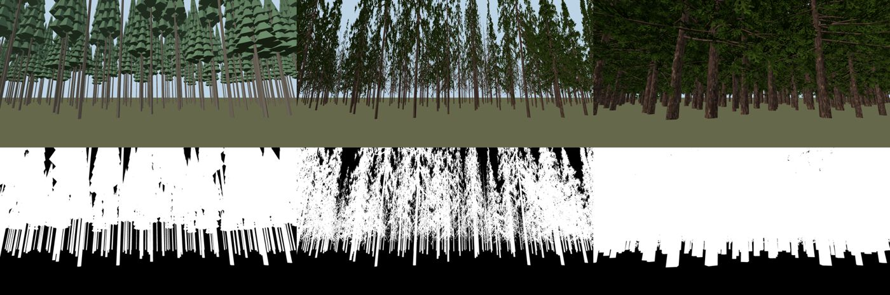

**Found.**
- **The tree drawing is not neutral.** At the same location, density and
  crown closure, swapping the asset moved the share of the view hidden behind
  trees by 10 points one way or 11 the other. For a VIA, where screening
  decides whether a block is visible, a new asset needs calibrating (against a
  matched field photo or LiDAR) before it replaces the current one.
- EZ-Tree's presets are not B.C. trees. *Pine* has a crown width/height of
  0.46–0.65 with foliage from 5 % of the height; PGMaps' pine is 0.14 with the
  live crown from 50 %. Lodgepole, spruce, subalpine fir and aspen presets
  would have to be made.
- The npm library (1.1.0) has no LOD; the Full/LOD1/LOD2 switch is in the
  editor app only. Halving sections, segments and leaves by hand cut branch
  triangles 4× (10,032 → 2,508).
- Its leaf material is not instancing-safe (instanced copies drew bare
  stems); a plain alpha-tested material was needed. PGMaps would use its own
  shader anyway.
- Generation is fast (5–22 ms per tree) and seeded, so variants can be built
  at load rather than shipped.

## 2. maplibre-landmarks TreesLayer at a forestry view

`bench/maplibre/landmarks.js`. A synthetic 2.0 × 1.2 km forest polygon south of
Prince George (240 ha; at 600/ha that is ≈144,000 stems) on Terrarium terrain.

| Settings | Eye level (pitch 84°) | Oblique (60°) | Plan |
|---|---|---|---|
| Defaults (`scatter.forest = 600/ha`) | 4,000 drawn of 10,510 scattered | 4,000 drawn | 4,000 drawn |
| `farCutoff:false, thinBeyondM:∞, maxTrees:200k, density:1` | **RangeError, 0 drawn** | 143,646 drawn (update 389 ms) | 143,633 drawn |

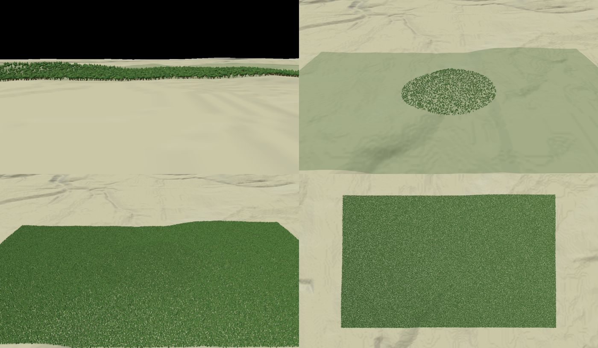

**Found.**
- Defaults draw a disc of 4,000 trees round the view centre and leave the rest
  of the stand as a flat fill (top right). A block outside that disc would read
  as open ground. Its own default forest density is 83 stems/ha.
- With every limit off, the eye-level view throws `Maximum call stack size
  exceeded` in `scatter` (`n.push(...c)` spreading a large per-tile array) and
  draws nothing. That is an upstream bug, easy to fix, but it is the view a VIA
  needs.
- Trees carry only a key and a position (`MappedTree`); size comes from the
  model. Inventory height and crown width per stem cannot be passed without
  forking.
- Requires MapLibre ≥ 6.13 and three ≥ 0.186.

## 3. maplibre-gl-three at eye level on terrain

`bench/maplibre/three.js`. 160 EZ-Tree pines placed with
`map.queryTerrainElevation`, positioned through `getEcefMatrix` /
`lngLatAltToEcef`, camera from `calculateCameraOptionsFromTo` 1.6 m above the
drawn ground.

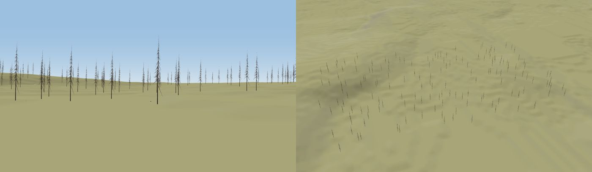

**Found.** Trees sit on the drawn ground and stay locked to it from eye level —
the case `treeLayer.ts` documents deck.gl failing. The library handles the
EGM96 vertical datum itself. Its tuple `LngLat` (`[lng, lat]`) differs from
MapLibre's object form. Peer range is `three ^0.186.1`, which **excludes
0.187**, and MapLibre `^6.12`. Visibility analysis would still be our own; the
library only draws.

## 4. Giro3D with LidarBC rasters

`bench/giro3d/main.js`. DEM and DSM of tile `093g097_1_2_1` in EPSG:3157
(registered with a proj4 string), same camera.

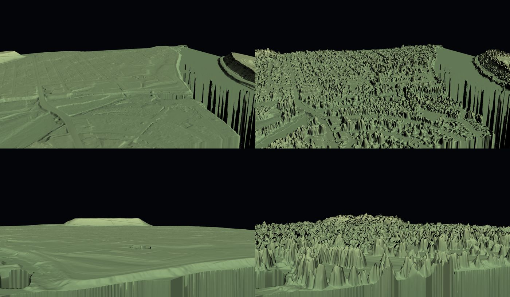

**Found.**
- **LidarBC GeoTIFFs are not cloud-optimised**: LZW, one row per strip, no
  overviews, header at the end of the file. `nrs.objectstore.gov.bc.ca` honours
  range requests but sends **no CORS header**, so no browser app can read it
  directly; it needs our proxy or a copy.
- Giro3D's `GeoTIFFSource` failed on the original files ("ran off the end of
  the buffer before finding EOI_CODE"; also with workers off and an 8 MB block
  size). The same rasters re-encoded uncompressed loaded at once. Converting
  imports to COG (`gdal_translate -of COG`) on the way in would avoid both
  problems for any viewer.
- Peer `three ^0.180` cannot share a bundle with landmarks or
  maplibre-gl-three (0.186). It would have to be its own route or lazy chunk.
- From a low viewpoint the DSM (right) hides the hill the DEM (left) shows:
  the terrain-agreement gap in the planner review, item 4, is not cosmetic.
- Canopy height on this tile (DSM − DEM): 38.8 % of cells over 2 m, P90
  14.3 m, P99 26.5 m, max 42.4 m.

Piero itself returned 502 on the first attempt and loaded on the second.

## 5. OpenForest4D with a Prince George canopy tile

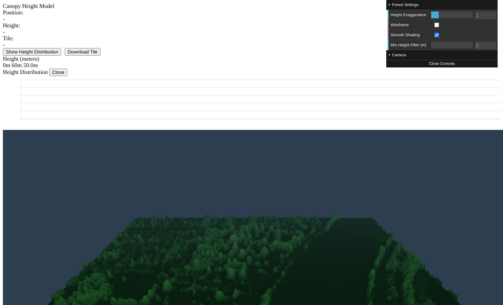

Ran on a 1 km PG CHM tile after two edits: UTM zone 11 is hard-coded in
`js/utils.js` (PG is zone 10), and `js/tile_meta_data.js` lists the tiles.
It draws canopy height on a flat plane — no ground — and needs exact 1 km
tiles. `dev-lidar` already covers canopy heat maps and tree isolation, so this
adds little beyond a reference for the height-distribution chart.

## 6. FORA on a full LidarBC point cloud

`bench/browser/fora2.cjs` drives the hosted app with the 294 MB LAZ.

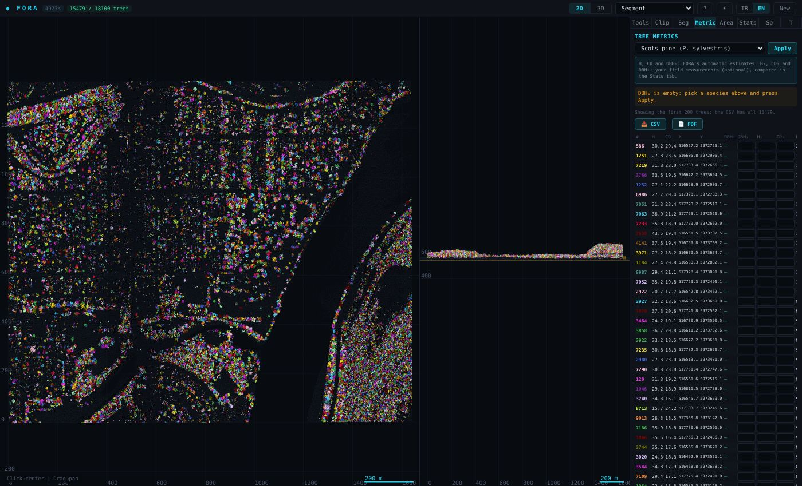

**Found.**
- Loaded in ~37–45 s; read 49.23 M points and **kept 4.92 M (10 %)** for
  display and analysis. Heights normalised at load against its own grid-min-Z
  ground.
- Segmentation (defaults) took ~10 s: 18,100 candidates, 15,479 trees kept.
  Height P10/P50/P90 4.2 / 14.2 / 27.0 m; crown diameter 2.5 / 7.4 / 12.5 m.
- **Max height 62.2 m against a 42.4 m DSM − DEM maximum**: the automatic
  ground is wrong in places. The LidarBC DEM should be supplied as the external
  DTM.
- Species allometry defaults to Scots pine (European list); biomass and DBH
  are not B.C. figures. Height, crown and position are what is useful.
- The CSV has `CenterX`, `CenterY` (EPSG:3157), `H_auto`, `CD_auto` — exactly a
  `TreeInstance` (position, height, crown width). PGMaps' "surveyed" stands are
  VRI polygons, so per-tree LiDAR input to the visual-quality forest would be
  new. The same could come from `dev-lidar`'s tree isolation instead.

## 7. Reference applications

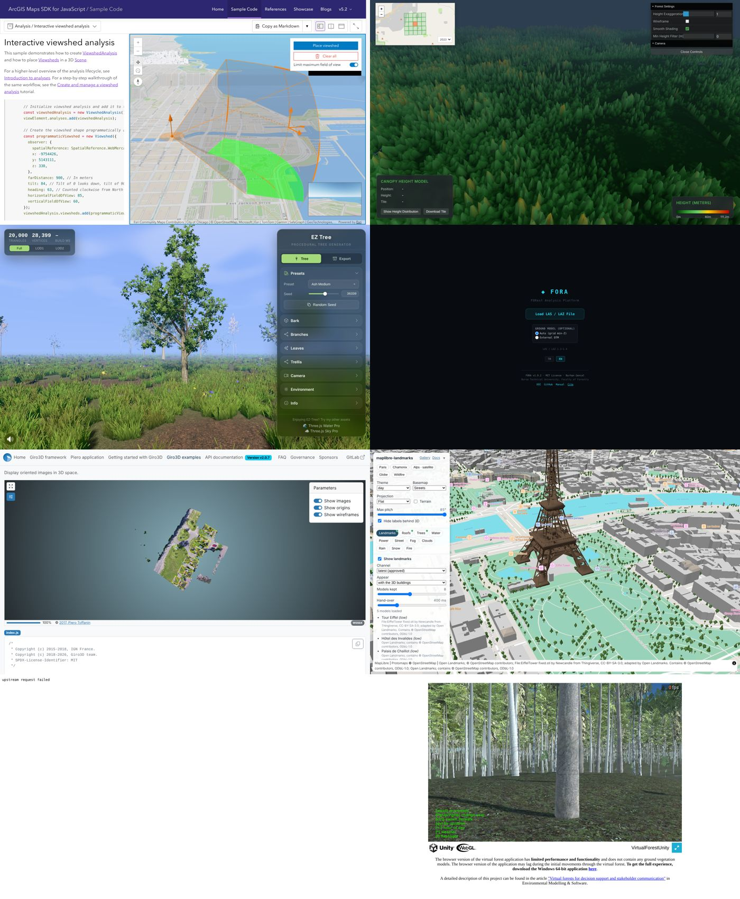

- **WSL Virtual Forest** — loaded 17,208 tree records (15,146 matched to a
  species model) and ~350 MB; under 1 fps on CPU. Good to see what a
  walk-through should feel like; nothing to integrate.
- **ArcGIS viewshed sample** — observer placement, direction, both angles and
  a preview inset all worked (1,275 requests). The clearest UX reference for
  placing a viewpoint.
- **EZ-Tree editor, landmarks demo, Giro3D oriented images, FORA, Piero** all
  loaded.

## 8. What a MapLibre 6 upgrade would touch

Landmarks and maplibre-gl-three both need MapLibre 6.

- 88 files import `maplibre-gl`; 5 use the default import, which v6 removed
  (`AqMapDeckLayers.tsx`, `AqMapLayers.tsx`, `WalkabilityDeckHeatmapLayer.tsx`,
  `DevNetworks.tsx`, `dev-view/RasterMapLayer.tsx`).
- v6 ships a separate worker module; under Vite the worker failed to load until
  `maplibre-gl` was excluded from `optimizeDeps`.
- geo-toolkit already allows `^5.15.0 || ^6.0.0`; `maplibre-gl-lidar` 0.21
  allows `^6`.

## 9. Recommendation, revised by the trial

1. **Feed real trees to the existing renderer.** Import a per-tree list
   (FORA CSV or `dev-lidar` tree isolation, with the LidarBC DEM as ground)
   for the near band along the road, keep VRI-driven stands beyond it. Small,
   and improves the screening evidence directly.
2. **Draw the LiDAR ground the analysis uses** (planner review item 4). Convert
   imported rasters to COG and serve them through the proxy; the Giro3D DEM/DSM
   comparison shows how much the horizon moves.
3. **Calibrate before changing tree shape.** Add a screen-cover check (the
   mask method in `eztree.js`) to the regression suite, then build B.C. EZ-Tree
   presets and accept one only where it matches a matched field photo.
4. **MapLibre 6 trial on a branch, with maplibre-gl-three for near-field
   meshes.** Skip maplibre-landmarks for the VIA tool.
5. **Giro3D as an optional detail view** on its own route, if the inspection
   value is wanted beyond `dev-lidar`.

## 10. Second round: whole-forest renderers (12 November, afternoon)

A second shortlist proposed complete forest engines rather than parts:
threejs-worldgen, Nanite Forest, BakedVoxelLighting, VistaWASM, Sylva,
OpenWorldGen-SDK, Inkwell WebGPU Trees and yomotsu/vegetation. Each demo was
loaded (WebGPU works here on SwiftShader, so the WebGPU paths ran) and each
repository's source was read for how it builds species, lights foliage, draws
distant trees and takes data. Scripts: `bench/browser/demos2.cjs`, `gl2.cjs`,
`gpu.cjs`.

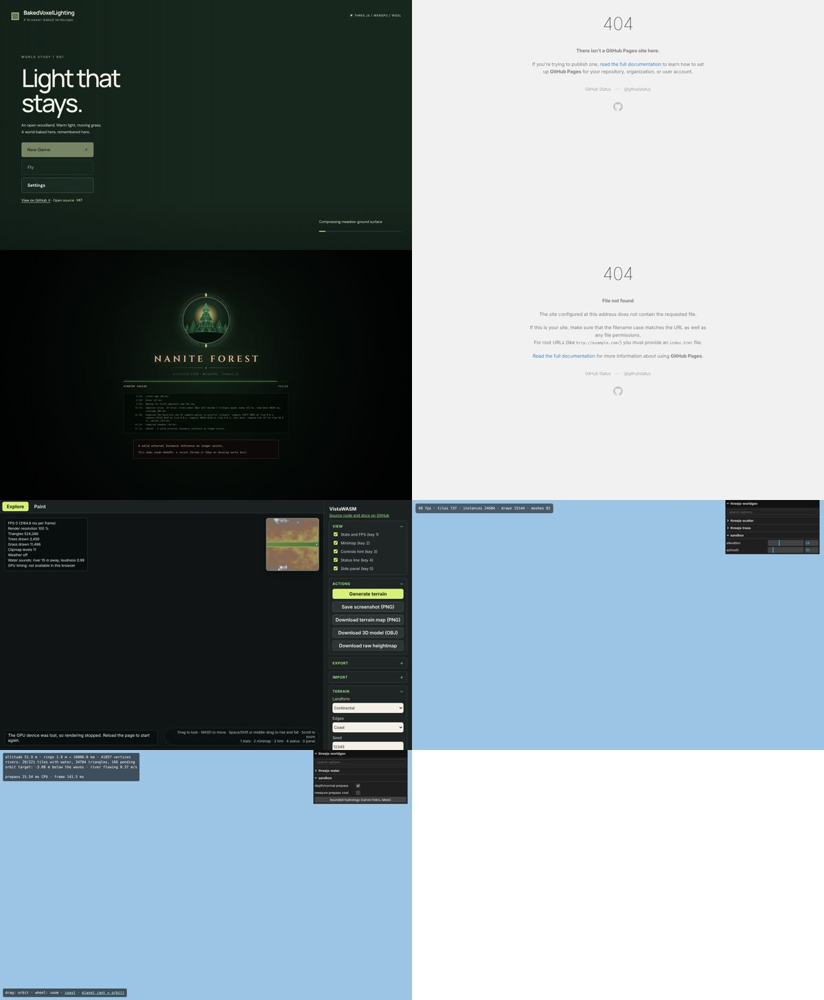
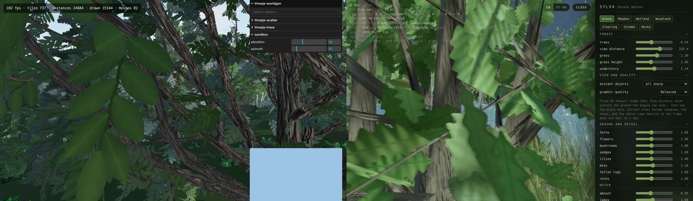

| Project | Licence (LICENSE file) | Ran here | Takes our DEM and tree list? | Verdict |
|---|---|---|---|---|
| threejs-worldgen | Apache-2.0 | Yes; WebGPU canvas reads back blank, `?webgl` draws (24,684 instances, 82 draw calls) | Height function yes; tree list no (Poisson placement) | Borrow species parameters and crown-depth AO |
| Nanite Forest | MIT (Lucy model non-commercial) | **Startup failed** on SwiftShader | No | Borrow coverage-preserving mip alpha |
| BakedVoxelLighting | MIT (generated textures, provenance unstated) | Loaded (88 MB), still baking at capture | No | Borrow whorl-group conifers, relit atlases |
| VistaWASM | **AGPL-3.0** | **GPU device lost**, 3.1 s a frame | **Yes**: `loadDemFromArrayBuffer`, `setTreeInstances` | Best design reference; AGPL and WebGPU-only, so ideas only |
| Sylva | MIT | WebGL2, 0.7 fps on CPU (6.3 M triangles) | No (noise terrain) | Native GLSL: card volume normals, crown self-shadow, HG transmission |
| OpenWorldGen-SDK | MIT | Demo URL 404 | DEM import yes; tree list no | Douglas-fir, aspen, birch parameters; crown AO |
| Inkwell WebGPU Trees | MIT | Demo URL 404 | No | Counter-example: thins distant trees without compensation |
| yomotsu/vegetation | MIT | Demo URL 404 | No | Fir frond geometry; a second coverage-preserving mip implementation |

**Conclusion.** None replaces the road view. Only VistaWASM takes a real DEM
and our own tree list, and it is AGPL and WebGPU-only (and could not hold a
frame on this machine). The engines are procedural worlds; the work that
matters for a VIA — the inventory's stand, the block, the eye — is ours either
way. So their techniques were re-implemented in the existing WebGL2 layer
rather than any engine adopted, as selectable renderers:

- **Lit shading** (Sylva's card normals and crown self-shadow; VistaWASM's wrap
  and back-light; crown-depth occlusion from OpenWorldGen-SDK and worldgen).
- **Detail when stopped**: our own detailed mesh generator (BakedVoxelLighting's
  whorl groups, VistaWASM's drooping spruce), drawn for the near stems only
  while the view holds still. EZ-Tree was not used at run time: its bark
  textures come from texture sites and its leaf textures carry no source, and
  `AGENTS.md` keeps third-party vegetation assets out of the app.
- **Coverage-preserving mipmaps** (Nanite Forest, yomotsu/vegetation).
- A pinned **screen-coverage test**, because two of the first detailed meshes
  changed screening by 20% and only the test showed it.

The contract (`forestry-visual-quality.md`) describes each.

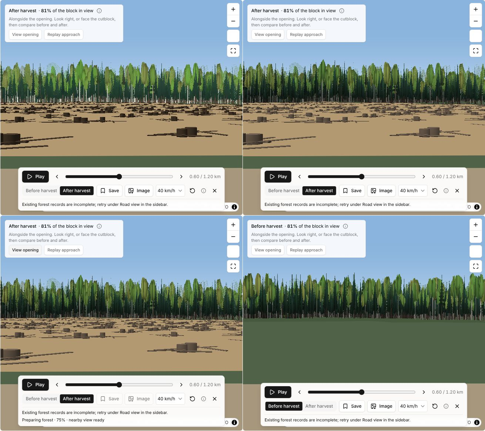

The roadside demo's opening from the same eye: *Flat* (top left), *Lit* (top
right), *Lit* with detail when stopped (bottom left: the nearest 1,779 stems
drawn as meshes) and before harvest (bottom right). After harvest the block
carries slash and stumps against a hard timber edge. The dotted crowns along
the far edge are the existing cross-fade between the 0–300 m and 250–600 m
bands; an A/B with GPU-built mipmaps showed the same, so it is not the new
coverage-preserving mipmaps. It was left as it was.

## 11. MapLibre 6: done

PGMaps and geo-toolkit now run MapLibre 6.18. What it took:

- 30 files' default imports (`import maplibregl from 'maplibre-gl'`, `import
  type MapLibreGL …`) became namespace imports; three test mocks lost their
  `default` wrapper.
- About ten stricter types: `error` events carry `{ message }` rather than `Error`,
  `sourcedata`'s `source` is the full source spec, `createExpression` takes a
  key path, paint-property names and filter expressions are typed.
- **The worker.** MapLibre 6 finds its worker with a run-time
  `new URL('./maplibre-gl-worker.mjs', import.meta.url)` that neither Vite's
  dev pre-bundle nor the build can follow. `vite.config.ts` aliases the bare
  `maplibre-gl` to `src/lib/maplibre-gl-entry.ts`, which sets the worker URL
  from a `?url` import before any map exists, for every importer (toolkit,
  maplibre-gl-lidar, deck.gl) and without pulling MapLibre into the main chunk.
- geo-toolkit's dev dependency moved to `^6.18.0` (its peer range already took
  6); with it at 5, the workspace kept a second MapLibre and every exported Map
  type clashed. Its own check, lint, format and 231 tests pass on 6.18.
- The trial bench's HTML pages are excluded from Vite's dependency scan: the
  first commit of this trial put them where the scan found them, and their
  imports (EZ-Tree, maplibre-gl-three) stopped the dev server.

The visual-quality browser suite passes 21 of its 27 tests on MapLibre 6. The
other six also fail, the same way (controls not ready within their timeouts on
SwiftShader), on an untouched MapLibre 5 checkout of `main` run on this
machine; they were not a regression of the upgrade.

## 12. Other renderers fed our own scene

The second round found no engine that takes the inventory's stand. Rather than
adopt one, the road view now writes its scene out as a renderer-neutral file,
and each engine gets a small adapter, so the engines stay outside the app and
all draw the same evidence. Details and run instructions:
`forestry-visual-tools-trial/engines/README.md`.

- **The scene package** (`src/pages/dev-forestry/scenePackage.ts`, Sidebar →
  _3D scene for other renderers_): local metres, the terrain grid, every stem
  the road view draws (same patches and seeds; tested to match within 2 cm, no
  stem twice), openings, slash, road scars, the eye and lens, and each species'
  own detailed model. The roadside demo writes 15,945 stems, 802 slash piles and
  a 401 × 401 ground grid, 3.2 MB with models.
- **threejs-worldgen** (Apache-2.0), forked as a patch: its scatter now accepts
  fixed instances, and an example draws the package. It rendered the roadside
  demo from the road view's eye on WebGL2 (15,945 stems, 15,903 drawn).
  Its far impostors look like grey posts on SwiftShader; this needs a check on
  a real GPU.

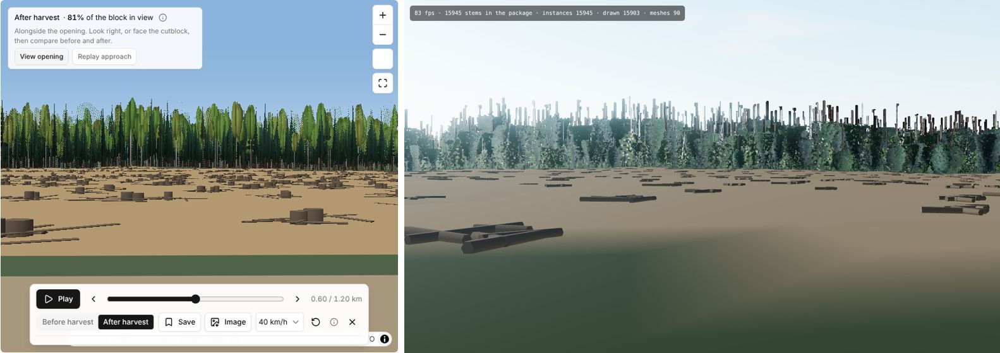

- **Nanite Forest** (MIT), forked as a patch: an example builds one Nanite type
  per species from the package's own models and places the package's stems.
  It typechecks against the library and runs its frame loop here. SwiftShader's
  WebGPU canvas reads back blank, though, and GPU stats never return, the same
  as Nanite's own examples. Not yet seen.
- **VistaWASM** (AGPL-3.0) is a **trial bench only**. A page of ours drives its
  public API with the package: `loadRawHeightmap`, `setTreeModel` with our
  models, `setTreeInstances` and `setCamera`. VistaWASM is installed by
  `npm install` in that folder only. It is never committed, never a dependency
  of the app and never deployed. The engine accepted the data, then lost its
  WebGPU device on this machine.
- **What the package loses in other engines.** VistaWASM and Nanite take one
  uniform scale per instance. A stem there keeps its height, but its crown
  width becomes its species' median. worldgen and PGMaps keep both.
- **EZ-Tree, again.** The forks use our own species models, not EZ-Tree's. EZ-Tree's
  geometry generator is MIT. Its bark textures were collected from texture sites,
  and its leaf textures state no source. Using its geometry with textures of our
  own would be fine; shipping its bundled textures would not (`AGENTS.md`).
- **Forks on GitHub.** This session's GitHub access covers only PGMaps and
  geo-toolkit, so creating the forks was refused. The patches and their base
  commits are in the repository instead. Forking the two upstreams and running
  `git am` makes them real forks.

## 13. On a real GPU, and chosen in the road view (13 November)

The second round ran on SwiftShader. This one ran the same scene package on an
Apple M4 Pro (Metal; headless Chrome 156 with the GPU on and the frame cap off),
and made the engines a choice in the road view itself: View options →
**Renderer** (`externalRenderers.ts`, `ExternalRoadRenderer.tsx`; contract in
`forestry-visual-quality.md`, **Choosing the renderer**).

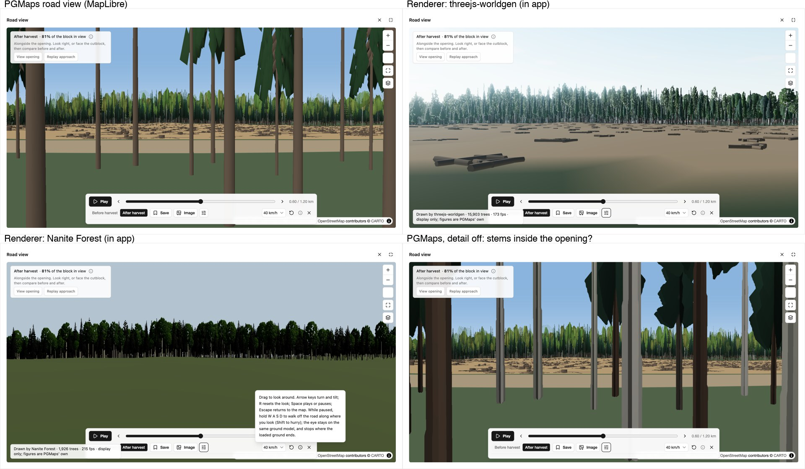

**What was wrong in the adapters, now fixed** (diffs beside each patch in
`forestry-visual-tools-trial/engines/`, `0002-*.diff`, apply with `git apply`):

- **worldgen's "grey posts" were upside-down impostors**, on every backend, not a
  SwiftShader artefact. The bake stacks atlas cells bottom-up and three.js reads
  render-target textures top-down. `packages/scatter/src/impostor.ts` reads the
  row from the top; a far impostor also now takes its stem's own width ÷ height
  (it kept the preset's width). This is an upstream worldgen bug, worth reporting.
- **Nanite drew nothing** because the adapter's 4 × 4 colour layers were nearest
  filtered (three declares no sampler for those, the library samples them) and
  declared one mip level (`clamp(lod, 0, −0.001)` does not compile). Filtered and
  mipmapped as `examples/gltf.ts` does them, the stand draws. The library itself
  was never at fault: its own glTF example and the full forest ran here.
- Both adapters take the road view's `postMessage` bridge (`?embed`, hello →
  scene → camera, ready, stats, rebuild in page without reloading).

**Frame times, same package, same eye** (roadside demo at *View opening*, 15,909
stems; 1280 × 720 CSS px at 1.5×; 5 s held still with a forced redraw and 5 s
panning ±20°; machine shared with other sessions, so upper bounds):

| Renderer | Ready | Still: fps, median / p95 ms | Panning: fps, median / p95 ms | JS heap |
| --- | --- | --- | --- | --- |
| PGMaps road view (MapLibre, 1857 × 957 px canvas) | 5.9 s (whole page) | 216, 4.2 / 7.4 | 200, 4.8 / 7.2 | 279 MB |
| threejs-worldgen, WebGPU | 1.9 s | 174, 5.7 / 6.0 | 175, 5.7 / 6.0 | 127 MB |
| threejs-worldgen, WebGL2 | 3.0 s | 149, 6.5 / 7.7 | 146, 6.6 / 8.0 | 102 MB |
| Nanite Forest (WebGPU) | 2.5 s | 206, 4.9 / 5.2 | 200, 5.0 / 5.4 | 277 MB |

Chosen in the road view, an engine's frame and PGMaps' map draw together: the
page held 116 fps panning with worldgen over it and 135 with Nanite, each ready
about 2 s after it was chosen. Every renderer has headroom at this scene; none
is the bottleneck. For scale, Nanite's own demo (1 M trees, shadows, TAA,
grass) took 6–13 ms a frame here.

**Found on the PGMaps side, and fixed.** At this eye the package has the
opening's edge 8 m south of the road, so the engines facing south draw slash
from about 10 m, while PGMaps' road view drew a row of tall stems 15–30 m out
in that direction. No stem the road view held was there: the stems were the
ones 10–25 m *north* of the station, drawn in front because the camera stood
29 m behind it. `driveController.ts` placed the camera only when the station or
view changed, and MapLibre keeps zoom and centre through a resize, so after
*Fullscreen* the taller canvas put the camera further back from its target 40 m
ahead (solved from the frame's own matrix: x = y = w = 0 lies 29 m north of the
station). The canvas size is now part of the pose (`driveController.test.ts`).
Anything viewed or saved after resizing the road view before this fix was seen
from behind the station; the analysis, which runs from the station, was not
affected. The PGMaps timings above were taken in that state.

**Still different between the engines** (display, not evidence): Nanite takes
one uniform scale per stem (heights kept, crown widths become the species'
median), draws foliage opaque, and does not draw openings, slash or road scars;
worldgen's species are its own presets (feathery spruce and fir, white aspen
and birch trunks) and its haze is bluish. Screening must be judged on PGMaps.

**What the engines' own demos add, for later.** Nanite's forest gets its look
from ez-tree branches and leaf cards, sun shadows, god rays, TAA and a textured
floor with litter and grass; its bark and leaf textures are ez-tree's, whose
sources are unstated, so they stay out of anything PGMaps deploys. worldgen's
`threejs-trees` draws leaves procedurally (no image files, Apache-2.0), with 29
species presets; `threejs-water` draws lakes and rivers with reflection, glint,
foam and Beer–Lambert colour, and computes them from a DEM;
`threejs-weathering` and `threejs-sky` give snow, rain, fog, burnt states and a
sun placed by date, time and latitude. For a VIA the honest uses are real lakes
and streams (BC FWA, not computed) for water viewpoints, snow on openings for
a winter view, and the field visit's sun.

## 14. Richer engines, water and weather (13 November, later)

Asked to bring Nanite's demo look across and to try `threejs-trees`,
`threejs-water` and `threejs-weathering` (non-B.C. tree shapes accepted for
now, and the ez-tree images used regardless of their unstated licence, for a
local trial only). The engine work is in each folder's `0003-*.diff`
(`engines/README.md`); PGMaps gained what the engines need to be fed.

**PGMaps side.**

- The package carries `water`: the basemap's lakes and rivers cut to the
  terrain grid (`polygon-clipping`), each at the lowest ground round its shore.
  Uncut, the roadside demo's river system came through 45 km across.
- With an engine chosen, View options adds *When* (date and local time),
  *Ground* (bare or snow) and *Weather* (clear, overcast, rain, snowing), sent as
  `pgmaps-environment` with that day's UTC offset. A change never rebuilds the
  stand. In the app, 20 January 15:30 put the sun 5.6–5.8° up in the south-west
  in both engines.
- The road view's own camera fix (§13, *Found on the PGMaps side*).

**Engines** (screenshots: `evidence/road-view-engines-weather.jpg`):

- *worldgen*: each species grown from `threejs-trees` in two or three height
  classes at the package's own sizes (full mesh to 55 m, simplified to 120 m,
  coarse to 190 m, impostors beyond); `threejs-sky` sky and clouds, with haze
  taking the sky's horizon colour (the blue fog is gone); `threejs-water` lakes
  with reflections; cut ground with duff, about 500 stumps a hectare and slash
  heaps; snow, rain and wet materials from `threejs-weathering`.
- *Nanite*: ez-tree conifers and broadleaves with leaf cards, the demo's
  dithered leaf edges and TAA, three crown-width classes per species (crown
  width within 7.0% on average, 11.8% at the 90th percentile; heights exact),
  4096 shadow map, god rays, the demo's floor with litter, cut ground, slash,
  WaterMesh reflections, and the same weather. Its wind sway is off: its
  motion output broke every tree material inside the water's reflection.

**Frame times, same package and eye as §13** (uncapped; shared machine, so
upper bounds; PGMaps now with its camera at the station):

| Renderer | Ready | Still: fps, median / p95 ms | Panning: fps, median / p95 ms |
| --- | --- | --- | --- |
| PGMaps road view | 6.1 s (whole page) | 208, 4.3 / 7.8 | 195, 5.0 / 8.0 |
| threejs-worldgen, WebGPU | 2.3 s | 268, 3.6 / 4.3 | 268, 3.7 / 4.3 |
| threejs-worldgen, WebGL2 | 3.7 s | 177, 5.8 / 6.7 | 171, 5.6 / 10.3 |
| Nanite Forest (WebGPU) | 4.1 s | 168, 5.9 / 7.1 | 169, 5.8 / 7.2 |

In the app, with vsync, worldgen was ready 2.5 s and Nanite 2.2 s after being
chosen, both holding 60 fps. Worst cases: worldgen looking straight into the
stand ran 70–80 fps (leaf-card overdraw; nothing hides trees behind trees), and
Nanite's lake view took 11–18 ms a frame.

**A benchmark trap.** With the frame cap off (`--disable-frame-rate-limit`),
neither engine finished building inside the app: the engine page is on the same
site as PGMaps (another port on 127.0.0.1), so it shares PGMaps' main thread,
and the road view's animation loops running thousands of times a second starved
it. The same build took 1.8 s as a top-level page. Test the embedded engines
with vsync on; time them as pages of their own.

**Left to do.** worldgen's open snow reads as a flat sheet and its winter
aspens keep their leaves; Nanite's aspens read lime, its litter orange and its
crowns stay bright at dusk; neither draws B.C. tree shapes yet, so screening is
still judged on PGMaps.
