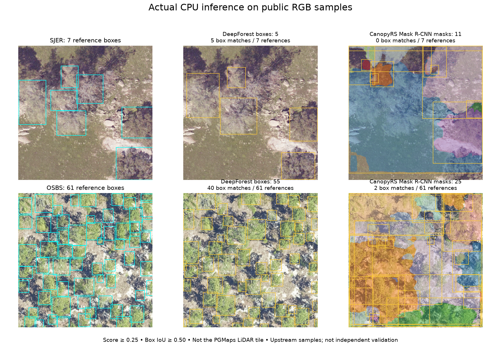

# Tree-model execution checks — 20 October 2026

**Update, 21 October 2026 UTC: SegmentAnyTree and original ForAINet have now completed bounded CPU inference on three BC crops.** See the [new run record, point outputs and side-profile figures](lidar-pointgroup-cpu-results.md). ForestFormer3D remains preprocessing-only; ForPT has no released tree-instance checkpoint. The sections below preserve the earlier preflight and RGB execution record.

## What ran

| Candidate | Actual execution | Result and remaining limit |
| --- | --- | --- |
| [SegmentAnyTree](https://github.com/SmartForest-no/SegmentAnyTree) | Downloaded and verified official 666 MB checkpoint; ran upstream coordinate preprocessing on all three LiDAR plots | All points preserved, reversible coordinates. **Network inference not run:** no local GPU, and HF Jobs unavailable through the connector. No new tree instances or quality score. |
| [ForestFormer3D](https://github.com/SmartForest-no/ForestFormer3D) | Downloaded official checkpoint archive, verified its CRC; ran the linked FF3D own-data loader in `test_mode=True` on all three plots | All points preserved; loader correctly returns no ground-truth labels. **Network inference not run:** GPU/runtime unavailable. |
| [ForPT](https://huggingface.co/prs-eth/ForPT) | Checked the upstream release and model zoo at the recorded commit | Instance segmentation still says **Coming soon**. Semantic, species and age models cannot substitute for individual-tree IDs. No network inference attempted. |
| [CanopyRS Mask2Former Swin-L](https://huggingface.co/CanopyRS/mask2former-swin-l-384-multi-selvamask) | Input/runtime assessment only | Not executed. Requires RGB imagery and the Detectron2/Detrex model runtime. No matching orthomosaic for our LiDAR tile is available in this workspace. No claim about this variant's quality. |
| [CanopyRS Mask R-CNN R50](https://huggingface.co/CanopyRS/maskrcnn-resnet50-multi-selvamask) | **Real CPU inference**, published weights, two public RGB fixtures | Produces crown masks, but this tropical SelvaMask checkpoint transferred poorly to these non-tropical samples. This is an additional runnable CanopyRS variant, not a test of Mask2Former. |
| [DeepForest RetinaNet](https://huggingface.co/weecology/deepforest-tree) | **Real CPU inference**, published weights, same two RGB fixtures | Produces crown boxes with useful matches on these samples. It does not assign LiDAR points to trees. |

SAM3 and TreeLearn were mentioned as additional research leads; neither was executed. No paid cloud job was submitted and the user point cloud was not uploaded to Hugging Face.

## Inspect the actual RGB outputs



These are **public sample images from DeepForest, not imagery of the user's LiDAR tile**. Both are 400 × 400 pixels. The samples and annotations come from DeepForest commit `081f1e07cf5e4fadc4f98480b1f1457d2bb782bd`, under `src/deepforest/data/`. Sample and annotation hashes are in each result JSON. Upstream samples may overlap model development data: these are runtime and transfer diagnostics, **not independent accuracy validation or a model leaderboard**.

At score ≥ 0.25, using confidence-ordered one-to-one matches with box IoU ≥ 0.50:

| Public fixture | Reference boxes | DeepForest: predictions / matched / missed | CanopyRS Mask R-CNN: predictions / matched / missed |
| --- | ---: | ---: | ---: |
| SJER image 477 | 7 | 5 / 5 / 2 | 11 / 0 / 7 |
| OSBS 029 | 61 | 55 / 40 / 21 | 25 / 2 / 59 |

DeepForest inference took 1.95 s and 1.93 s respectively on CPU with two Torch threads. CanopyRS Mask R-CNN took 4.32 s and 5.23 s. These exclude weight download, setup and model loading. They describe small crops, not whole-tile throughput.

The full threshold sweep (0.05, 0.25, 0.50), pixel boxes, confidence scores, checkpoint hashes and timings are saved in [DeepForest SJER](hf-tree-model-tests/deepforest-sjer.json), [DeepForest OSBS](hf-tree-model-tests/deepforest-osbs.json), [CanopyRS SJER](hf-tree-model-tests/canopy-maskrcnn-sjer.json) and [CanopyRS OSBS](hf-tree-model-tests/canopy-maskrcnn-osbs.json). The corresponding compressed mask arrays are beside the CanopyRS JSON files. The figure uses the same fixed 0.25 threshold for both models.

Mask R-CNN was compared using its **boxes** against box annotations; no mask IoU, mask AP or per-tree LiDAR accuracy was measured. Its masks often cover large background regions in these examples. Differences in biome, image resolution, season and training distribution need investigation before operational use. These results do not establish that every CanopyRS checkpoint performs poorly.

## Checks on the actual LiDAR

The original LAZ has XYZ and return/classification metadata, **no RGB** and no reviewed individual-tree labels. A colourised canopy-height raster is not a replacement for aerial RGB imagery. We did not feed one to either image model.

The existing comparison cache supplies three 25 × 25 m cores with a 10 m buffer on every side. Each exported input covers 45 × 45 m:

| Plot | Accepted returns | Nominal returns/m² |
| --- | ---: | ---: |
| crown-3146-north | 65,019 | 32.1 |
| crown-85 | 83,843 | 41.4 |
| crown-1 | 65,258 | 32.2 |

All **214,120** accepted points were exported. No display sampling was used. The exporter verifies each cache array against its existing provenance hash before writing binary XYZ PLY in EPSG:3157 with source CGVD2013 elevations (EPSG:6647). DTM-normalised height, original classification and EPT node/point identities remain in sidecar arrays. The input contains no fabricated colours, species or tree IDs.

Actual upstream preprocessing was checked by restoring the coordinates and comparing every row. Maximum error was 0.00000191 m for SegmentAnyTree and 0.00000184 m for FF3D. This verifies coordinate conversion and point retention; it does **not** verify model features, segmentation or an output-to-input join after neural inference. See [plot provenance](hf-tree-model-tests/plot-inputs.json) and [preprocessing/runtime evidence](hf-tree-model-tests/3d-preflight.json).

The CUDA allocation probe failed with `Torch not compiled with CUDA enabled`; `nvidia-smi` is absent. Hugging Face authentication succeeded, but the Jobs tool returned `UNAVAILABLE: MCP tool hf_jobs was not returned by tools/list`. Thus no GPU job could be launched through the available connector. Neither neural network was silently replaced by a CHM algorithm.

## Reproduce the tests

Code is in `scripts/lidar/evaluate_rgb_tree_models.py`, `scripts/lidar/prepare_hf_tree_plots.py` and `scripts/lidar/check_hf_tree_preprocessing.py`. The RGB runner builds the published network architectures directly and requires strict checkpoint loading with no missing or unexpected parameters. It does not exercise either project's complete tiling, aggregation, GIS export or browser interface. The upstream loader check is independently repeatable; its output is saved in [upstream-preprocessing.json](hf-tree-model-tests/upstream-preprocessing.json).

The tested environment was Python 3.12.14, Torch 2.8.0+cpu, torchvision 0.23.0+cpu, NumPy 2.5.4 and Pillow 13.0.0. Detectron2 was built from commit `b0fe2f0a5bb6496f65246ef35687a386a9f19202`, with `CC=gcc CXX=g++ MAX_JOBS=2`. The initial build failed because its selected `clang++` executable was absent; the explicit GCC build succeeded. Additional dependencies: safetensors, fvcore, iopath, omegaconf, hydra-core, PyYAML, pycocotools, cloudpickle, packaging, tensorboard and OpenCV. Plot preparation requires NumPy; upstream preprocessing also requires pandas, plyfile and joblib.

Exact checkpoint download URLs, sizes and SHA-256 hashes are saved in [downloads.json](hf-tree-model-tests/downloads.json). The Hugging Face revisions are:

- DeepForest: `cc21436bc5d572dde8ff5f93c1e71a32f563cace`, `model.safetensors`.
- CanopyRS Mask R-CNN: `b5aa5c02254b713f47ed7292497b809547425c76`, `model_best_maskrcnn_r50_selvamask.pth`.

Given local model weights and the pinned public DeepForest checkout:

```bash
python scripts/lidar/evaluate_rgb_tree_models.py \
  --model deepforest --weights /path/to/deepforest.safetensors \
  --sample /path/to/DeepForest/src/deepforest/data/OSBS_029.png \
  --truth /path/to/DeepForest/src/deepforest/data/OSBS_029.csv \
  --output /path/to/results/deepforest-osbs.json

python scripts/lidar/evaluate_rgb_tree_models.py \
  --model canopy-maskrcnn --weights /path/to/canopy-maskrcnn.pth \
  --sample /path/to/DeepForest/src/deepforest/data/OSBS_029.png \
  --truth /path/to/DeepForest/src/deepforest/data/OSBS_029.csv \
  --output /path/to/results/canopy-maskrcnn-osbs.json

python scripts/lidar/prepare_hf_tree_plots.py \
  --cache /workspace/scratch/tree-benchmarks \
  --output /path/to/disposable-gpu-inputs

python scripts/lidar/check_hf_tree_preprocessing.py \
  --models-root /path/to/pinned-upstream-checkouts \
  --plots /path/to/disposable-gpu-inputs \
  --output /path/to/preprocessing-check

python -m unittest discover -s scripts/lidar -p test_hf_tree_metrics.py -v
```

Use the SJER TIFF and its `_truth.csv` instead to reproduce the other fixture. The four box-scoring tests check duplicate predictions, disjoint boxes, empty predictions and confidence filtering. Source benchmark cache regeneration is documented in [the existing segmentation comparison](lidar-segmentation-benchmarks.md).

The downloaded 3D checkpoints are legacy training archives: PyTorch 2.8's default `weights_only=True` loader rejects embedded OmegaConf/NumPy/MMEngine classes. [Checkpoint global inspection](hf-tree-model-tests/checkpoint-globals.json) records those dependencies. Use a compatible isolated upstream runtime; do not interpret this serialization issue as a model-quality result. Full weights and the user point crops stay outside Git.

## What to add to the workbench after GPU evaluation

1. Prioritise **SegmentAnyTree**, then **ForestFormer3D**, for the actual requirement: coloured individual-tree point instances and side profiles. Run their neural inference on these exact plots, retain unassigned/background points, and verify the output joins back to original returns before showing it as a new result. Give the FF3D full pipeline disposable copies: its upstream runner clears its input folder after processing.
2. Review split crowns, merged neighbours and the structure-review plot against manually labelled reference trees. Without that reference, report method disagreement, runtime and visual review—not accuracy.
3. Offer **RGB crown detection as a separate optional input** with an orthomosaic upload and georeferencing checks. DeepForest can propose boxes; a locally validated crown-mask model can propose polygons. Neither should be labelled a 3D stem or a species identification.
4. In the interface, show model/checkpoint, required input, execution location, confidence threshold, provenance and completed/failed/blocked status. Keep unvalidated predictions reviewable and distinguish them from the existing CHM memberships. GPU processing requires a backend or user-run worker; it does not currently run in a GitHub Pages browser tab.
5. Revisit ForPT when its instance implementation and weights are released. Do not expose its current semantic or species predictions as tree isolation.

ForestFormer3D also needs licence clarification before product adoption: the official repository states CC BY-NC 4.0 while its Zenodo record lists GPL-3.0-or-later. The above experiments do not resolve that conflict.
