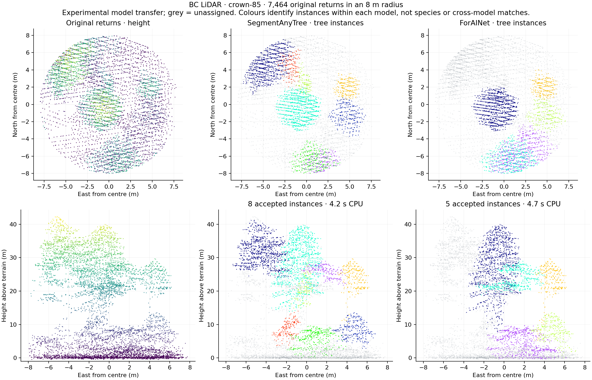
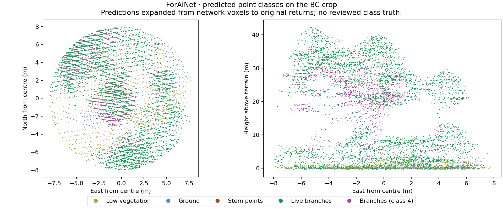

# SegmentAnyTree and original ForAINet: completed CPU inference

Both official networks completed inference on three bounded crops of the user's BC LiDAR on 21 October 2026 UTC. These are actual neural predictions, including grouping and proposal scoring. They are separate from the earlier coordinate-loader checks and from ForestFormer3D's ForAINetV2 loader.

Hugging Face authentication succeeded with a Pro account and Jobs scope. The connector's `hf_jobs` operation still returned `UNAVAILABLE: MCP tool hf_jobs was not returned by tools/list`. Keyword searches of the public Spaces API for SegmentAnyTree, ForAINet and ForestSens returned no matches. No paid job was submitted and no user points were uploaded to Hugging Face. The runs below used this workspace's CPU.

## Results

Each crop is an 8 m radius cylinder at an existing plot centre. Both models received identical sampled representatives, with all original returns retained in the output through a separately recorded nearest-neighbour interpolation. The models used the official checkpoint's `latest` state and test transforms, strict parameter loading, 0.2 m voxel sampling, and default proposal filtering (IoU threshold 0.3, more than 100 representative points, score greater than 0.6).

| Source plot | Original returns in cylinder | Network representatives | SegmentAnyTree accepted instances / CPU seconds | ForAINet accepted instances / CPU seconds |
| --- | ---: | ---: | ---: | ---: |
| crown-85 | 7,464 | 6,806 | 8 / 4.23 | 5 / 4.69 |
| crown-1 | 6,755 | 5,313 | 4 / 3.76 | 0 / 3.38 |
| crown-3146-north | 5,366 | 4,613 | 3 / 3.88 | 2 / 3.96 |

Times cover forward inference, grouping, scoring and final filtering with two CPU threads. They exclude installation, weight download, model loading, input preparation and rendering. Two model processes ran concurrently. These small-crop timings cannot establish full-tile throughput.



[crown-1 comparison](hf-tree-model-tests/cpu-results/crown-1-instances.png) · [crown-3146-north comparison](hf-tree-model-tests/cpu-results/crown-3146-north-instances.png)

## What the outputs tell us

The crown-85 output gives useful tree-colour and side-profile candidates. The models disagree about how to split or retain neighbouring crowns. Grey points include background and rejected proposals. An accepted instance is a model prediction, not a reviewed tree count; colours have meaning only within one model's output.

The crown-1 crop has a tall structure-shaped central object. SegmentAnyTree divided it into four accepted instances, while ForAINet retained none at these thresholds. This is a useful false-positive review case, but the object's identity and the correctness of either model have not been field verified.

ForAINet additionally predicted five point classes: low vegetation, ground, stem points, live branches and branches (upstream class 4). It predicted only **16 stem representatives across all 16,732 representatives**: 3, 6 and 7 in the respective crops. Visual inspection also shows questionable semantic assignments, including ground-labelled points high above the terrain in crown-85. These outputs provide review candidates; they do not support reliable DBH or stem-volume measurements from this run.



These experiments run one cylinder per plot, with truncated boundary crowns. They do not execute the complete upstream overlapping-cylinder voting, tile merging, inventory measurements or a full 84.6-million-return tile run. Input XYZ was translated by the buffered plot's XYZ minimum, matching the existing SegmentAnyTree local-frame preprocessing; this is local elevation, not DTM-normalised height. Terrain-normalised height in the figures comes from the original sidecar and was used only for display. Sampling, coordinate frame, density and biome can affect transfer. No reviewed instance or semantic ground truth was available, so no accuracy score or model ranking is claimed.

## Evidence and reproducibility

The original LAZ hash is `f5246f351e8d5923bf8a5dfddc0753032dbe8cb6e687ae58818cc701cb398ecf`. Individual summaries record the input PLY and checkpoint SHA-256, source revision, point counts and timing. Each NPZ stores original source-row identities, original projected XYZ, interpolated labels, direct representative identities/labels and interpolation distances. The saved labels are not hidden in a screenshot.

For each of `sat` and `forainet`, the files under [cpu-results](hf-tree-model-tests/cpu-results/) are named `<model>-<plot>-summary.json` and `<model>-<plot>-points.npz`. [Runtime checks](hf-tree-model-tests/cpu-results/runtime-checks.json), [dependency versions](hf-tree-model-tests/cpu-results/requirements-freeze.txt) and the four small upstream compatibility patches are in that directory. Large model weights stay outside Git.

The isolated runtime uses Python 3.10.22, PyTorch 1.13.1+cpu, MinkowskiEngine 0.5.4 built CPU-only and torch-points-kernels 0.7.0 built CPU-only. This avoids the incompatible Python 3.12 / Torch 2.8 runtime used in the earlier preflight. The point kernels needed a missing C++ `<memory>` include under GCC 14. One hard-coded `.cuda()` allocation per model was changed to use `cluster.device`. The runner uses spawned workers to avoid an OpenMP fork deadlock, and resets the sampling seed after network construction to make representatives identical across models. No learned parameter or network architecture was replaced. The compatibility patches use zero context; apply each in its matching pinned checkout with `git apply --unidiff-zero /path/to/<name>-cpu.patch`.

The CPU sparse convolution was checked against a hand-calculated three-point result, region growing against known groups, and both proposal filters against overlapping/disjoint candidates. All six runs loaded parameters strictly and explicitly verified that the backbone's output coordinate rows match the input representatives before joining predictions to source points. Both models' representative identities and interpolation distances also match exactly within each crop.

With the pinned upstream checkout, patched CPU dependencies and official weights available:

```bash
PYTHONPATH=/path/to/torch-points-kernels /path/to/cpu-venv/bin/python scripts/lidar/run_pointgroup_cpu.py \
  --repo /path/to/SegmentAnyTree \
  --weights /path/to/segment-any-tree.pt \
  --plots /path/to/prepared-plots --plot-id crown-85 \
  --output /path/to/cpu-results/sat-crown-85
```

For original ForAINet, use `--repo /path/to/ForAINet/PointCloudSegmentation`, its official `PointGroup-PAPER.pt` checkpoint and an output named `forainet-crown-85`. Repeat with the other two plot IDs. Run each repository in a separate Python process because both provide the same `torch_points3d` package. Input preparation is described in the [earlier execution record](hf-tree-model-tests.md).

```bash
/path/to/cpu-venv/bin/python scripts/lidar/render_pointgroup_cpu.py \
  --results /path/to/cpu-results --plots /path/to/prepared-plots \
  --plot-id crown-85 --output /path/to/figures
```

Primary implementations: [SegmentAnyTree](https://github.com/SmartForest-no/SegmentAnyTree), [original ForAINet](https://github.com/prs-eth/ForAINet). Their repository code licences were inspected (MIT/BSD notices for SegmentAnyTree, BSD 3-Clause for ForAINet); model checkpoints and upstream code are not redistributed here. The existing published comparison site has not been redeployed with these new CPU results in this run.
