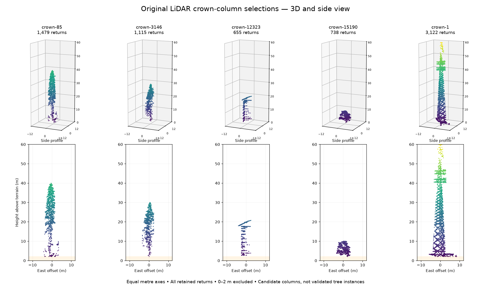

# Original-return tree-shape review

**The 3D points support useful crown inspection, but some current “tree” candidates are structure-shaped.** Five fresh, bounded crops were extracted from the original tile on 20 October 2026. These are the existing CHM crown-column memberships, not new SegmentAnyTree or ForestFormer3D outputs. The public OSBS RGB fixture does not supply a matching point cloud for this review.



| Candidate | Original returns | Observed maximum above DTM | Visual observation, unverified |
| --- | ---: | ---: | --- |
| crown-85 | 1,479 | 39.95 m | Plausible tree-shaped crown, with sparse lower returns. |
| crown-3146 | 1,115 | 30.00 m | Plausible tree-shaped crown. |
| crown-12323 | 655 | 20.73 m | Straight and sloping lines resemble a pole with a crossarm or wires. Review as a possible structure. |
| crown-15190 | 738 | 10.01 m | Low, broad vegetation-shaped selection; individual plant membership is uncertain. |
| crown-1 | 3,122 | 59.99 m | Repeated lattice and horizontal features resemble a utility tower. Review as a possible structure. |

These are deliberately selected examples, not a random sample or a classification accuracy estimate. Tree-like shape does not establish species, stem diameter, branch reconstruction or correct individual-tree segmentation. The two structure observations require imagery or field confirmation before assigning a verified class. Ground and returns below 2 m are excluded, so the figures cannot establish that lower stems are bare.

## Rotatable review artifact

The self-contained viewer is generated at `/workspace/artifacts/tree-3d-review/index.html`. It includes all **7,109** crop returns, with no display subsampling or synthetic branches. It offers candidate selection, mouse rotation, east/north side views, a top view, equal metre axes, shared scale, point size and original EPT node/point identity on hover. It also switches between height above each point's local source terrain and source elevation relative to the crown-centre ground value. The latter retains terrain differences, matching the existing application's 3D coordinate convention. The standalone artifact contains the Plotly library and data; it does not upload points or require a CDN.

The PNG above shares one physical scale across candidates and includes the highest observed return. The standalone viewer defaults to a per-candidate fit so short candidates remain easy to inspect.

## What was checked

- All five fresh crops fit the 750,000 decoded-input-return limit without omitting an intersecting EPT node.
- The source DTM hash matches the frozen analysis provenance. All 7,109 exported point identities, coordinates, classifications and withheld exclusions were independently checked against the original EPT node files. Legacy overlap class 12 is excluded; the checked EPT LAS nodes have no separate overlap dimension, so these checks do not independently establish overlap-flag fidelity to the pre-conversion source LAZ. See [source checks](lidar-tree-shape-review/source-checks.json).
- The application's actual `treePointVertices` function encoded all five crops with finite coordinates and one vertex per return. Inverse Mercator reconstruction had less than 0.003 mm vertical numerical error. That measures coordinate encoding precision, **not LiDAR or terrain accuracy**. See [vertex checks](lidar-tree-shape-review/vertex-checks.json).
- Five existing test files passed: **24 tests** covering crown selection, profiles, inspection, inspector interaction and benchmark data. The generated standalone HTML's bundled library and viewer JavaScript parse successfully.
- The existing UI source exposes **Trees → select a crown → Isolate original returns in 3D → 3D points**, plus rotation and thin slices in the linked Profile pane. No application renderer change was required by these checks.

The live browser-control connection was unavailable. These checks do **not** verify live WebGL pixels, browser point loading or the deployed layout. Offline exact-cell crops can also differ slightly from browser crops at coordinate-precision boundaries. The application and published site have not been changed.

## Reproduce

Generate the five named inputs with `scripts/lidar/inspect_tree_ept.py --crown <id> --output /path/to/crops/<id>.json` from the repository root, with its original local EPT and DTM files present. Then run:

```bash
python scripts/lidar/review_tree_shapes.py \
  --crops /path/to/crops --output /path/to/review
```

Dependencies are NumPy, Matplotlib, pyproj and Plotly. The output is `index.html`, `tree-shapes.png` and `review.json`. The generator's five review notes are visual observations of these examples, not executable structure-detection rules or field-verified labels. [Numerical summaries](lidar-tree-shape-review/review.json) retain source and crop hashes.

For product use, keep these objects as review candidates and use the existing Review/edit controls to record a rejection or uncertain structure observation. GPU tree-instance inference remains the next model experiment; the current shape review does not remove that dependency. A richer forest workflow should distinguish vegetation from structures before treating every height maximum as a tree.
