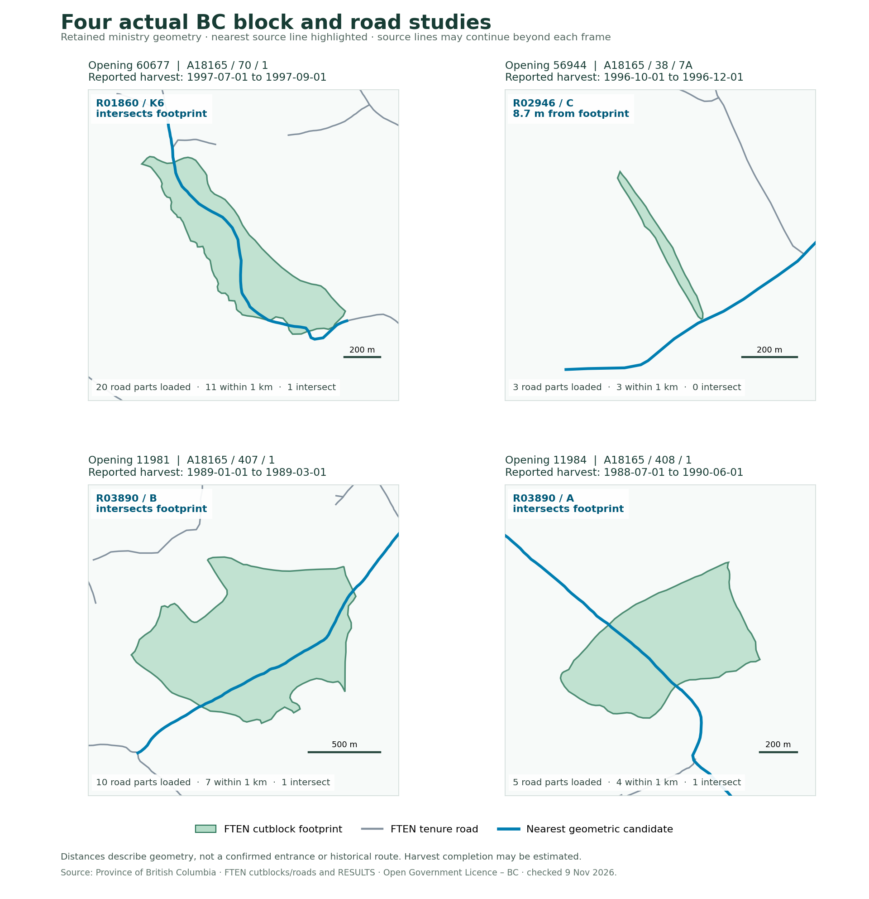
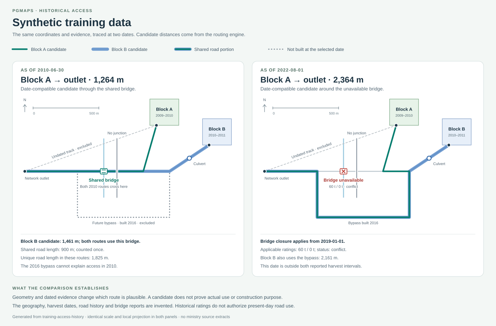
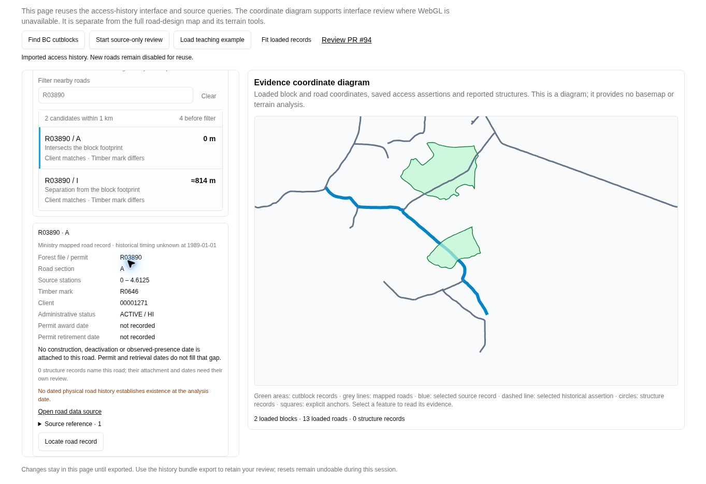
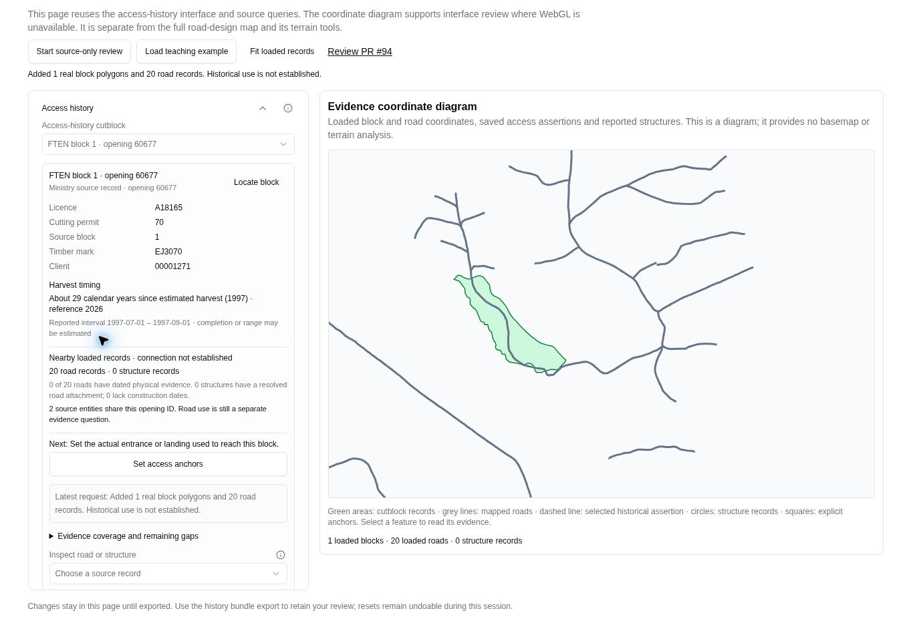

# Historical access examples and real BC studies

The application provides live cutblock search and four real opening investigations
(`60677`, `56944`, `11981`, `11984`). They query actual ministry sources and show the connections those records
support and the evidence still missing. **Training · reconstruct block access and
bridges** demonstrates dated routing, shared infrastructure, conflicting reports
and review using invented evidence.

The committed project, bundle, report and route diagram below contain **invented
training data**. The one provincial extract is the
[block–road reference set](reference-pairs/README.md): 347 real blocks with the
road built for each, and roads generated from rules learned on them.
See the [workflow, observed source findings and expansion guide](../../../docs/forestry-road-design/access-history.md).

## Inspect the actual BC opening

In a local or preview build of this PR, open **Forest road design** and
choose **Projects → Find BC cutblocks**, or filter the scenario library to **BC records**. The app
loads the real source records and regional terrain before opening a clean project.
The **Access investigation** workspace displays the actual source geometry with
record counts and evidence; the old 300 m starter road, engineering profile and cost
are suppressed. **Start design** explicitly opens a proposed-road workspace. Its historical
ledger initially contains only sources: no road construction/presence events,
entrances, outlets, structures or historical routes are invented. Source/terrain
failure or cancellation keeps the previous project.

Within an existing project, **Access history → Source records → Opening ID → Load actual BC records**
stages the lookup for another opening. Inspect the preview, then choose **Add records to this
project** or **Dismiss preview**. Retained project geometry and evidence are not
silently overwritten. The selected-block overview excludes unrelated synthetic
records unless they are explicitly associated; explicit mixing is flagged.

The live recipe queries exact opening ID `60677` in
[RESULTS openings](https://delivery.maps.gov.bc.ca/arcgis/rest/services/whse/bcgw_pub_whse_forest_vegetation/MapServer/26)
and [FTEN cutblock polygons](https://delivery.maps.gov.bc.ca/arcgis/rest/services/whse/bcgw_pub_whse_forest_tenure/MapServer/8),
then [FTEN road segment lines](https://delivery.maps.gov.bc.ca/arcgis/rest/services/whse/bcgw_pub_whse_forest_tenure/MapServer/21)
intersecting the footprint envelope with an approximately 1 km buffer. It separately
measures road separation from the actual footprint. The recipe accepts up to 25
polygon parts, 250 road records/parts and 30,000 combined vertices, and has a
65-second source-assembly limit, with up to 30 seconds per source request. Query URLs, geographic bounds, record counts,
retrieval time and typed identity snapshots are retained in the project.

The same recipe accepts other positive opening IDs. The overview shows licence/permit/block/client identifiers, reported harvest timing,
dated-road evidence counts, crossing-attachment gaps and the next useful action.
Use **Evidence coverage and remaining gaps** to distinguish successful zero-row
queries from skipped or unretained requests. Click a road/block and choose **Access
evidence**, or use **Inspect road or structure** and **Locate**. Saved entrances and
outlets appear as map markers; a block-assigned outlet may extend its investigation
corridor beyond the initial nearby query.

The connected public records do not establish a road built for the block, a route
actually used, physical road construction dates, or the historical bridge/culvert
configuration. Structure inventories are not queried by the open-data recipe.
The next evidence is a reviewed entrance/outlet, dated imagery or engineering
records for the necessary road extents, permitted crossing records, and an
applicable operating/haul record against which to check a candidate trace.

### Four checked real cases



The [case guide](../../../docs/forestry-road-design/bc-access-discovery.md) records their
source keys, query counts, footprint distances and exact source requests. Openings
11981 and 11984 share the same R03890/A and R03890/B records. Open one study and add
the other opening to compare both footprints with the shared road linework.
The figure is derived from actual returned source coordinates and is not an app
screenshot or a historical-route reconstruction. Its generator consumes locally
retained pilot JSON; raw provincial extracts are not checked into PGMaps.

### Observed results on 2026-11-09

The [full observed-findings table and exact request URLs](../../../docs/forestry-road-design/access-history.md#what-the-opening-60677-records-established)
describe the actual bounded sample. The source responses were retrieved at
02:21 UTC for opening/polygon identity and 02:35 UTC for roads; later queries can differ.

| Check | Actual observation |
| --- | --- |
| Opening and block | 1 RESULTS record, 1 FTEN record; opening `60677`, cutblock key `162217` |
| Matching business identity | Licence `A18165`, permit `70`, block `1`, timber mark `EJ3070`, client `00001271` |
| FTEN harvest fields | `1997-07-01` to `1997-09-01`; completion may be estimated |
| Mapped geometry | 1 polygon part; 20 road source records and 20 line parts |
| Nearby candidate set | 11 roads within 1,000 m of the actual footprint; 1 has zero separation |
| Closest candidate | `R01860 / K6`, road `OBJECTID 20924`; geometric contact does not establish a historical entrance or use |
| Code comparison | All 20 roads share the client code; 0 share the block's timber mark |
| Historical access | No physical road events, reviewed entrances/outlets, bridge inventory or documented-use route supplied |

The exact west/south/east/north road envelope was
`[-123.73618604975827, 54.72553584100911, -123.68720192591495, 54.75248933903812]`.
These source connections identify what to investigate next. They do not yet identify
the road built for the block or explain the original routing decision.

To reproduce the bounded live source review from the command line:

```sh
node --import tsx scripts/forestry/inspect-bc-access-pilot.ts 60677
```

This prints query provenance, identities, candidate counts and gaps. It writes no
provincial snapshot into the repository. Use `--help` for the optional explicit
Python transport on a managed network with configured proxies.

## Open the synthetic reconstruction



[Open the vector comparison](access-history-comparison.svg). It is generated from
the same coordinates and trace results as the project, not from a browser screenshot.

- [Openable road project](synthetic-access-history.road.json): use **Open** in Forest road design.
- [Portable history bundle](synthetic-access-history.bundle.json): use **Terrain → Access history → Import** in another project.
- [Generated evidence report](synthetic-access-history-report.md): inspect the two original 2010 route assertions and their sources.
- [Expected outcomes](expected-outcomes.json): compare block A in 2010 and 2022, including excluded roads and conflicting bridge evidence.

The same example is available through **Projects → Browse example scenarios →
Training · reconstruct block access and bridges**. It works without ministry requests.

Block A's inferred 2010 path is approximately **1.264 km** through the shared
bridge. At 2022-08-01, the bridge has a closure and conflicting 60 t / 0 t reports;
the available candidate uses the later bypass and is approximately **2.364 km**.
That later route does not explain the block's 2009–2010 harvest. The two 2010
paths total approximately **2.725 km** when counted separately, but use about
**1.825 km** of unique source road geometry, including about **0.900 km** of overlap.
Construction costs remain unknown.

Known closures and removals remain blocking even when an undated report is present
or unknown timing is allowed. Compatible dated observations can narrow construction
windows. Imported assertions must preserve source-node connectivity, encountered
crossing IDs and their supporting sources; editing coincident segments cannot create
an undeclared junction. The full guide describes those chronology and import checks.

## Review the interface without a terrain map

[interface-review.html](interface-review.html) mounts the application's actual
access-history panel beside an SVG coordinate diagram. With a local Vite development
server, open `/examples/forestry/access-history/interface-review.html` to inspect
the synthetic workflow or load actual records explicitly. The diagram displays
retained coordinates, route assertions, structures and anchors; it supplies no
basemap or terrain analysis. This review page is separate from the production
MapLibre plan. It is not a substitute for production-map acceptance testing.

[interface-review-phone.html](interface-review-phone.html) hosts the same page in
a 320 CSS px iframe for a reproducible narrow-layout review. The browser-exported
real study was imported and applied there; its document and viewport widths both
measured 320 px. This checks component layout, not mobile-device or WebGL behavior.

The [validation record](../../../docs/forestry-road-design/access-history-validation.md)
includes the live-source and export/import observations, full source typechecks,
application build, regression results and remaining full-map acceptance gate.

### Captured interface

The current discovery and shared-road review uses the same production controls.
Search opening 11981, add opening 11984, then filter the candidate list by R03890.
The blue line below is the selected source geometry; it is not an inferred
historical haul route. The portable study contains two blocks and thirteen unique
road records. Exact source requests and the four checked examples are documented
in the [discovery guide](../../../docs/forestry-road-design/bc-access-discovery.md).



[Live cutblock discovery](review/bc-cutblock-discovery.jpg) ·
[320 px live search](review/bc-cutblock-search-320px.jpg)

#### Earlier opening-60677 review

The screenshot below shows actual opening 60677 and the returned road geometry.
The left panel is the production evidence interface; the right pane is the
review entry's labelled coordinate diagram. No historical route or bridge was
inferred for this actual block. Source records are from the Province of British
Columbia's RESULTS and FTEN services, retrieved 2026-11-09 and licensed under the
Open Government Licence – British Columbia; the exact source links are above.



[320 px imported study](review/320px-imported-study.jpg) ·
[Synthetic connected-network interface](review/teaching-example.jpg)

## Regenerate the synthetic files

Regenerate the project, bundle, report, expected outcomes and vector diagram with:

```sh
npm ci
npm run ci:prepare
npm run example:access-history
```

No network query is made by the generator. It uses the application's source
implementation, parser and serializers so the example stays reviewable and importable.
The PNG preview is a raster copy of the SVG. To refresh it with Inkscape installed:

```sh
inkscape examples/forestry/access-history/access-history-comparison.svg \
  --export-type=png \
  --export-filename=examples/forestry/access-history/access-history-comparison.png
```
